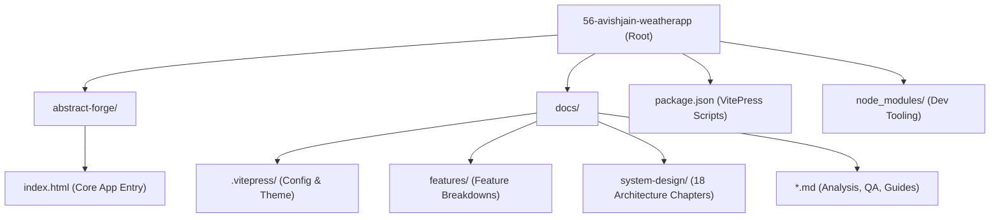

# 00. Project Map & File Tree (Step 1 Project Scan)



---

## 1. Complete Folder Hierarchy & File Purpose

```
56-avishjain-weatherapp/
├── abstract-forge/
│   └── index.html                # Single-page core application: HTML5 markup, CSS3 styling, and Vanilla JS logic (387 lines)
├── docs/
│   ├── .vitepress/
│   │   ├── config.mjs            # VitePress configuration: routing, sidebar, search, and Mermaid integration
│   │   └── theme/
│   │       ├── index.js          # Theme entry extending VitePress default theme
│   │       └── custom.css        # Pure black dark mode tokens (#000000), contrast overrides, and table styling
│   ├── features/
│   │   ├── f1-hero-current-weather.md   # Feature F1: 3D tilt hero card and localized clock
│   │   ├── f2-interactive-uv-index.md   # Feature F2: Interactive UV index counter & tier classification
│   │   ├── f3-dynamic-5day-forecast.md  # Feature F3: Dynamic 5-day forecast with focus-blur shader
│   │   ├── f4-radar-zoom-magnifier.md   # Feature F4: Dual-layer live radar zoom lens
│   │   ├── f5-3d-cylindrical-carousel.md# Feature F5: 3D perspective revolving world cities carousel
│   │   └── f6-css-animated-navbar.md    # Feature F6: Zero-JS CSS sliding pill navigation bar
│   ├── system-design/
│   │   ├── README.md                    # System design syllabus and architecture index
│   │   ├── 01-requirements-and-estimation.md
│   │   ├── 02-architecture-styles.md
│   │   ├── 03-networking-and-communication.md
│   │   ├── 04-load-balancing-and-scaling.md
│   │   ├── 05-databases-and-storage.md
│   │   ├── 06-caching.md
│   │   ├── 07-messaging-and-async.md
│   │   ├── 08-consistency-and-distributed-systems.md
│   │   ├── 09-reliability-and-resilience.md
│   │   ├── 10-api-design-and-rate-limiting.md
│   │   ├── 11-security-architecture.md
│   │   ├── 12-search-and-ai-architecture.md
│   │   ├── 13-real-time-systems.md
│   │   ├── 14-observability-and-operations.md
│   │   ├── 15-performance-engineering.md
│   │   ├── 16-cost-and-tradeoffs.md
│   │   ├── 17-classic-questions.md
│   │   └── decisions.md                 # Design decision records and trade-offs log
│   ├── index.md                  # VitePress homepage layout with hero badges and feature cards
│   ├── 00-project-type.md        # Step 0: Project type classification and evidence
│   ├── 00a-project-analysis.md   # Deep architectural analysis, traces, and inventory
│   ├── 00b-project-pitch.md      # 30-second and 2-minute spoken interview pitch scripts
│   ├── 00-project-map.md         # Folder map, dependency audit, and entry points (this file)
│   ├── 01-features.md            # Master feature catalog and Say It Out Loud index
│   ├── 02-build-order.md         # Rebuilding guide from scratch step by step
│   ├── 03-api-reference.md       # Client-side contracts and backend expansion endpoints
│   ├── 04-tech-comparisons.md    # Comprehensive tech comparison matrices
│   ├── 05-architecture.md        # Browser rendering engine, event loop, and state flow
│   ├── 06-security.md            # OWASP Top 10 client-side security assessment
│   ├── 07-ai-integration.md      # AI integration analysis and LLM weather advisory roadmap
│   ├── 08-quality-and-ops.md     # Testing, Lighthouse performance, CI/CD, and DevOps
│   ├── 09-interview-qa.md        # 150+ categorized technical interview questions and answers
│   ├── 10-gaps-and-improvements.md# Technical debt and future enhancement roadmap
│   ├── 11-glossary.md            # Technical glossary of all concepts used
│   ├── 12-confirm-list.md        # Explicit checklist of [CONFIRM WITH DEVELOPER] items
│   ├── 13-master-checklist.md    # 275-point exhaustive master technical checklist
│   ├── 14-say-it-out-loud.md     # Verbal rehearsal scripts and practice checkboxes
│   └── README.md                 # Documentation root index and reading order
├── package.json                  # Node.js project manifest and VitePress documentation scripts
└── package-lock.json             # Pinned dependency lockfile
```

---

## 2. Tech Stack Detected & Exact Versions

| Component / Layer | Technology | Exact Version | Delivery Channel |
| :--- | :--- | :--- | :--- |
| **Markup Language** | HTML5 Standard | Living Standard | Native Browser Parser |
| **Logic Engine** | Vanilla ECMAScript (ES6+) | ES2022+ Native | Native Browser V8 / JavaScriptCore |
| **Styling Framework** | Tailwind CSS CDN | v3.x (Play CDN) | `<script src="https://cdn.tailwindcss.com">` |
| **Physics / Gyroscope** | VanillaTilt.js | v1.8.1 | `<script src="https://cdnjs.cloudflare.com/.../vanilla-tilt.min.js">` |
| **Typography** | Inter Font Family | Variable Web Font | Tailwind Font Stack / Google Fonts |
| **Documentation Engine**| VitePress | ^1.6.3 | NPM devDependency |
| **Diagramming Engine** | Mermaid.js / Plugin | ^11.4.1 / ^1.0.10 | NPM devDependency |
| **Runtime Environment** | Node.js | v22.23.2 | Host Environment |
| **Package Manager** | NPM | v10.9.8 | Host Environment |

---

## 3. Dependency Inventory & Justifications

### Client-Side CDN Dependencies

```html
<!-- abstract-forge/index.html:7 -->
<script src="https://cdn.tailwindcss.com"></script>
```
- **Reason:** Provides instant utility classes (flexbox, grid, spacing, colors) for rapid UI scaffolding without requiring a local Node.js build step or postcss pipeline.

```html
<!-- abstract-forge/index.html:8 -->
<script src="https://cdnjs.cloudflare.com/ajax/libs/vanilla-tilt/1.8.1/vanilla-tilt.min.js"></script>
```
- **Reason:** Lightweight (sub-4KB) smooth 3D tilt library that binds to requestAnimationFrame for 60fps hardware-accelerated parallax card tilting with customizable specular glare.

### Documentation Tooling Dependencies (devDependencies in `package.json`)

| Package Name | Pinned / Resolved Version | Purpose & Rationale |
| :--- | :--- | :--- |
| `vitepress` | `^1.6.3` | Ultra-fast Vue-powered static site generator for documentation |
| `mermaid` | `^11.4.1` | JavaScript diagramming and charting tool using markdown-inspired text |
| `vitepress-plugin-mermaid`| `^1.0.10` | VitePress integration for rendering interactive Mermaid diagrams directly |

---

## 4. Environment Variables & Secrets Audit

| Variable Name | Required Service | Current State | Code Location | Where to Obtain |
| :--- | :--- | :--- | :--- | :--- |
| `None` | N/A | Public client app; zero secrets embedded | Public code | Open access |
| `VITE_OPENWEATHER_API_KEY` | OpenWeatherMap | [Roadmap - Recommended for live API] | docs/system-design/ | [openweathermap.org](https://openweathermap.org) |
| `VITE_GEMINI_API_KEY` | Google Gemini AI | [Roadmap - Recommended for AI weather analysis] | docs/07-ai-integration.md | [aistudio.google.com](https://aistudio.google.com) |

> [!IMPORTANT]
> Because this is a client-side frontend, no secret keys or database credentials should ever be hardcoded into the browser scripts. Any future paid third-party API keys must be proxied through a serverless backend edge worker or rate-limited API gateway.

---

## 5. Third-Party Services & External APIs

1. **Tailwind CDN Service:** Hosted by Tailwind Labs on Cloudflare Edge. Provides JIT stylesheet compilation on DOM changes.
2. **CDNJS Cloudflare Mirror:** Distributes the pre-minified `vanilla-tilt.min.js` bundle across global edge points.
3. **Placehold.co Image Service:** Provides dynamic SVG/PNG placeholder imagery for text masks and the radar map loupe target.

---

## 6. Project Entry Points

- **Primary Application Entry Point:** [abstract-forge/index.html](file:///Users/avishjain/avishjain9-repos/56-avishjain-weatherapp/abstract-forge/index.html)
- **Documentation Site Entry Point:** [docs/index.md](file:///Users/avishjain/avishjain9-repos/56-avishjain-weatherapp/docs/index.md)
- **Documentation Configuration:** [docs/.vitepress/config.mjs](file:///Users/avishjain/avishjain9-repos/56-avishjain-weatherapp/docs/.vitepress/config.mjs)
- **NPM Scripts:**
  - `npm run docs:dev`: Runs local VitePress documentation server with instant hot module reloading.
  - `npm run docs:build`: Compiles static HTML/CSS/JS documentation bundle to `docs/.vitepress/dist`.
  - `npm run docs:preview`: Previews the production-built documentation locally.
