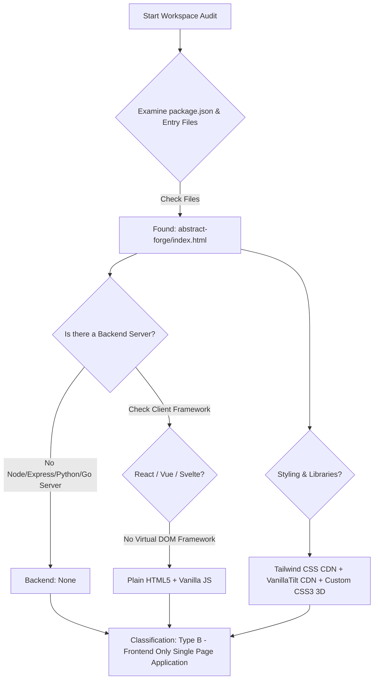

# 00. Project Type Detection (Step 0 Pre-Check)

## 1. Project Type Classification

- **Detected Category:** **Type B: Frontend-only Single Page Application (Vanilla JavaScript / HTML5 / CSS3)**
- **Sub-Classification:** Interactive Data Visualization & Meteorological Dashboard
- **Backend Code:** None in current repo (Static single-file deployment)
- **Database:** None (Client-side mock state & interactive in-memory stores)
- **Authentication:** None (Public single-page dashboard)
- **AI Integration:** None currently implemented (Design roadmap documented for AI weather forecasts)

---

## 2. Empirical Evidence & File Audit

The project classification is proven conclusively by inspecting the workspace filesystem:

1. **Folder & File Inventory:**
   - [abstract-forge/index.html](file:///Users/avishjain/avishjain9-repos/56-avishjain-weatherapp/abstract-forge/index.html): The single, complete source code file (387 lines) containing HTML markup, embedded CSS styling (`<style>` lines 10–175), and embedded Vanilla JavaScript (`` ([abstract-forge/index.html#L7](file:///Users/avishjain/avishjain9-repos/56-avishjain-weatherapp/abstract-forge/index.html#L7)).
   - **VanillaTilt.js CDN:** `` ([abstract-forge/index.html#L8](file:///Users/avishjain/avishjain9-repos/56-avishjain-weatherapp/abstract-forge/index.html#L8)).

3. **External Asset Integrations:**
   - Remote placeholder graphics hosted on `placehold.co` for Radar map backgrounds and text-mask clipping assets ([abstract-forge/index.html#L34](file:///Users/avishjain/avishjain9-repos/56-avishjain-weatherapp/abstract-forge/index.html#L34), [#L90](file:///Users/avishjain/avishjain9-repos/56-avishjain-weatherapp/abstract-forge/index.html#L90), [#L233](file:///Users/avishjain/avishjain9-repos/56-avishjain-weatherapp/abstract-forge/index.html#L233)).

---

## 3. Adaptation Strategy for this Documentation Suite

In accordance with **RULE 8 (ADAPT TO THE PROJECT TYPE)**:

1. **Frontend Deep Dive:**
   - Deeply document vanilla DOM manipulation, event listeners, CSS 3D matrix math (`perspective`, `transform-style: preserve-3d`, `rotateY`, `translateZ`), reactive CSS variables (`--zoom-x`, `--zoom-y`), client state management, and layout performance.
2. **Backend & Database Sections:**
   - Clearly marked as **"Not applicable for this project type (Frontend-only single-page application)"**.
   - In architectural and system design sections, provide the exact blueprint of how a production backend (Node.js/Express or Go), database (PostgreSQL/TimescaleDB or MongoDB), and Redis cache would be architected if full meteorological telemetry ingestion were added.
3. **AI Integration Sections:**
   - Clearly marked as **"No AI integration currently implemented"**.
   - Supplemented with a detailed system design specification for integrating Gemini 1.5 Pro / GPT-4o for weather hazard summaries and natural language meteorological advisory.
4. **All Diagrams, Say It Out Loud Scripts, VitePress Site, Interview Q&A, and Master Checklist:**
   - Maintained at 100% rigor without omitting any required analysis.
