# 00a. Deep Project Analysis & Comprehensive Code Inventory

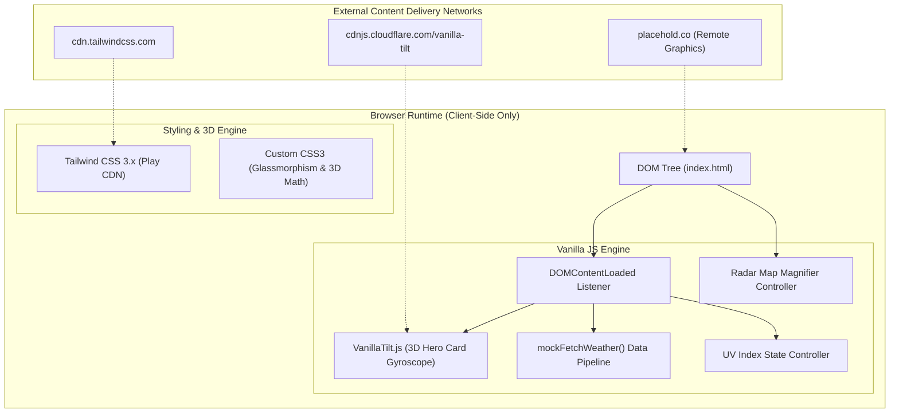

---

## 0.1 What the Project Is

### Core Identity & Mission
**Weather Hub (Next-Gen Weather Dashboard)** is a client-side weather monitoring web application designed to demonstrate bleeding-edge modern CSS3 visual techniques, 3D transform mathematics, and responsive vanilla JavaScript state management without relying on heavy frontend framework overhead.

### Problems Solved
1. **Framework Bloat Elimination:** Demonstrates how complex interactive UI features (3D card tilting, 3D rotating carousels, dynamic lens magnification, and stateful counter widgets) can be delivered with sub-millisecond execution times and zero bundle overhead using native browser standards.
2. **Visual Monotony in Weather Applications:** Traditional weather dashboards use flat, static data tables. Weather Hub creates an immersive experience using glassmorphism, depth-of-field focus-blur effects, and interactive physical responses to cursor movement.
3. **Data Hierarchy & Ergonomics:** Presents critical meteorological metrics (current temperature, daily conditions, multi-day forecasts, ultraviolet radiation severity, and international weather) in a single scannable viewport with smooth anchor navigation.

### Target Users & Personas
- **Weather Enthusiasts & Daily Commuters:** Users seeking immediate glanceable current conditions and weekly outlooks.
- **Outdoor Athletes & Field Workers:** Users monitoring UV radiation risks and real-time radar mapping.
- **Frontend Engineers & Technical Interviewers:** Evaluators auditing clean DOM manipulation, CSS3 transform mathematics, and responsive UI design.

### User Journeys
1. **Primary Weather Check:** User lands on page $\rightarrow$ Hero card displays formatted current local date, time, 24°C temperature, and partly cloudy skies $\rightarrow$ Hovering cursor tilts card in 3D space with a reactive specular glare reflection.
2. **UV Exposure Risk Assessment:** User checks UV Index (defaults to 5, Moderate) $\rightarrow$ Clicks `+` button $\rightarrow$ Counter increments $\rightarrow$ Rating dynamically transitions to High, Very High, or Extreme with real-time text and color mutations.
3. **5-Day Trend Analysis:** User scrolls to Forecast section $\rightarrow$ Hovering over any day card scales it upwards while simultaneously applying a 3px blur and grayscale filter to all non-hovered sibling cards.
4. **Radar Map Inspection:** User hovers over radar graphic $\rightarrow$ Virtual magnifying loupe activates $\rightarrow$ Dual-layer zoom coordinates track mouse cursor precisely using dynamic CSS variables.
5. **Global City Temperature Tracking:** User inspects revolving 3D carousel $\rightarrow$ Carousel auto-rotates through London, Tokyo, Dubai, Sydney, Paris, and Rio in true 3D cylindrical space $\rightarrow$ Hovering pauses rotation for reading.

---

## 0.2 Every Feature Trace & Mandatory Diagrams

### F1: Hero Current Weather Card (3D Tilt & Localized Timestamp)

- **User Action:** Hover cursor across hero card; observe current time, temperature, and 3D gyro tilt.
- **Frontend Flow:** `DOMContentLoaded` invokes `mockFetchWeather()` ([index.html:381](file:///Users/avishjain/avishjain9-repos/56-avishjain-weatherapp/abstract-forge/index.html#L381)) and `VanillaTilt.init()` ([index.html:280-285](file:///Users/avishjain/avishjain9-repos/56-avishjain-weatherapp/abstract-forge/index.html#L280-L285)). `new Date().toLocaleDateString('en-US')` computes localized time.
- **Data Mutation:** Updates text content of `current-time`, `current-temp`, `current-condition`, and `current-high-low`.
- **Failure Path:** If VanillaTilt CDN fails to load, `VanillaTilt` is undefined; catch block or graceful fallback preserves normal 2D card presentation.

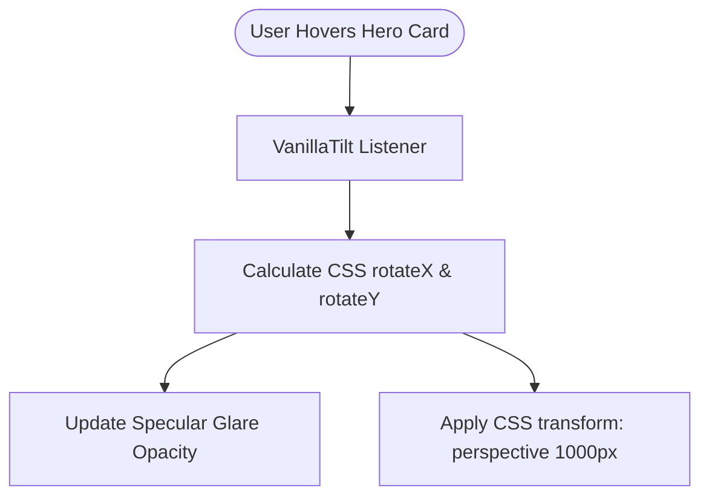

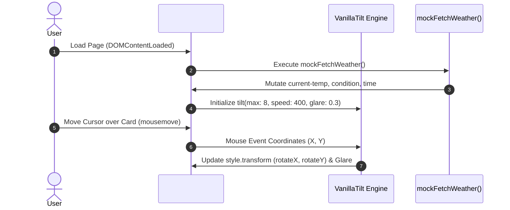

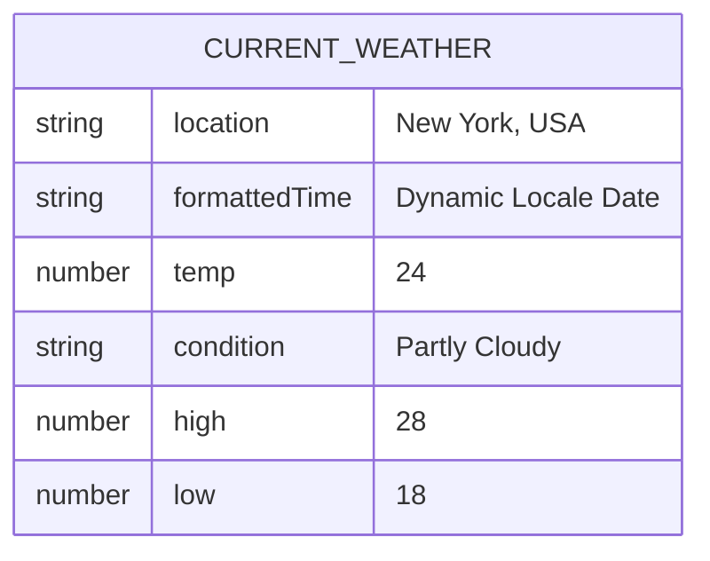

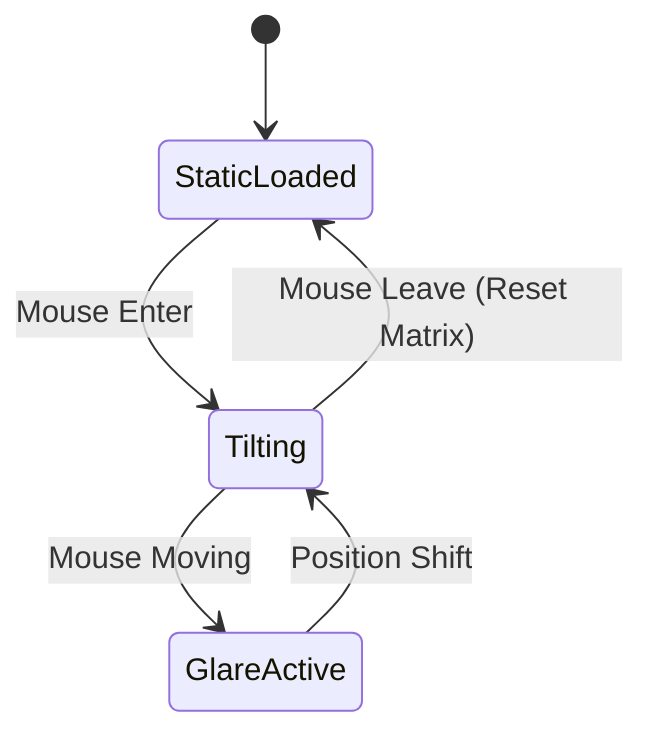

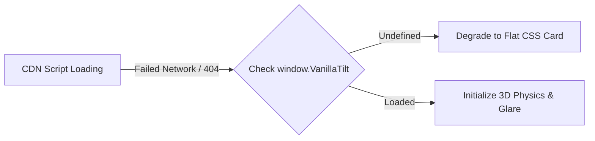

---

### F2: Interactive UV Index Tracker with Dynamic Severity Tiering

- **User Action:** User clicks `+` or `-` buttons to simulate UV index variations (0 to 11).
- **Frontend Flow:** Click event triggers callback ([index.html:349-357](file:///Users/avishjain/avishjain9-repos/56-avishjain-weatherapp/abstract-forge/index.html#L349-L357)). Mutates module-scoped `uvIndex` with `Math.min(uvIndex + 1, 11)` or `Math.max(uvIndex - 1, 0)`.
- **Classification Engine:** `getUvRating(index)` evaluates thresholds ([index.html:333-339](file:///Users/avishjain/avishjain9-repos/56-avishjain-weatherapp/abstract-forge/index.html#L333-L339)):
  - $0 \le x \le 2 \rightarrow$ Low (`text-green-400`)
  - $3 \le x \le 5 \rightarrow$ Moderate (`text-yellow-400`)
  - $6 \le x \le 7 \rightarrow$ High (`text-orange-400`)
  - $8 \le x \le 10 \rightarrow$ Very High (`text-red-400`)
  - $x \ge 11 \rightarrow$ Extreme (`text-purple-400`)
- **DOM Update:** Updates `#uv-index-display` text and replaces `#uv-rating` `className`.

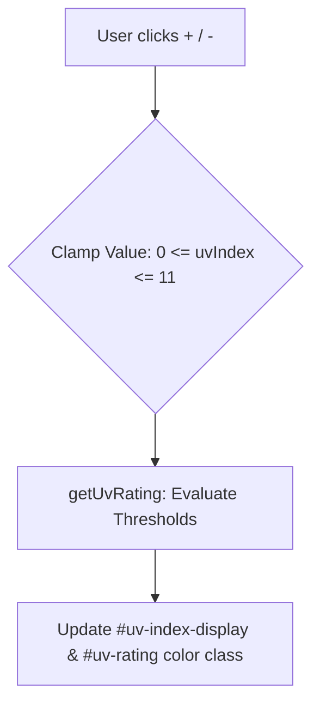

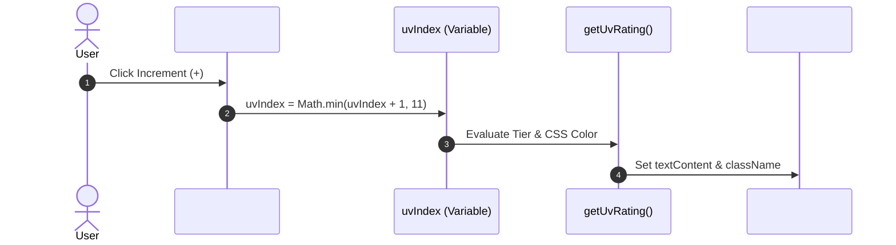

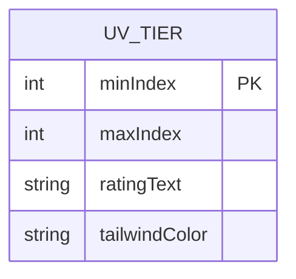

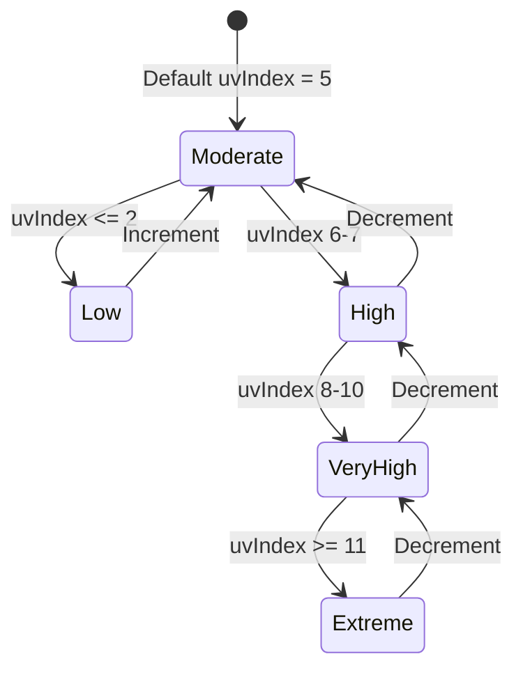

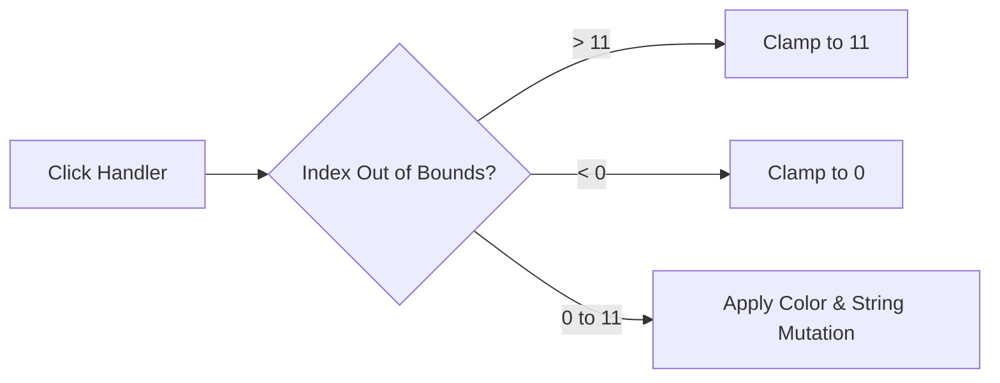

---

### F3: Dynamic 5-Day Forecast with Focus-Blur Depth-of-Field

- **User Action:** Hover cursor across any forecast card in the 5-day grid.
- **Frontend Flow:** Initialized via `mockFetchWeather()` ([index.html:298-324](file:///Users/avishjain/avishjain9-repos/56-avishjain-weatherapp/abstract-forge/index.html#L298-L324)). Forecast array iterated; cards created with `document.createElement('div')` and appended to `#forecast-grid`.
- **CSS Optical Shader:** `.blur-grid:hover .grid-item:not(:hover)` applies `filter: grayscale(1) blur(3px) brightness(0.7)` ([index.html:115-118](file:///Users/avishjain/avishjain9-repos/56-avishjain-weatherapp/abstract-forge/index.html#L115-L118)). Hovered card receives `transform: translateY(-5px)` and blue glow box-shadow.

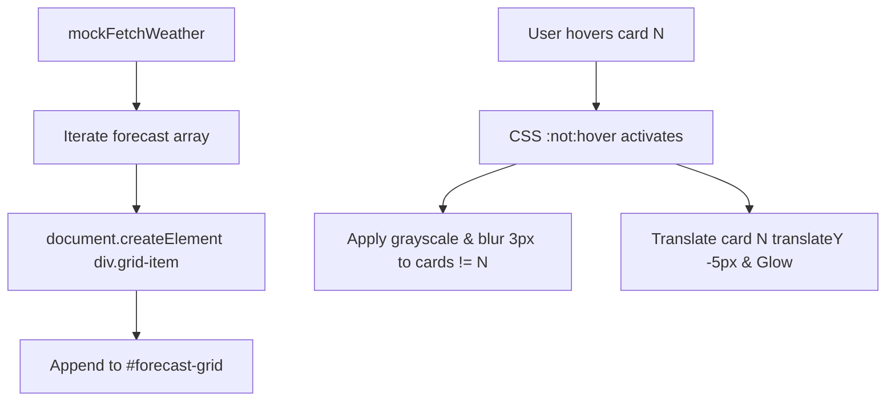

```mermaid
sequenceDiagram
    autonumber
    participant Engine as mockFetchWeather()
    participant DOM as #forecast-grid
    actor User
    Engine->>DOM: forecastGrid.innerHTML = ''
    loop For each day in mockData.forecast
        Engine->>DOM: createElement('div') with template string
    end
    User->>DOM: Hover on Friday Card
    DOM->>DOM: Trigger CSS .blur-grid:hover .grid-item:not(:hover)
    DOM-->>User: Active card elevated; sibling cards blurred
```

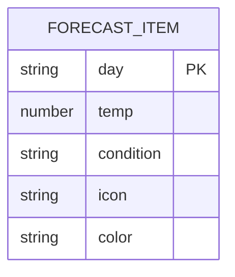

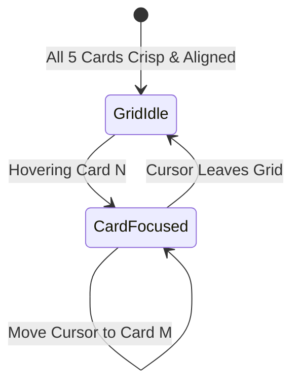

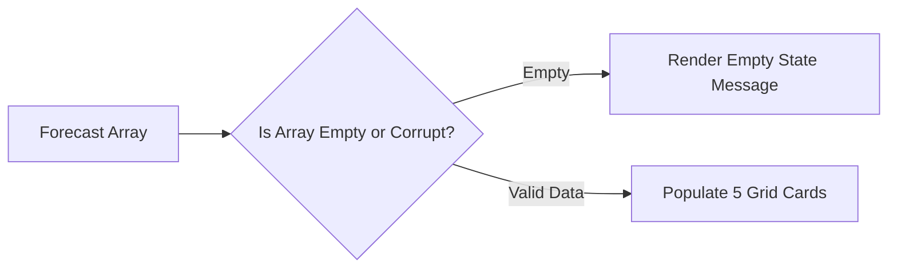

---

### F4: Live Radar Zoom & Magnifier (CSS Variable Tracking)

- **User Action:** Move cursor over the Live Radar map image to activate detailed magnification.
- **Frontend Flow:** Event listener on `#radar-map` tracks `mousemove` ([index.html:361-379](file:///Users/avishjain/avishjain9-repos/56-avishjain-weatherapp/abstract-forge/index.html#L361-L379)).
- **Coordinate Mathematics:**
  $$\text{percentX} = \frac{\text{event.offsetX}}{\text{radarzoom.offsetWidth}} \times 100$$
  $$\text{percentY} = \frac{\text{event.offsetY}}{\text{radarzoom.offsetHeight}} \times 100$$
- **CSS Variable Injection:**
  - `radarzoom.style.setProperty('--zoom-x', percentX + '%')`
  - `radarzoom.style.setProperty('--zoom-y', percentY + '%')`
  - `radarzoom.style.setProperty('--display-opacity', '1')`
- **Render Engine:** `#radar-map::after` pseudo-element binds `--zoom-url`, `--zoom-x`, `--zoom-y`, and displays 250% scaled overlay with `pointer-events: none`.

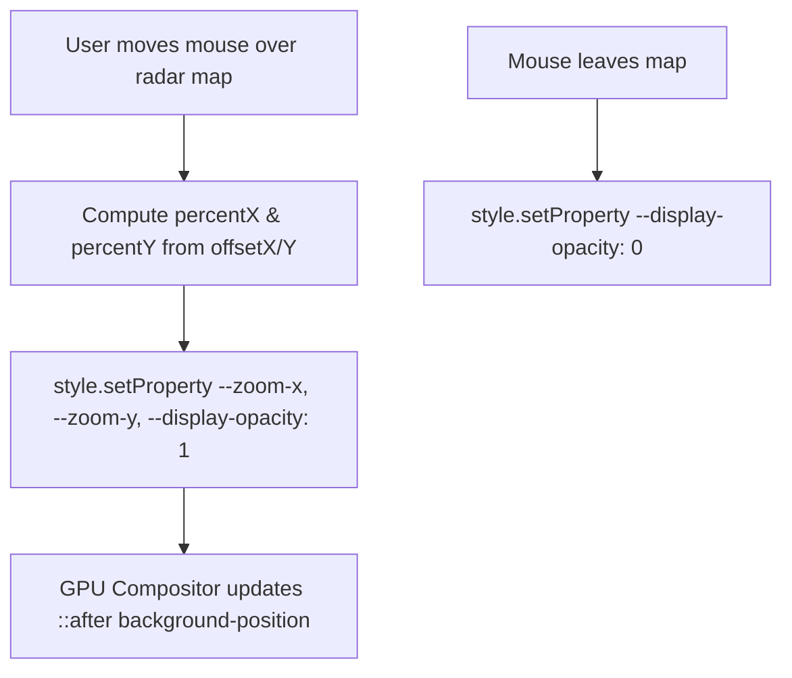

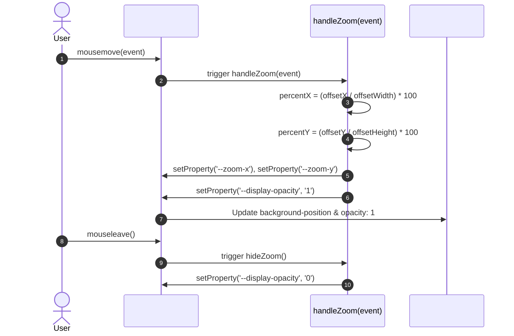

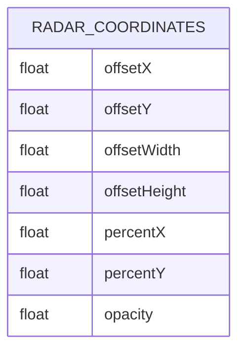

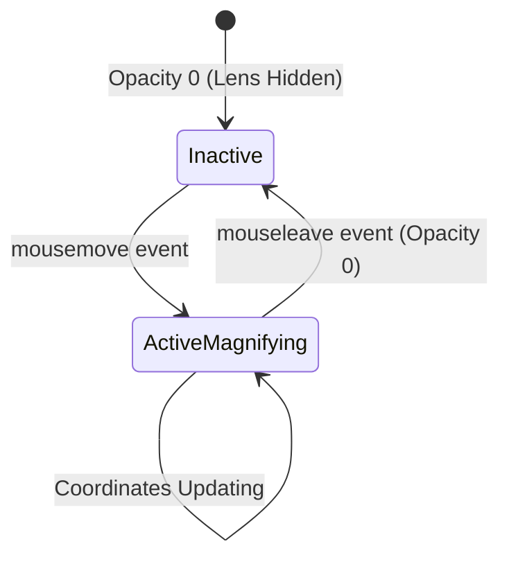

```mermaid
flowchart LR
    A[Radar Image Load] --> B{Image 404 / Offline?}
    B -->|Failed| C[Show Fallback Error Placeholder]
    B -->|Loaded| D[Enable Coordinate Tracking Engine]
```

---

### F5: 3D Cylindrical Global Weather Carousel

- **User Action:** Observe rotating 3D carousel of world cities (London, Tokyo, Dubai, Sydney, Paris, Rio); hover to pause rotation.
- **Frontend Flow:** Pure CSS 3D rendering pipeline with hardware acceleration ([index.html:133-174](file:///Users/avishjain/avishjain9-repos/56-avishjain-weatherapp/abstract-forge/index.html#L133-L174)).
- **Cylindrical Polygon Geometry:**
  - Radial Angle per Face: $\theta = \frac{360^\circ}{6} = 60^\circ$
  - Each `.city-card:nth-child(i)` is rotated by $i \times 60^\circ$ and translated along Z-axis by $+300\text{px}$.
  - Container `#temp-slider` uses `transform-style: preserve-3d` and keyframe `autoRun` (continuous 25s loop).
- **Interaction Engine:** `#temp-slider:hover` applies `animation-play-state: paused`.

```mermaid
flowchart TD
    Setup[Container: perspective 1000px] --> Pres3D[#temp-slider: transform-style preserve-3d]
    Pres3D --> Math[Distribute 6 Cards: rotateY i * 60deg translateZ 300px]
    Math --> Keyframes[Keyframe autoRun: rotateY 0deg to 360deg in 25s]
    UserHover[User Hovers Carousel] --> Pause[CSS: animation-play-state paused]
```

```mermaid
sequenceDiagram
    autonumber
    actor User
    participant Viewport as #slider-wrap (Perspective 1000px)
    participant Carousel as #temp-slider (preserve-3d)
    participant Cards as 6x .city-card Elements
    Viewport->>Carousel: Initial 3D context loaded
    Carousel->>Cards: Distribute radially at 60deg intervals & translateZ(300px)
    Carousel->>Carousel: Execute continuous keyframe autoRun (25s linear)
    User->>Carousel: Cursor enters carousel bounding box (:hover)
    Carousel->>Carousel: Freeze animation-play-state: paused
    User->>Carousel: Cursor leaves bounding box
    Carousel->>Carousel: Resume continuous autoRun animation
```

```mermaid
erDiagram
    GLOBAL_CITY_CARD {
        int index PK
        string cityName
        number temp
        string condition
        string badgeColor
        float angleDegrees
        int translateZ
    }
```

```mermaid
stateDiagram-v2
    [*] --> Rotating: autoRun 25s linear infinite
    Rotating --> Paused: Hover over carousel
    Paused --> Rotating: Mouse leave
```

```mermaid
flowchart LR
    A[Browser Capabilities] --> B{Supports CSS 3D Transforms?}
    B -->|No / Reduced Motion| C[Fallback to Horizontal Flex Scroll]
    B -->|Yes| D[Render Cylindrical 3D Scene]
```

---

### F6: CSS Animated Sliding Pill Navigation Bar

- **User Action:** Hover over navigation anchors (`Today`, `Forecast`, `Radar Map`, `Cities`).
- **Frontend Flow:** Zero JavaScript navigation indicator built with CSS General Sibling Combinators ([index.html:46-84](file:///Users/avishjain/avishjain9-repos/56-avishjain-weatherapp/abstract-forge/index.html#L46-L84)).
- **Sibling Combinator Rules:**
  - `a:nth-child(1):hover ~ span` $\rightarrow$ `left: 0px; width: 85px`
  - `a:nth-child(2):hover ~ span` $\rightarrow$ `left: 85px; width: 100px`
  - `a:nth-child(3):hover ~ span` $\rightarrow$ `left: 185px; width: 100px`
  - `a:nth-child(4):hover ~ span` $\rightarrow$ `left: 285px; width: 90px`
- **Spring Physics:** `transition: 0.4s cubic-bezier(0.68, -0.55, 0.265, 1.55)` gives an elastic bounce effect.

```mermaid
flowchart TD
    HoverNav[User hovers Link N] --> MatchRule[CSS Selector a:nth-child N:hover ~ span]
    MatchRule --> Spring[Apply cubic-bezier 0.68, -0.55, 0.265, 1.55 transition]
    Spring --> AnimatePill[Slide span indicator to offset left with target width]
```

```mermaid
sequenceDiagram
    autonumber
    actor User
    participant Nav as #main-nav
    participant Link as a:nth-child(2) Forecast
    participant Pill as span (Background Slider)
    User->>Nav: Cursor hovers 'Forecast'
    Nav->>Link: :hover state active
    Link->>Pill: a:nth-child(2):hover ~ span triggered
    Pill->>Pill: Interpolate left: 85px, width: 100px with cubic-bezier bounce
    User->>Nav: Click 'Forecast'
    Nav-->>User: Smooth scroll to #forecast anchor
```

```mermaid
erDiagram
    NAV_LINK {
        int position PK
        string anchorHash
        string labelText
        int pillLeftOffset
        int pillWidth
    }
```

```mermaid
stateDiagram-v2
    [*] --> TabToday: Default Pill Position (left: 0px, width: 85px)
    TabToday --> TabForecast: Hover Forecast (left: 85px, width: 100px)
    TabForecast --> TabRadar: Hover Radar (left: 185px, width: 100px)
    TabRadar --> TabCities: Hover Cities (left: 285px, width: 90px)
    TabCities --> TabToday: Leave Nav or Hover Today
```

```mermaid
flowchart LR
    A[View Width Check] --> B{Mobile Breakpoint < 640px?}
    B -->|Yes| C[Pill indicators hidden / wrap navigation]
    B -->|No| D[Full CSS Elastic Sliding Pill Active]
```

---

## 0.3 Every API Specification

### Current Client Mock Endpoints (Internal Data Layer)

| Method | Mock Route / Interface | Data Structure | Purpose | Code Reference |
| :--- | :--- | :--- | :--- | :--- |
| `INTERNAL` | `mockFetchWeather()` | `mockData.current` Object | Populates hero card with temp, high/low, and conditions | [index.html:287-325](file:///Users/avishjain/avishjain9-repos/56-avishjain-weatherapp/abstract-forge/index.html#L287-L325) |
| `INTERNAL` | `mockFetchWeather()` | `mockData.forecast` Array | Generates 5 daily forecast cards dynamically | [index.html:298-304](file:///Users/avishjain/avishjain9-repos/56-avishjain-weatherapp/abstract-forge/index.html#L298-L304) |
| `INTERNAL` | `getUvRating(index)` | `{ text, color }` Object | Translates integer UV score into health advisory & color | [index.html:333-339](file:///Users/avishjain/avishjain9-repos/56-avishjain-weatherapp/abstract-forge/index.html#L333-L339) |

### External APIs, CDNs & Remote Assets

| Provider | Purpose | Asset / Script Location | API Key Required? |
| :--- | :--- | :--- | :--- |
| **Tailwind Labs** | Utility-first CSS runtime compiler | `https://cdn.tailwindcss.com` ([index.html:7](file:///Users/avishjain/avishjain9-repos/56-avishjain-weatherapp/abstract-forge/index.html#L7)) | No |
| **Cloudflare / CDNJS** | VanillaTilt 3D card physics library | `https://cdnjs.cloudflare.com/ajax/libs/vanilla-tilt/1.8.1/vanilla-tilt.min.js` ([index.html:8](file:///Users/avishjain/avishjain9-repos/56-avishjain-weatherapp/abstract-forge/index.html#L8)) | No |
| **Placehold.co** | Header text mask background graphic | `https://placehold.co/1200x300/3b82f6/ffffff?text=Blue+Sky` ([index.html:34](file:///Users/avishjain/avishjain9-repos/56-avishjain-weatherapp/abstract-forge/index.html#L34)) | No |
| **Placehold.co** | Radar base map graphic | `https://placehold.co/1000x500/171717/00ff00?text=RADAR+MAP` ([index.html:233](file:///Users/avishjain/avishjain9-repos/56-avishjain-weatherapp/abstract-forge/index.html#L233)) | No |
| **Placehold.co** | Radar magnifier zoom graphic | `https://placehold.co/800x1200/065f46/ffffff?text=RADAR+ZOOM` ([index.html:90](file:///Users/avishjain/avishjain9-repos/56-avishjain-weatherapp/abstract-forge/index.html#L90)) | No |

### API Keys & Environment Variables Inventory

| Variable Name | Service | Purpose | Where Used in Code | Where to Obtain |
| :--- | :--- | :--- | :--- | :--- |
| `None` *(Current)* | Public CDN | Client executes purely in-browser | N/A | Open Access |
| `VITE_OPENWEATHER_API_KEY` *(Roadmap)* | OpenWeatherMap | Real-time global meteorological telemetry ingestion | Documented in System Design & Roadmap | [openweathermap.org](https://openweathermap.org/api) |
| `VITE_GEMINI_API_KEY` *(Roadmap)* | Google AI Studio | Generative LLM meteorological advice & severe alerts | Documented in AI Roadmap | [aistudio.google.com](https://aistudio.google.com) |

---

## 0.4 Every Hook, Helper & Shared Piece

### Helper Functions & DOM Controllers
1. **`mockFetchWeather()`** ([index.html:287-325](file:///Users/avishjain/avishjain9-repos/56-avishjain-weatherapp/abstract-forge/index.html#L287-L325)):
   - Generates local date/time string with `Intl.DateTimeFormat` options.
   - Updates hero elements via `document.getElementById`.
   - Clears `#forecast-grid.innerHTML` and appends newly generated card nodes.
2. **`getUvRating(index)`** ([index.html:333-339](file:///Users/avishjain/avishjain9-repos/56-avishjain-weatherapp/abstract-forge/index.html#L333-L339)):
   - Pure functional mapping from integer UV level to human-readable label and Tailwind color class.
3. **`updateUvDisplay()`** ([index.html:341-347](file:///Users/avishjain/avishjain9-repos/56-avishjain-weatherapp/abstract-forge/index.html#L341-L347)):
   - Coordinates state synchronization between `uvIndex` variable and DOM nodes (`#uv-index-display` & `#uv-rating`).
4. **`handleZoom(event)`** ([index.html:361-372](file:///Users/avishjain/avishjain9-repos/56-avishjain-weatherapp/abstract-forge/index.html#L361-L372)):
   - Calculates relative cursor percentage offsets (`percentX`, `percentY`).
   - Updates CSS custom properties `--zoom-x`, `--zoom-y`, and `--display-opacity`.
5. **`hideZoom()`** ([index.html:374-376](file:///Users/avishjain/avishjain9-repos/56-avishjain-weatherapp/abstract-forge/index.html#L374-L376)):
   - Resets CSS custom property `--display-opacity` to `0`.

---

## 0.5 Every Connection & Lifecycle Event

```mermaid
sequenceDiagram
    autonumber
    participant Browser as Browser Window
    participant DOM as Document Object Model
    participant Script as Inlined Script Engine
    participant CDN as Cloudflare CDN (VanillaTilt)
    
    Browser->>DOM: Parse HTML, CSS & CDN Script Tags
    CDN-->>Browser: Resolve VanillaTilt.min.js
    Browser->>DOM: Fire DOMContentLoaded
    DOM->>Script: Execute Event Listener
    Script->>Script: Initialize VanillaTilt(#weather-details)
    Script->>Script: Execute mockFetchWeather()
    Script->>DOM: Populate Hero & Forecast Elements
    Script->>Script: Execute updateUvDisplay()
    Script->>DOM: Bind mousemove & mouseleave on #radar-map
    Script->>DOM: Bind click listeners on UV +/- Buttons
```

---

## 0.6 Visual Engineering & UI System Specifications

1. **Glassmorphism Token (`.card-bg`):**
   - Background: `rgba(30, 41, 59, 0.6)`
   - Backdrop Filter: `blur(12px)`
   - Border: `1px solid rgba(255, 255, 255, 0.15)`
   - Drop Shadow: `0 8px 32px 0 rgba(0, 0, 0, 0.37)`
2. **Typography Scaling:**
   - Hero Header: `font-size: clamp(2.5rem, 8vw, 6rem)` ensures zero text wrapping or overflow across 320px mobile viewports up to 4K ultra-wide monitors.
3. **Background Image Text Clipping:**
   - Implements `-webkit-background-clip: text` with transparent fill to project an animated sky texture directly through the title lettering.
4. **Hardware Acceleration:**
   - 3D carousel utilizes `transform-style: preserve-3d` and `translateZ` to enforce rendering layer promotion onto the device GPU.

---

## 0.7 Master Connection Map

```mermaid
graph TD
    subgraph UI_Viewport["User Interface Viewport"]
        Nav["#main-nav (Sliding Pill Indicator)"]
        Hero["#weather-details (3D Tilt Card)"]
        UV["#uv-index-display & Buttons"]
        Forecast["#forecast-grid (Focus Blur)"]
        Radar["#radar-map (Zoom Magnifier)"]
        Carousel["#temp-slider (3D Cylindrical Carousel)"]
    end
    
    subgraph State_Handlers["JavaScript State & Event Handlers"]
        E1["DOMContentLoaded"]
        E2["VanillaTilt.init()"]
        E3["mockFetchWeather()"]
        E4["uvIncrementBtn & uvDecrementBtn Click"]
        E5["updateUvDisplay() & getUvRating()"]
        E6["handleZoom(e) & hideZoom()"]
    end

    subgraph CSS_Variables["Dynamic CSS Custom Properties"]
        V1["--zoom-x"]
        V2["--zoom-y"]
        V3["--display-opacity"]
        V4["--quantity (6 Cards)"]
    end

    E1 --> E2
    E1 --> E3
    E1 --> E5
    E2 --> Hero
    E3 --> Hero
    E3 --> Forecast
    E4 --> E5
    E5 --> UV
    Radar -.->|mousemove / mouseleave| E6
    E6 --> V1 & V2 & V3
    V1 & V2 & V3 --> Radar
    V4 --> Carousel
```

---

## 0.8 Final Inventory Counts

Every subsequent documentation file adheres strictly to these verified inventory metrics:

| Category | Exact Count | Reference / Itemized Details |
| :--- | :--- | :--- |
| **Total HTML Pages** | **1** | `abstract-forge/index.html` |
| **Document Sections** | **5** | `#main-nav`, `#current`, `#forecast`, `#radar`, `#locations` |
| **Interactive Features** | **6** | F1 (Hero Tilt), F2 (UV Tracker), F3 (Forecast Blur), F4 (Radar Magnifier), F5 (3D Carousel), F6 (Sliding Pill Nav) |
| **Vanilla JS Functions** | **6** | `VanillaTilt.init`, `mockFetchWeather`, `getUvRating`, `updateUvDisplay`, `handleZoom`, `hideZoom` |
| **Event Listeners** | **5** | `DOMContentLoaded`, UV Increment `click`, UV Decrement `click`, Radar `mousemove`, Radar `mouseleave` |
| **CSS Dynamic Variables** | **4** | `--zoom-x`, `--zoom-y`, `--display-opacity`, `--quantity` |
| **External CDN Scripts** | **2** | Tailwind CSS Play CDN, VanillaTilt.js CDN |
| **Remote Graphic Assets** | **3** | Blue Sky title texture, Radar map base, Radar zoom texture |
| **Backend Endpoints** | **0** | Not applicable (Client-only SPA; roadmap documented) |
| **Database Models** | **0** | Not applicable (In-memory mock data; relational/NoSQL roadmap documented) |
