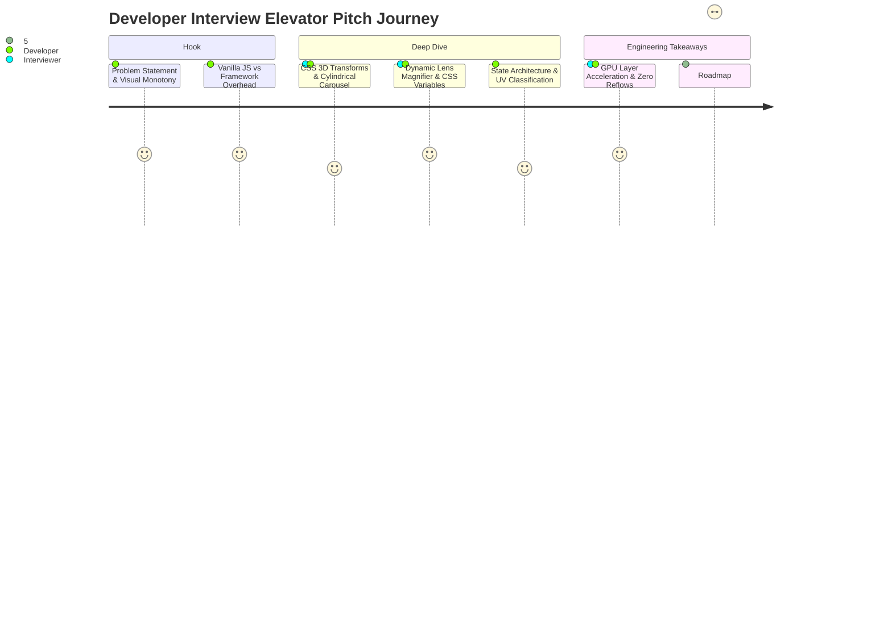

# 00b. Project Elevator Pitch (30-Second & 2-Minute Versions)

---

## 30-Second Spoken Pitch (High-Impact Executive Summary)

> "I built Weather Hub, a high-performance meteorological web dashboard engineered with Vanilla JavaScript, HTML5, and advanced modern CSS3. Instead of relying on heavy frontend frameworks for basic interactivity, I demonstrated how native browser capabilities—like CSS 3D perspective transforms, hardware-accelerated cylindrical carousels, dynamic lens magnification via CSS custom properties, and glassmorphism—can deliver an ultra-responsive, zero-runtime-overhead user experience. The app features interactive UV index tracking with real-time severity classification, an optical focus-blur 5-day forecast, and physical 3D card tilt physics. It shows my deep mastery of DOM lifecycles, CSS rendering pipelines, and visual engineering."

---

## 2-Minute Spoken Pitch (Comprehensive Technical Walkthrough)

> "In many modern web projects, developers default to pulling in heavy frameworks like React or large animation packages just to build interactive dashboard components. For Weather Hub, I wanted to step back and prove how far you can push native browser APIs and cutting-edge CSS3 to build a production-grade, highly engaging meteorological interface with virtually zero bundle bloat and sub-millisecond execution times.
>
> The project solves the visual monotony of traditional weather apps through five key architectural features:
>
> First, for the primary hero weather card, I integrated 3D gyroscope physics using VanillaTilt, which calculates cursor proximity and applies dynamic perspective rotations and specular glare on the fly. 
> 
> Second, I built an interactive UV Index monitoring engine. It maintains state in vanilla JavaScript and uses a functional evaluation algorithm to dynamically re-classify ultraviolet radiation risks into five clinical tiers—from Low to Extreme—instantly synchronizing the DOM text and Tailwind color tokens without unnecessary re-renders.
> 
> Third, I implemented an optical depth-of-field 5-day forecast grid. Using the CSS `:not(:hover)` pseudoclass, hovering over any single day scales that card forward while applying a 3-pixel Gaussian blur and grayscale filter to its sibling cards, directing user focus effortlessly.
> 
> Fourth, I developed a dual-layer Live Radar zoom magnifier. Instead of spinning up a heavyweight canvas rendering loop, I bound a mousemove listener that computes relative cursor percentages and pipes them directly into CSS Custom Properties: `--zoom-x`, `--zoom-y`, and `--display-opacity`. A hardware-accelerated pseudo-element reads these variables to position a 250% magnified radar layer smoothly at 60 frames per second.
> 
> Finally, I engineered a revolving 3D global weather carousel. Using pure CSS cylindrical projection mathematics, each city card is rotated by 60 degrees along the Y-axis and translated 300 pixels forward in 3D space, running an infinite linear keyframe loop that automatically pauses when hovered.
> 
> By keeping the core application framework-free, the entire interface loads instantly, eliminates virtual DOM reconciliation costs, and demonstrates how a deep understanding of browser rendering engines, composite layers, and clean DOM manipulation leads to exceptional user experiences."

---

## Pitch Comparison Matrix

| Aspect | 30-Second Version | 2-Minute Version |
| :--- | :--- | :--- |
| **Primary Goal** | Instant hook & core stack summary | Comprehensive architectural and feature breakdown |
| **Best Used For** | Initial intro, recruiter screens, lightning talks | Technical interviews, hiring manager deep-dives |
| **Key Highlights** | Zero-bundle overhead, 3D CSS math, responsive UI | Exact mathematical formulas, CSS custom properties, state logic |
| **Takeaway** | Confident, articulate, foundation-strong engineer | Deep technical competence across browser rendering and DOM |
