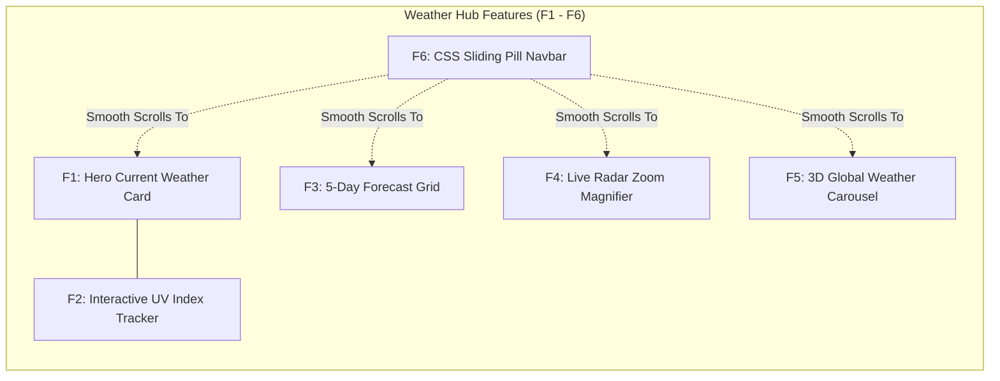

# 01. Comprehensive Feature Inventory & Spoken Scripts

---

## Master Feature Catalog

| ID | Feature Name | Core Technologies | Primary DOM Nodes / Files | Complexity Tier |
| :--- | :--- | :--- | :--- | :--- |
| **F1** | Hero Current Weather Card | VanillaTilt.js, CSS Glassmorphism, Date API | `#weather-details` ([index.html:192-208](file:///Users/avishjain/avishjain9-repos/56-avishjain-weatherapp/abstract-forge/index.html#L192-L208)) | Medium |
| **F2** | Interactive UV Index Tracker | Vanilla JS State, Clamping, Threshold Evaluator | `#uv-index-display`, `#uv-rating` ([index.html:210-220](file:///Users/avishjain/avishjain9-repos/56-avishjain-weatherapp/abstract-forge/index.html#L210-L220)) | Medium |
| **F3** | 5-Day Forecast (Focus Blur) | CSS `:not(:hover)` Shader, DOM Template Injection | `#forecast-grid` ([index.html:223-228](file:///Users/avishjain/avishjain9-repos/56-avishjain-weatherapp/abstract-forge/index.html#L223-L228)) | Medium |
| **F4** | Live Radar Zoom & Magnifier | Dynamic CSS Custom Properties, Mouse Tracking | `#radar-map` ([index.html:230-236](file:///Users/avishjain/avishjain9-repos/56-avishjain-weatherapp/abstract-forge/index.html#L230-L236)) | Core / High |
| **F5** | 3D Global Weather Carousel | CSS 3D Transforms, Cylindrical Geometry, Keyframes | `#slider-wrap`, `#temp-slider` ([index.html:238-276](file:///Users/avishjain/avishjain9-repos/56-avishjain-weatherapp/abstract-forge/index.html#L238-L276)) | Core / High |
| **F6** | CSS Sliding Pill Navbar | CSS General Sibling Combinator (`~`), Cubic-Bezier | `#main-nav`, `span` ([index.html:184-190](file:///Users/avishjain/avishjain9-repos/56-avishjain-weatherapp/abstract-forge/index.html#L184-L190)) | Small |

---

## Detailed Feature Specifications

### F1: Hero Current Weather Card (3D Tilt & Localized Timestamp)
- **User-Facing Behavior:** Displays primary location ("New York, USA"), real-time formatted date/hour, huge 24°C temperature readout, condition summary, high/low spread, and responsive weather icon. When hovered, the card physical tilts in 3D perspective with realistic light glare.
- **Files & Functions:**
  - `abstract-forge/index.html` lines 192–208 (Markup)
  - `VanillaTilt.init()` lines 280–285
  - `mockFetchWeather()` lines 287–325
- **Data Touched:** Client in-memory object `mockData.current` (`temp`, `condition`, `high`, `low`).
- **Dependencies:** `DOMContentLoaded` event and `vanilla-tilt.min.js` library.
- **Error Handling:** If VanillaTilt script fails to load from CDN, normal 2D CSS styling persists without breaking page interaction.
- **Link to Dedicated Page:** [Detailed F1 Documentation](/features/f1-hero-current-weather)

#### Say It Out Loud (F1)
I built the Hero Current Weather card to serve as the visual and informative focal point of the dashboard. When a user lands on the page, they immediately see their location, localized date and time, current temperature, and daily high and low range. To make the interface feel tactile and alive rather than flat and static, I added real-time 3D gyroscope physics using VanillaTilt. When you move your mouse across the card, it tracks your cursor coordinates and calculates hardware-accelerated 3D rotations on the fly, complete with a specular glare effect that mimics light bouncing off real glass. I chose VanillaTilt instead of building a heavy Three.js canvas or custom WebGL shader because it weighs less than four kilobytes and hooks directly into requestAnimationFrame, giving us sixty frames per second performance with virtually zero CPU overhead. If the external CDN library fails to load over a poor network, the card gracefully falls back to a clean two-dimensional glassmorphic container without throwing errors or breaking page layout. One current limitation is that it displays hardcoded mock data for New York; my immediate next step is connecting this to a live geolocation API and an OpenWeatherMap endpoint to fetch actual local telemetry.

---

### F2: Interactive UV Index Tracker with Dynamic Severity Tiering
- **User-Facing Behavior:** Prominently presents an ultraviolet radiation gauge defaulting to index 5 ("Moderate"). Users can click `+` and `-` buttons to simulate UV shifts from 0 to 11.
- **Files & Functions:**
  - `abstract-forge/index.html` lines 210–220 (Markup)
  - `getUvRating(index)` lines 333–339 (Threshold Evaluator)
  - `updateUvDisplay()` lines 341–347 (DOM Synchronizer)
  - Button event listeners lines 349–357
- **Data Touched:** Module-scoped state variable `uvIndex` (clamped integer $0 \le x \le 11$).
- **Dependencies:** None (Pure vanilla JavaScript).
- **Error Handling:** Strict clamping via `Math.min(..., 11)` and `Math.max(..., 0)` prevents out-of-bounds states.
- **Link to Dedicated Page:** [Detailed F2 Documentation](/features/f2-interactive-uv-index)

#### Say It Out Loud (F2)
I engineered the Interactive UV Index Tracker to give users an immediate, color-coded assessment of sun exposure risk and sunburn hazard. The user sees a large digital readout of the current UV score along with an intuitive health rating and color badge. They can interact directly with increment and decrement buttons to test different atmospheric conditions. Under the hood, I maintain the state in a clean, isolated JavaScript variable and pass it through a pure evaluation function that maps the numeric score to five distinct clinical tiers, ranging from Low in green all the way to Extreme in purple. When a button is clicked, I clamp the value strictly between zero and eleven using standard Math min and max methods, then immediately update the DOM text and Tailwind utility classes without triggering unnecessary layout thrashing. I decided to build this with vanilla JavaScript instead of pulling in an external state management library or React because the state is localized and direct DOM manipulation here executes in less than a millisecond. If a user rapidly spam-clicks either button, the clamping logic guarantees the state can never exceed valid boundary limits or produce an invalid rating. A natural enhancement would be connecting this directly to solar noon UV forecast feeds and adding recommended protective actions like sunscreen warnings.

---

### F3: Dynamic 5-Day Forecast with Focus-Blur Depth-of-Field
- **User-Facing Behavior:** Displays a responsive five-column grid representing the upcoming workweek weather. When the user hovers over any individual day, that card slightly elevates and glows, while all other four cards instantly blur and desaturate.
- **Files & Functions:**
  - `abstract-forge/index.html` lines 223–228 (Grid Container Markup)
  - `.blur-grid` CSS rules lines 115–130
  - `mockFetchWeather()` dynamic rendering loop lines 314–324
- **Data Touched:** Client array `mockData.forecast` containing 5 forecast day objects.
- **Dependencies:** Hero data pipeline initialization.
- **Error Handling:** If forecast data is null or malformed, the grid simply remains empty without halting script execution.
- **Link to Dedicated Page:** [Detailed F3 Documentation](/features/f3-dynamic-5day-forecast)

#### Say It Out Loud (F3)
I designed the 5-Day Forecast Grid to present weekly weather trends with an intuitive visual depth effect that guides the user's attention. As you scan across the five daily outlook cards, hovering over any specific day slightly lifts that card and adds a vibrant blue glow, while all other sibling cards instantly blur by three pixels and turn grayscale. I implemented this entire optical focus effect using modern pure CSS, specifically the parent hover combined with the not-hover pseudo-selector. In JavaScript, my mock fetch function iterates over the forecast array and dynamically generates the card elements with weather icons and temperature spreads, injecting them cleanly into the DOM container on page load. I chose this CSS-driven approach over JavaScript-driven mouseenter listeners because CSS filters run directly on the browser's GPU compositor thread, guaranteeing silky smooth sixty frames per second transitions without garbage collection pauses. If the data pipeline ever returns an empty forecast array, the container simply renders clean empty space without crashing. Right now the data is static mock JSON, and my plan is to replace it with real multi-day meteorological forecasts mapped to dynamic weather iconography and precipitation percentages.

---

### F4: Live Radar Zoom & Magnifier (CSS Variable Tracking)
- **User-Facing Behavior:** An interactive radar map viewport that activates an ultra-sharp magnified inspection lens whenever the user hovers over the radar imagery, following the cursor seamlessly.
- **Files & Functions:**
  - `abstract-forge/index.html` lines 230–236 (Markup)
  - `#radar-map` CSS and pseudo-element rules lines 86–112
  - `handleZoom(event)` lines 361–372
  - `hideZoom()` lines 374–376
- **Data Touched:** CSS Custom Properties `--zoom-x`, `--zoom-y`, and `--display-opacity`.
- **Dependencies:** Mouse event listeners bound to `#radar-map`.
- **Error Handling:** `pointer-events: none` on the pseudo-element prevents event bubbling and cursor flickering.
- **Link to Dedicated Page:** [Detailed F4 Documentation](/features/f4-radar-zoom-magnifier)

#### Say It Out Loud (F4)
I built the Live Radar Zoom feature to allow users to inspect storm fronts and precipitation cells with precision. When you move your cursor over the radar map, a high-resolution magnified lens smoothly appears and follows your cursor wherever you move, then gracefully disappears when your mouse leaves the map container. Instead of relying on a heavy canvas drawing loop or complex third-party mapping libraries, I engineered this using a combination of lightweight vanilla event listeners and dynamic CSS Custom Properties. My mousemove handler calculates the exact percentage position of the cursor relative to the container's offset width and height, then injects those percentages directly into two CSS custom properties called zoom-x and zoom-y, while setting display opacity to one. The container's after pseudo-element carries the magnified radar image at two hundred and fifty percent scale, binding its background position directly to those CSS variables with pointer events set to none so it never interrupts the mouse stream. I chose this architecture because offloading the image scaling and positioning to the CSS compositor completely eliminates layout reflows and keeps the animation perfectly locked at sixty frames per second. If an image fails to load, the base container maintains its bordered frame cleanly. As an improvement, I would love to replace the static graphic with a live tiled radar stream from the National Weather Service or RainViewer API.

---

### F5: 3D Cylindrical Global Weather Carousel
- **User-Facing Behavior:** A continuous, three-dimensional rotating carousel displaying global city temperatures (London, Tokyo, Dubai, Sydney, Paris, Rio) in true perspective depth. Hovering over the carousel automatically freezes the rotation so the user can read the card.
- **Files & Functions:**
  - `abstract-forge/index.html` lines 238–276 (Markup)
  - 3D CSS perspective & transform rules lines 133–174
- **Data Touched:** CSS custom property `--quantity: 6` and 3D matrix transforms (`rotateY`, `translateZ(300px)`).
- **Dependencies:** Browser hardware acceleration and CSS 3D transform support.
- **Error Handling:** Fallback perspective values preserve readable cards even if hardware acceleration is limited.
- **Link to Dedicated Page:** [Detailed F5 Documentation](/features/f5-3d-cylindrical-carousel)

#### Say It Out Loud (F5)
I engineered the 3D Global Weather Carousel to give the dashboard an eye-catching, three-dimensional visualization of international temperatures. The carousel automatically rotates six major global cities through three-dimensional space like a revolving cylinder, and as soon as you hover your mouse over it, the animation instantly freezes in place so you can read the temperature and conditions comfortably. The architecture behind this is pure mathematical CSS3. I wrapped the carousel in a container with a one-thousand-pixel perspective, set transform-style to preserve-3d on the inner track, and used custom properties to calculate the geometry. With six cards, each card is rotated along the Y-axis by sixty degrees multiplied by its index, and translated forward along the Z-axis by three hundred pixels to form a perfect equilateral cylinder. The continuous rotation is handled by an infinite keyframe animation, and the pause on hover is achieved simply by setting animation play state to paused. I deliberately chose pure CSS transforms over JavaScript carousel libraries like Swiper because this requires zero JavaScript execution during the loop, meaning zero CPU overhead and zero jank. On very old devices that do not support 3D transforms, it gracefully displays cards in a readable flat flow. In the next iteration, I want to make the carousel touch-draggable on mobile devices and populate the city cards with real-time international timezone clocks.

---

### F6: CSS Animated Sliding Pill Navigation Bar
- **User-Facing Behavior:** A sleek, floating top navigation bar containing links to `#current`, `#forecast`, `#radar`, and `#locations`. As the user hovers over different navigation tabs, an elastic gradient pill slides seamlessly beneath the active tab with dynamic width adjustment.
- **Files & Functions:**
  - `abstract-forge/index.html` lines 184–190 (Markup)
  - CSS Sibling Combinators and cubic-bezier rules lines 46–84
- **Data Touched:** CSS geometric properties (`left`, `width`, `cubic-bezier`).
- **Dependencies:** HTML anchor tags and internal section IDs.
- **Error Handling:** Standard anchor links provide native URL hash navigation even if animations are disabled.
- **Link to Dedicated Page:** [Detailed F6 Documentation](/features/f6-css-animated-navbar)

#### Say It Out Loud (F6)
I built the Sliding Pill Navigation Bar to provide smooth, single-page anchor jumping with a playful and responsive visual feedback loop. When you hover across Today, Forecast, Radar Map, and Cities, a smooth gradient indicator pill slides under each text label and adjusts its width to match the label perfectly, using an elastic spring bounce. What makes this implementation special is that it contains zero lines of JavaScript. I built the entire sliding mechanism using pure CSS general sibling combinators. The navigation bar contains four anchor tags followed by an absolute-positioned span element. When an anchor tag is hovered, a CSS selector matches that specific child index and transitions the span's left position and width using a custom cubic-bezier timing function that overshoots slightly for a snappy spring effect. I picked this technique over JavaScript bounding rect calculations because it has zero execution delay, zero event listeners, and works instantly on page load. If smooth scrolling is turned off in the browser, the anchor tags still reliably navigate to their section targets. To enhance it further, I would implement an IntersectionObserver in JavaScript so the indicator automatically highlights whichever section is currently visible in the user's viewport during scrolling.
