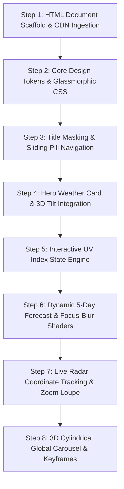

# 02. Step-by-Step Rebuild Order



---

## Rebuild Workflow Summary

To rebuild Weather Hub from a blank directory to a fully functioning application, follow this chronological 8-step engineering blueprint.

| Step | Phase Name | Primary Files & Assets | Verification Test |
| :--- | :--- | :--- | :--- |
| **1** | Document Scaffolding | `index.html` (Head, Viewport, CDNs) | Tailwind utilities compile in browser |
| **2** | CSS Tokens & Glassmorphism | `<style>` (`.card-bg`, gradients) | Backdrop blur renders on dark gradient |
| **3** | Title & Pill Navigation | `#main-title`, `#main-nav`, `span` | Hovering links smoothly animates pill |
| **4** | Hero Card & 3D Tilt | `#weather-details`, `VanillaTilt.init` | Card tilts with specular glare on mousemove |
| **5** | UV Index State Machine | `uvIndex`, `getUvRating()`, buttons | Clicking +/- updates score and color tier |
| **6** | 5-Day Forecast Grid | `mockFetchWeather()`, `.blur-grid` | Hovering one card blurs the other four |
| **7** | Live Radar Magnifier | `#radar-map`, `handleZoom()`, CSS vars | Mousemove reveals 250% magnified lens |
| **8** | 3D Global Carousel | `#temp-slider`, `@keyframes autoRun` | Carousel continuously orbits and pauses on hover |

---

## Step 1: HTML Document Scaffold & CDN Ingestion

Create `index.html` and define standard HTML5 boilerplate with Tailwind CSS and VanillaTilt CDNs.

```html
<!DOCTYPE html>
<html lang="en">
<head>
    <meta charset="UTF-8">
    <meta name="viewport" content="width=device-width, initial-scale=1.0">
    <title>Next-Gen Weather Dashboard</title>
    <!-- Tailwind CSS Play CDN for utility classes -->
    <script src="https://cdn.tailwindcss.com"></script>
    <!-- VanillaTilt.js for hardware-accelerated 3D parallax card tilting -->
    <script src="https://cdnjs.cloudflare.com/ajax/libs/vanilla-tilt/1.8.1/vanilla-tilt.min.js"></script>
</head>
<body class="bg-gradient-to-br from-gray-900 to-gray-950 text-gray-200">
    <main class="max-w-7xl mx-auto space-y-12 py-8 px-4 sm:px-6 lg:px-8">
        <!-- Content will mount here -->
    </main>
</body>
</html>
```

### Line-by-Line Breakdown:
- **Line 5:** Defines mobile-friendly responsive viewport constraints.
- **Line 7:** Pulls in Tailwind CSS via runtime compiler script, giving access to flex, grid, and palette utilities.
- **Line 9:** Imports VanillaTilt 1.8.1 from CDNJS mirror for gyroscopic 3D physics.
- **Line 11:** Applies dual-stop dark gradient background (`#101827` to `#0d1117`).

---

## Step 2: Core Design Tokens & Glassmorphism Engine

Implement reusable frosted glassmorphic styling tokens inside `<style>`.

```css
.card-bg {
    background: rgba(30, 41, 59, 0.6);
    backdrop-filter: blur(12px);
    -webkit-backdrop-filter: blur(12px);
    border: 1px solid rgba(255, 255, 255, 0.15);
    box-shadow: 0 8px 32px 0 rgba(0, 0, 0, 0.37);
}
```

### Line-by-Line Breakdown:
- **Line 2:** Semi-transparent slate background allows the background gradient to bleed through softly.
- **Line 3–4:** Standard and WebKit vendor-prefixed backdrop blur filters frost underlying elements.
- **Line 5:** Subtle translucent white 1px border establishes clear spatial card boundaries.
- **Line 6:** Deep 32px drop shadow lifts cards off the page canvas into elevated visual layers.

---

## Step 3: Header Text Masking & Sliding Pill Navbar

Construct `#main-title` and `#main-nav` using CSS general sibling combinators (`~`).

```html
<h1 id="main-title" class="text-center w-full">WEATHER HUB</h1>
<nav id="main-nav">
    <a href="#current">Today</a>
    <a href="#forecast">Forecast</a>
    <a href="#radar">Radar Map</a>
    <a href="#locations">Cities</a>
    <span></span>
</nav>
```

```css
#main-nav span {
    position: absolute;
    top: 0; left: 0; width: 85px; height: 100%;
    background: linear-gradient(90deg, #3b82f6, #60a5fa);
    border-radius: 0.75rem;
    transition: 0.4s cubic-bezier(0.68, -0.55, 0.265, 1.55); 
}
#main-nav a:nth-child(1):hover ~ span { left: 0px; width: 85px; }
#main-nav a:nth-child(2):hover ~ span { left: 85px; width: 100px; }
#main-nav a:nth-child(3):hover ~ span { left: 185px; width: 100px; }
#main-nav a:nth-child(4):hover ~ span { left: 285px; width: 90px; }
```

### Line-by-Line Breakdown:
- **HTML Line 8:** Empty `<span>` trailing sibling acts as the moving indicator pill.
- **CSS Line 5:** Custom cubic-bezier creates a spring-loaded elastic bounce during transitions.
- **CSS Lines 7–10:** Sibling combinator `~` identifies hovered link index and snaps the pill to corresponding offsets.

---

## Step 4: Hero Weather Card & 3D Tilt Integration

Build `#weather-details` and bind `VanillaTilt.init()` on `DOMContentLoaded`.

```javascript
VanillaTilt.init(document.getElementById("weather-details"), {
    max: 8,
    speed: 400,
    glare: true,
    "max-glare": 0.3,
});
```

---

## Step 5: Interactive UV Index State Engine

Build `#uv-index-display`, threshold rating evaluation function, and button listeners.

```javascript
let uvIndex = 5;
function getUvRating(index) {
    if (index <= 2) return { text: "Low", color: "text-green-400" };
    if (index <= 5) return { text: "Moderate", color: "text-yellow-400" };
    if (index <= 7) return { text: "High", color: "text-orange-400" };
    if (index <= 10) return { text: "Very High", color: "text-red-400" };
    return { text: "Extreme", color: "text-purple-400" };
}
function updateUvDisplay() {
    uvDisplay.textContent = uvIndex;
    const rating = getUvRating(uvIndex);
    uvRating.textContent = rating.text;
    uvRating.className = `text-2xl mt-2 font-bold ${rating.color}`;
}
uvIncrementBtn.addEventListener('click', () => { uvIndex = Math.min(uvIndex + 1, 11); updateUvDisplay(); });
uvDecrementBtn.addEventListener('click', () => { uvIndex = Math.max(uvIndex - 1, 0); updateUvDisplay(); });
```

---

## Step 6: Dynamic 5-Day Forecast & Focus-Blur Shaders

Implement `mockFetchWeather()` DOM injection loop and CSS `:not(:hover)` focus shader.

```css
.blur-grid:hover .grid-item:not(:hover) {
    filter: grayscale(1) blur(3px) brightness(0.7);
    transition: filter 0.5s ease;
}
.blur-grid .grid-item:hover {
    transform: translateY(-5px);
    box-shadow: 0 10px 30px rgba(59, 130, 246, 0.5); 
}
```

---

## Step 7: Live Radar Coordinate Tracking & Zoom Loupe

Create `#radar-map` and attach `mousemove` and `mouseleave` listeners to inject CSS custom properties.

```javascript
const handleZoom = (event) => {
    const x = event.offsetX;
    const y = event.offsetY;
    const percentX = (x / radarzoom.offsetWidth) * 100;
    const percentY = (y / radarzoom.offsetHeight) * 100;
    radarzoom.style.setProperty('--zoom-x', percentX + '%');
    radarzoom.style.setProperty('--zoom-y', percentY + '%');
    radarzoom.style.setProperty('--display-opacity', '1');
};
radarzoom.addEventListener('mousemove', handleZoom);
radarzoom.addEventListener('mouseleave', () => radarzoom.style.setProperty('--display-opacity', '0'));
```

---

## Step 8: 3D Cylindrical Global Carousel & Keyframes

Mount `#slider-wrap` with perspective and configure hexagonal prism cards with `rotateY` and `translateZ(300px)`.

```css
#slider-wrap { height: 350px; perspective: 1000px; overflow: hidden; }
#temp-slider {
    position: relative; width: 200px; height: 250px; margin: 50px auto;
    transform-style: preserve-3d; animation: autoRun 25s linear infinite;
}
#temp-slider:hover { animation-play-state: paused; }
.city-card:nth-child(1) { transform: rotateY(0deg) translateZ(300px); }
.city-card:nth-child(2) { transform: rotateY(60deg) translateZ(300px); }
.city-card:nth-child(3) { transform: rotateY(120deg) translateZ(300px); }
.city-card:nth-child(4) { transform: rotateY(180deg) translateZ(300px); }
.city-card:nth-child(5) { transform: rotateY(240deg) translateZ(300px); }
.city-card:nth-child(6) { transform: rotateY(300deg) translateZ(300px); }
@keyframes autoRun {
    from { transform: perspective(1000px) rotateX(-16deg) rotateY(0deg); }
    to { transform: perspective(1000px) rotateX(-16deg) rotateY(360deg); }
}
```
