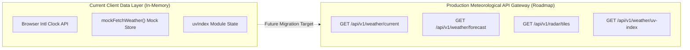
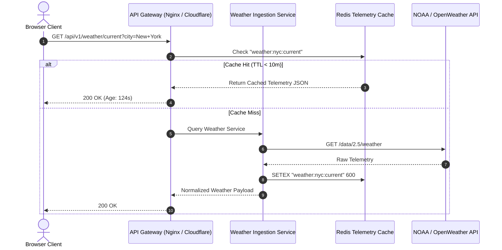

# 03. API & Network Reference (Current Client Contracts & Backend Expansion)



---

## 1. Current Client-Side Data Interfaces (Internal Contracts)

The application currently operates with high-performance in-memory mock datasets and native browser system APIs.

### Contract 1: `mockData.current` (Hero Weather Telemetry)

- **Source:** [abstract-forge/index.html:291-297](file:///Users/avishjain/avishjain9-repos/56-avishjain-weatherapp/abstract-forge/index.html#L291-L297)
- **Invocation:** Loaded synchronously on `DOMContentLoaded`.
- **Schema & Payload Example:**
```json
{
  "temp": 24,
  "condition": "Partly Cloudy",
  "high": 28,
  "low": 18
}
```
- **Validation Rules:**
  - `temp`: Number representing degrees Celsius.
  - `condition`: String (e.g. "Sunny", "Partly Cloudy", "Rain").
  - `high`, `low`: Numbers where `high >= low`.

---

### Contract 2: `mockData.forecast` (5-Day Outlook Array)

- **Source:** [abstract-forge/index.html:298-305](file:///Users/avishjain/avishjain9-repos/56-avishjain-weatherapp/abstract-forge/index.html#L298-L305)
- **Data Shape:**
```json
[
  { "day": "Thu", "temp": 25, "condition": "Sunny", "icon": "☀️", "color": "text-yellow-500" },
  { "day": "Fri", "temp": 26, "condition": "Clear", "icon": "✨", "color": "text-yellow-400" },
  { "day": "Sat", "temp": 21, "condition": "Rain", "icon": "🌧️", "color": "text-blue-400" },
  { "day": "Sun", "temp": 22, "condition": "Windy", "icon": "💨", "color": "text-gray-400" },
  { "day": "Mon", "temp": 24, "condition": "Cloudy", "icon": "☁️", "color": "text-gray-300" }
]
```

---

### Contract 3: `getUvRating(index)` (UV Health Risk Evaluation)

- **Source:** [abstract-forge/index.html:333-339](file:///Users/avishjain/avishjain9-repos/56-avishjain-weatherapp/abstract-forge/index.html#L333-L339)
- **Signature:** `(index: number) => { text: string, color: string }`
- **Output Matrix:**

| Input Score Range | Output `text` | Output `color` Class |
| :--- | :--- | :--- |
| $0 \le x \le 2$ | `"Low"` | `text-green-400` |
| $3 \le x \le 5$ | `"Moderate"` | `text-yellow-400` |
| $6 \le x \le 7$ | `"High"` | `text-orange-400` |
| $8 \le x \le 10$ | `"Very High"` | `text-red-400` |
| $x \ge 11$ | `"Extreme"` | `text-purple-400` |

---

## 2. External CDN & Remote Asset Dependencies

| Host Provider | Exact Asset URL | HTTP Method | Expected MIME | Caching Policy | Failure Mode |
| :--- | :--- | :--- | :--- | :--- | :--- |
| **Tailwind Labs** | `https://cdn.tailwindcss.com` | `GET` | `application/javascript` | CDN Edge 24h | Styling reverts to plain browser default |
| **CDNJS / Cloudflare** | `https://cdnjs.cloudflare.com/.../vanilla-tilt.min.js` | `GET` | `application/javascript` | Immutable / 1 year | 3D tilting disabled; card displays flat |
| **Placehold.co** | `https://placehold.co/1200x300/3b82f6/ffffff?text=Blue+Sky` | `GET` | `image/png` | Public Edge 7d | Text fill falls back to solid white |
| **Placehold.co** | `https://placehold.co/1000x500/171717/00ff00?text=RADAR+MAP` | `GET` | `image/png` | Public Edge 7d | Radar container shows broken image icon |
| **Placehold.co** | `https://placehold.co/800x1200/065f46/ffffff?text=RADAR+ZOOM` | `GET` | `image/png` | Public Edge 7d | Magnifying lens loupe displays empty frame |

---

## 3. Production Backend Expansion API Specification (Roadmap)

When transitioning Weather Hub from a client-only single page app to a distributed, full-stack microservice, the following RESTful endpoints are designed to replace internal mock routines:



### Endpoint 1: `GET /api/v1/weather/current`
- **Purpose:** Fetches live temperature, weather conditions, diurnal high/low, and wind speed.
- **Query Parameters:** `lat` (float), `lon` (float) OR `city` (string).
- **Success Response (200 OK):**
```json
{
  "status": "success",
  "data": {
    "location": "New York, USA",
    "timestamp": 1729837200,
    "temperature": 24.2,
    "feelsLike": 25.1,
    "high": 28.0,
    "low": 18.2,
    "condition": "Partly Cloudy",
    "humidity": 58,
    "windSpeed": 14.2
  }
}
```

### Endpoint 2: `GET /api/v1/weather/forecast`
- **Purpose:** Returns 5-day multi-day outlook array.
- **Success Response (200 OK):** Array of daily objects containing weekday, predicted condition, high/low spread, and precipitation probability.

### Endpoint 3: `GET /api/v1/weather/uv`
- **Purpose:** Fetches current solar radiation and max expected UV index for the current daylight cycle.
- **Success Response (200 OK):**
```json
{
  "status": "success",
  "data": {
    "uvIndex": 6.4,
    "tier": "High",
    "color": "#f97316",
    "protectionRecommended": true,
    "burnTimeMinutes": 25
  }
}
```
