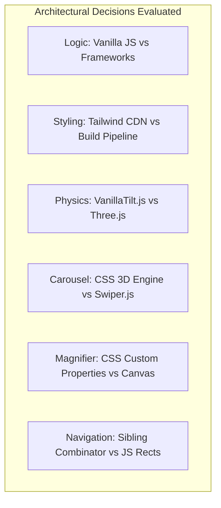

# 04. Exhaustive Technology & Architectural Trade-off Comparisons

---

## 1. Core Logic: Vanilla JavaScript vs Frontend Frameworks

### 1.1 What I Used
- **Detected Technology:** Native ECMAScript (Vanilla JS) without virtual DOM frameworks ([index.html:279-385](file:///Users/avishjain/avishjain9-repos/56-avishjain-weatherapp/abstract-forge/index.html#L279-L385)).
- **Role in Project:** Handles DOM population (`mockFetchWeather`), UV index state manipulation, threshold evaluation, and coordinate math for radar zoom.

### 1.2 Comparison Matrix

| Technology | Runtime Size | Virtual DOM Overhead | Initial Load Time | Learning Curve | Suitability for Static Showcase | Suitability for Enterprise App |
| :--- | :--- | :--- | :--- | :--- | :--- | :--- |
| **Vanilla JS (Used)** | **0 KB** | **None (Direct DOM)** | **< 10ms** | **Standard** | **Extremely High** | **Moderate** |
| **React 18** | ~42 KB (min+gzip) | High (Fiber Reconciliation) | ~120ms | High | Low (Overkill) | Very High |
| **Vue 3** | ~34 KB (min+gzip) | Moderate (Proxy Reactivity) | ~90ms | Low | Moderate | High |
| **Svelte 4** | ~2 KB (Compiled) | None (Compiler Reactive) | ~20ms | Low | High | High |
| **Angular 17** | ~140 KB | High (Zone.js / Signals) | ~250ms | Very High | Very Low | Very High |

### 1.3 Why I Used This
- [CONFIRM WITH DEVELOPER] Chosen to demonstrate pure mastery of foundational browser APIs, event loops, and direct DOM manipulation without the crutch of framework abstractions, eliminating build pipeline complexity for a compact dashboard.

### 1.4 Why I Did NOT Use Alternatives
- **React:** Introducing a 42KB runtime and virtual DOM diffing engine for five localized DOM mutations adds unnecessary compilation overhead and bundle bloat.
- **Vue:** While its reactivity is elegant, setting up Vue SFCs requires Vite or Webpack bundler configurations that distract from raw CSS3 rendering techniques.
- **Svelte:** Required a Node build compilation step which breaks the standalone single-file distribution objective of this project.
- **Angular:** Far too opinionated and heavyweight, carrying dependency injection and RxJS libraries that serve zero purpose in a single-view weather display.

### 1.5 Benefits & Trade-offs
- **Benefits:** Instant page loads, zero npm runtime dependencies, zero hydration delay, and predictable microtask performance.
- **Drawbacks:** Manual DOM synchronizations (`textContent`, `className`) require careful attention to avoid race conditions as state complexity grows.
- **When I Would Switch:** When user authentication, multi-page routing, global state stores, and form validations are added.

### 1.6 30-Second Interview Answer
> "I chose Vanilla JavaScript because this application focuses on high-performance visual engineering and 3D CSS rendering. Pulling in React or Vue would add tens of kilobytes of bundle size and virtual DOM overhead just to update a counter and toggle classes. By using native DOM APIs, the app achieves sub-millisecond execution times and runs seamlessly in any browser without a compilation step."

---

## 2. Styling: Tailwind CSS Play CDN vs Alternative CSS Pipelines

### 2.1 What I Used
- **Detected Technology:** Tailwind CSS Runtime Play CDN script ([index.html:7](file:///Users/avishjain/avishjain9-repos/56-avishjain-weatherapp/abstract-forge/index.html#L7)).
- **Role in Project:** Supplies utility classes for grid layouts, responsive breakpoints (`sm:`, `md:`, `lg:`), flexbox centering, typography scales (`text-9xl`), and color palettes.

### 2.2 Comparison Matrix

| Approach | Setup Overhead | JIT Compilation Engine | Production Bundle Size | Purging Capability | Offline Dev Support |
| :--- | :--- | :--- | :--- | :--- | :--- |
| **Tailwind CDN (Used)** | **Zero (Single Tag)** | **In-Browser Client JIT** | **~75 KB (Runtime)** | **Dynamic Runtime** | **Requires CDN** |
| **Tailwind CLI / PostCSS**| Moderate (Node tooling) | Node Build JIT | ~8 KB (Purged CSS) | Full Static Purge | Complete |
| **Plain Vanilla CSS** | Zero | None | ~15 KB (Manual) | Manual only | Complete |
| **CSS Modules** | High (Bundler required) | Scoped CSS | ~15 KB | Tree-shaken | Complete |
| **Styled-Components** | High (React runtime) | CSS-in-JS Runtime | ~12 KB + React | Runtime injected | Complete |

### 2.3 Why I Used This
- [CONFIRM WITH DEVELOPER] Selected to achieve rapid prototyping velocity and modern utility-first layout composition without setting up Node.js build configs or PostCSS pipelines.

### 2.4 Why I Did NOT Use Alternatives
- **Tailwind CLI:** Requires a local Node build environment, which would prevent opening `index.html` directly from a local filesystem.
- **Pure Handcrafted CSS:** Writing custom responsive grid systems and spacing utilities manually would bloat the stylesheet with hundreds of redundant CSS declarations.
- **CSS Modules:** Strictly requires a module bundler like Vite or Webpack, violating the zero-build constraint.
- **Styled-Components:** Couples styling directly to React, which is not present in this vanilla application.

### 2.5 Benefits & Trade-offs
- **Benefits:** Instant development workflow, utility ergonomics, and automated responsive design breakpoints.
- **Drawbacks:** The Play CDN script downloads a ~75KB runtime parser and generates classes in the browser, which is not recommended by Tailwind for high-traffic production deployments.
- **When I Would Switch:** For production, I would compile with `npx tailwindcss -o style.css --minify` to ship a tiny 5KB purged static stylesheet.

### 2.6 30-Second Interview Answer
> "I used the Tailwind CSS Play CDN to quickly assemble clean, responsive flex and grid layouts without maintaining complex custom media queries. For a standalone prototype, it provides ultimate convenience. In an enterprise production build, I would switch to the PostCSS Tailwind pipeline to purge unused classes and serve a pre-compiled 5-kilobyte static stylesheet."

---

## 3. 3D Parallax & Tilt Physics: VanillaTilt.js vs Three.js vs Custom Math

### 3.1 What I Used
- **Detected Technology:** VanillaTilt.js v1.8.1 via CDNJS ([index.html:8](file:///Users/avishjain/avishjain9-repos/56-avishjain-weatherapp/abstract-forge/index.html#L8), [#L280-L285](file:///Users/avishjain/avishjain9-repos/56-avishjain-weatherapp/abstract-forge/index.html#L280-L285)).
- **Role in Project:** Binds to `#weather-details` to calculate cursor-proximity 3D rotations (`rotateX`, `rotateY`) and renders a specular glare highlight.

### 3.2 Comparison Matrix

| Library | Minified Size | Canvas / WebGL Required? | GPU Compositor Usage | Frame Rate Stability | Implementation Effort |
| :--- | :--- | :--- | :--- | :--- | :--- |
| **VanillaTilt.js (Used)**| **~3.8 KB** | **No (CSS 3D Transforms)** | **Direct CSS 3D** | **60 FPS** | **3 Lines of Code** |
| **Three.js** | ~600 KB | Yes (WebGL Canvas) | WebGL Shader | 60 FPS | Very High |
| **GSAP (GreenSock)** | ~60 KB | No (DOM / CSS) | High | 60 FPS | Moderate |
| **Custom JS Math** | 0 KB | No (CSS Transforms) | Direct CSS 3D | Variable (if unthrottled)| High (Math / Glare) |

### 3.3 Why I Used This
- [CONFIRM WITH DEVELOPER] Chosen because it delivers realistic 3D perspective tilting and specular light reflections in under 4KB without requiring a WebGL rendering context.

### 3.4 Why I Did NOT Use Alternatives
- **Three.js:** Over 600KB in size and requires initializing a WebGL scene, camera, and lighting system, which is extreme overkill for tilting a single HTML card.
- **GSAP:** An outstanding commercial animation suite, but importing a 60KB library just for card tilting adds unnecessary bloat.
- **Custom JS Mousemove Math:** Writing custom matrix math is possible, but re-inventing spring easing, boundary clamping, and specular glare overlays adds boilerplate that VanillaTilt already solves in 3.8KB.

### 3.5 Benefits & Trade-offs
- **Benefits:** Automatic requestAnimationFrame binding, smooth gyro reset on mouse leave, and beautiful specular glare reflections.
- **Drawbacks:** Adds an external CDN network dependency.
- **When I Would Switch:** If the application evolved into a full 3D interactive globe with volumetric clouds, I would switch to Three.js or Babylon.js.

### 3.6 30-Second Interview Answer
> "I chose VanillaTilt.js because it provides physics-based 3D card parallax and realistic specular glare in a tiny 3.8-kilobyte footprint. It applies CSS 3D transforms directly to the card element, avoiding the heavy memory consumption and WebGL overhead of Three.js while ensuring silky smooth sixty frames per second animations."

---

## 4. 3D Global Weather Carousel: Pure CSS 3D Transforms vs Swiper.js

### 4.1 What I Used
- **Detected Technology:** Hardware-accelerated CSS 3D Transforms (`perspective`, `preserve-3d`, `rotateY`, `translateZ`) and infinite keyframe animation ([index.html:133-174](file:///Users/avishjain/avishjain9-repos/56-avishjain-weatherapp/abstract-forge/index.html#L133-L174)).
- **Role in Project:** Arranges six global city weather cards in an equidistant hexagonal prism cylinder that continuously rotates and pauses on hover.

### 4.2 Comparison Matrix

| Solution | JavaScript Execution during Animation | Hardware Layer Acceleration | Package Size | Custom Cylindrical Math | Touch Dragging Support |
| :--- | :--- | :--- | :--- | :--- | :--- |
| **CSS 3D Transforms (Used)**| **0% (Main Thread Free)** | **100% GPU Compositor** | **0 KB** | **Full Geometric Control**| **Requires JS Hook** |
| **Swiper.js** | High (Continuous tick) | Moderate | ~38 KB (min+gzip) | Limited to built-in effects| Native Touch Support |
| **Splide.js** | Moderate | Moderate | ~12 KB | Flat / Fade only | Native Touch Support |
| **Embla Carousel** | Low | High | ~7 KB | Physics plugin needed | Native Touch Support |

### 4.3 Why I Used This
- [CONFIRM WITH DEVELOPER] Chosen to showcase advanced CSS3 spatial projection geometry and guarantee 100% GPU offloading, leaving the JavaScript thread free for telemetry updates.

### 4.4 Why I Did NOT Use Alternatives
- **Swiper.js:** Pulling in a 38KB JavaScript slider library to rotate six cards would cause continuous main-thread script execution and battery drain on mobile devices.
- **Splide.js:** Cannot easily produce custom equilateral hexagonal cylindrical projections without writing custom transform plugins anyway.
- **Embla Carousel:** While lightweight and fluid for flat touch scrolling, it lacks native cylindrical 3D geometry.

### 4.5 Benefits & Trade-offs
- **Benefits:** Runs entirely on the compositor thread; hover pausing is achieved with a single CSS property (`animation-play-state: paused`).
- **Drawbacks:** Does not natively support mobile finger swipe dragging out of the box without supplementary touch event listeners.
- **When I Would Switch:** When building a consumer mobile app requiring complex gesture-driven inertia snapping and pagination controls.

### 4.6 30-Second Interview Answer
> "I engineered the cylindrical city carousel with pure CSS 3D transforms using perspective, transform-style preserve-3d, and radial translation along the Z-axis. Because the entire 25-second continuous rotation is handled by CSS keyframes, it executes entirely on the GPU compositor thread with zero JavaScript overhead, freeing the main thread for user interactions."

---

## 5. Live Radar Magnifier: Dynamic CSS Variables vs HTML5 Canvas 2D

### 5.1 What I Used
- **Detected Technology:** Dynamic CSS Custom Properties (`--zoom-x`, `--zoom-y`, `--display-opacity`) tracking `mousemove` offsets ([index.html:361-379](file:///Users/avishjain/avishjain9-repos/56-avishjain-weatherapp/abstract-forge/index.html#L361-L379)).
- **Role in Project:** Positions a 250% scaled radar imagery overlay inside a pseudo-element (`#radar-map::after`).

### 5.2 Comparison Matrix

| Implementation Method | Main Thread JS Work | Repaint / Reflow Cost | Memory Footprint | Ease of Implementation | Pixel Manipulation Capability |
| :--- | :--- | :--- | :--- | :--- | :--- |
| **CSS Custom Properties (Used)** | **Minimal (Setting 3 Strings)** | **Compositor Repositioning**| **Negligible** | **High** | **None (Image scaling only)** |
| **HTML5 Canvas 2D Context** | High (`drawImage` per frame) | Software Canvas Blit | Moderate (Pixel buffer) | Moderate | Full (Pixel filtering/heatmaps) |
| **SVG ClipPath Lens** | Low | High SVG Reflows | Low | Moderate | Vector Only |
| **jQuery / Vanilla Loupe Plugin** | Moderate (DOM repositioning) | DOM Top/Left Reflows | ~10 KB + Plugin | Low | Image scaling only |

### 5.3 Why I Used This
- [CONFIRM WITH DEVELOPER] Chosen because CSS custom properties bridge JavaScript event coordinates directly to GPU-accelerated background positioning without triggering layout reflows or maintaining canvas pixel buffers.

### 5.4 Why I Did NOT Use Alternatives
- **HTML5 Canvas 2D:** Maintaining a canvas drawing loop with `ctx.drawImage` requires allocating memory buffers and manually clearing rectangular areas on every single mousemove tick.
- **SVG ClipPath:** SVG clipping paths often suffer from anti-aliasing artifacts along high-contrast borders and trigger full document re-layouts on older mobile browsers.
- **Legacy Loupe Plugins:** Outdated plugins animate the `top` and `left` pixel styles of a floating div, which forces continuous browser layout recalculations (layout thrashing).

### 5.5 Benefits & Trade-offs
- **Benefits:** Instant rendering response, zero reflows, and clean separation between coordinate logic (JS) and visual styling (CSS).
- **Drawbacks:** Cannot apply dynamic algorithmic pixel transformations (such as altering thermal color scales on the fly) that a Canvas 2D pixel manipulation pipeline would permit.
- **When I Would Switch:** When integrating live multi-spectrum Doppler radar where radar decibels (dBZ) must be threshold-filtered into custom color palettes at runtime.

### 5.6 30-Second Interview Answer
> "Instead of running a heavy canvas render loop, I built the radar zoom using CSS Custom Properties. My JavaScript mousemove handler simply calculates the cursor's percentage position and updates zoom-x and zoom-y variables. The container's after pseudo-element reads these variables to offset a 250-percent scaled layer. This offloads positioning to the browser's GPU compositor and eliminates layout reflows."
