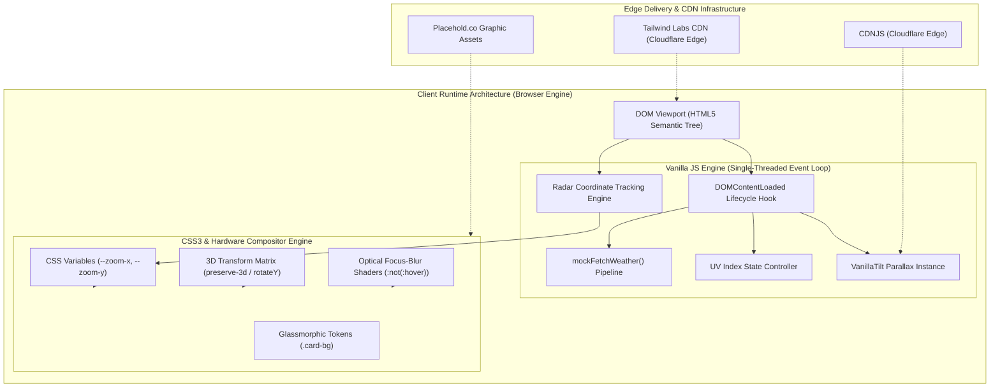
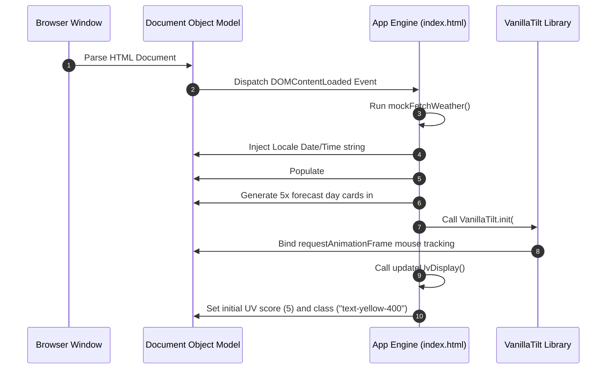
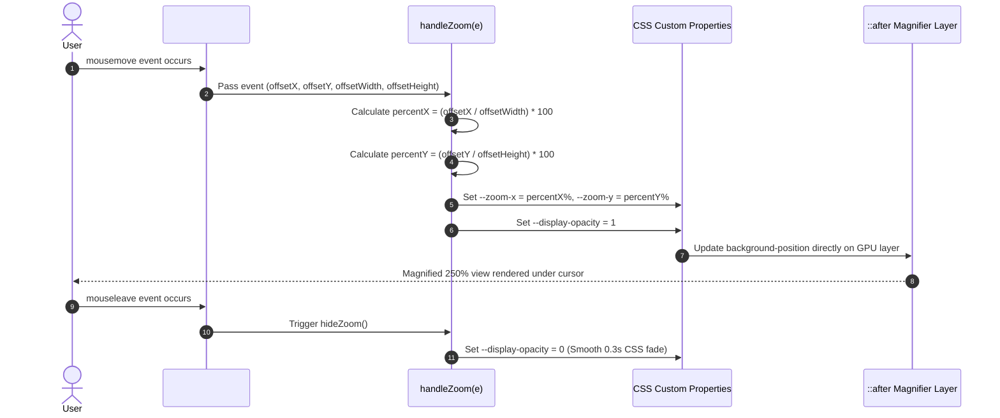
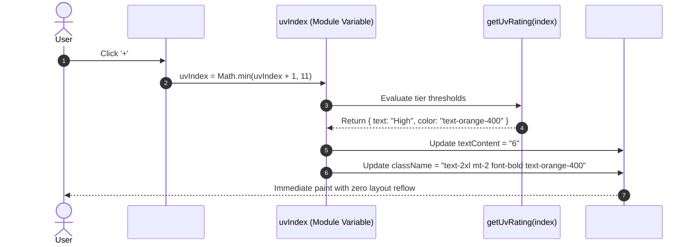
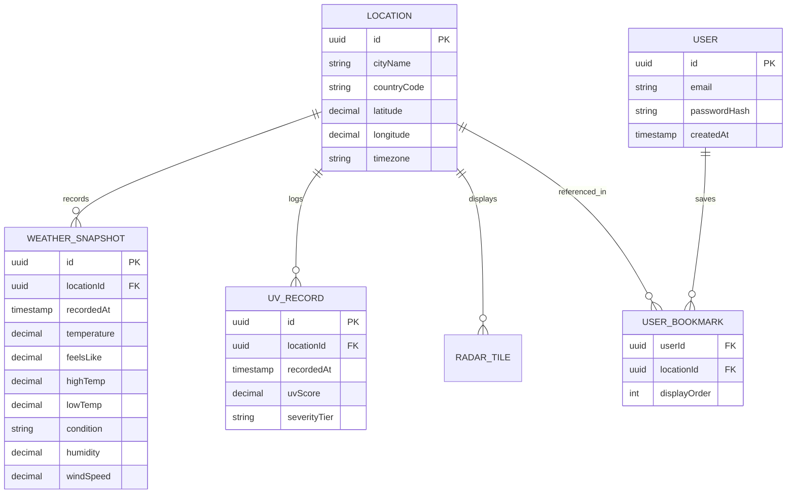
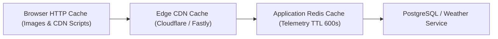

# 05. System Architecture, Data Lifecycle & Scaling Evolution

---

## 1. High-Level Architecture Overview

Weather Hub is engineered as an **Event-Driven Client-Side Single Page Application (SPA)**. It enforces a strict separation between:
1. **The Structural DOM Layer:** Clean semantic HTML5 elements structured into five intuitive sections (`#main-nav`, `#current`, `#forecast`, `#radar`, `#locations`).
2. **The Logic & State Controller Layer:** Vanilla ECMAScript running on the browser's native JavaScript V8/JavaScriptCore engine, managing localized state, date-time formatting, and event listener pipelines.
3. **The Hardware-Accelerated Presentation Layer:** Advanced CSS3 utilizing GPU-promoted composite layers, custom properties, and matrix transforms to handle complex animations with zero main-thread blocking.

---

## 2. End-to-End Request & Interaction Lifecycles

### Lifecycle 1: Page Mount & Data Hydration Cycle

---

### Lifecycle 2: Real-Time Radar Zoom Tracking

---

### Lifecycle 3: UV Index State Mutation Cycle

---

## 3. Database Schema Blueprint (Backend Expansion Roadmap)

While Weather Hub currently executes entirely client-side with mock data, scaling to a multi-user production system requires a relational or time-series data layer.

### Entity Relationship Diagram

---

## 4. Caching & Invalidation Architecture

1. **Client Browser Cache:**
   - Static assets (`vanilla-tilt.min.js`, Tailwind script, graphics) cached with `Cache-Control: public, max-age=31536000, immutable`.
2. **Edge CDN Layer:**
   - Caches HTML and edge-rendered weather summaries with a 60-second Stale-While-Revalidate (SWR) window.
3. **Redis Telemetry Cache (Production Roadmap):**
   - In-memory key-value store caching live meteorological API responses with 10-minute TTL (`weather:{city_id}:current`), protecting external vendor API rate limits.

---

## 5. Scaling to 100x Traffic: Bottlenecks & Remedies

| Bottleneck Stage | Identified Vulnerability | Architectural Remedy |
| :--- | :--- | :--- |
| **1. CDN Rate Limiting & Bandwidth** | Play CDN (`cdn.tailwindcss.com`) compiling CSS in hundreds of thousands of client browsers | Pre-compile Tailwind CSS at build time into a minified 5KB static stylesheet served via multi-region CDN (Cloudflare). |
| **2. Third-Party Placeholder Failures** | Remote image links on `placehold.co` rate-limiting or going offline under heavy load | Host optimized WebP/SVG weather icons and radar raster graphics directly on an AWS S3 bucket fronted by CloudFront. |
| **3. Upstream Weather API Quotas** | Direct client-to-API calls exhausting 60 req/min free tier limits on live APIs | Introduce an Edge API Gateway with Redis caching and batching: fetch weather once per city every 10 minutes and broadcast to millions of users. |
