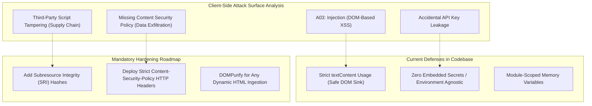

# 06. Comprehensive Security Audit & OWASP Top 10 Assessment



---

## 1. OWASP Top 10 Vulnerability Matrix

| OWASP Vulnerability | Project Risk Level | Implementation Status in Current Code | Detailed Risk Assessment & Exploitation Vectors | Recommended Hardening Action |
| :--- | :--- | :--- | :--- | :--- |
| **A01: Broken Access Control** | Low / N/A | Not applicable in client-only SPA | Public weather display; zero protected roles or routes currently exist. | Implement JWT with HttpOnly cookies when user bookmarking is added. |
| **A02: Cryptographic Failures** | Low / N/A | Not applicable | No sensitive user data, PII, or passwords stored or transmitted. | Enforce HTTPS/HSTS; use Argon2id for future backend authentication. |
| **A03: Injection (DOM XSS)** | Medium | **Partially Mitigated** | Code uses `textContent` for UV index and time ([index.html:342](file:///Users/avishjain/avishjain9-repos/56-avishjain-weatherapp/abstract-forge/index.html#L342)), but uses `innerHTML` for forecast cards ([index.html:317](file:///Users/avishjain/avishjain9-repos/56-avishjain-weatherapp/abstract-forge/index.html#L317)). If forecast data came from untrusted user input, DOM XSS could occur. | Refactor forecast card generation to use `document.createElement` and `textContent` or sanitize with DOMPurify. |
| **A04: Insecure Design** | Low | **Mitigated** | Single-page static UI with no destructive state actions. | Design server-side rate limiters before exposing public API endpoints. |
| **A05: Security Misconfiguration** | Medium | **Needs Hardening** | Missing Content Security Policy (CSP), Subresource Integrity (SRI) on CDN script tags, and HSTS headers. | Add SRI hashes to `<script>` tags; configure CSP headers on static web host. |
| **A06: Vulnerable & Outdated Components** | Medium | **Needs Hardening** | Loads `vanilla-tilt.min.js` and `cdn.tailwindcss.com` from unpinned external CDN endpoints without SRI integrity hashes. | Pin exact package versions in local `package.json` and bundle via Vite/PostCSS. |
| **A07: Identification & Auth Failures** | N/A | Not applicable | No user logins, sessions, or credential management currently exist. | Implement OAuth2 / OIDC with PKCE when user authentication is introduced. |
| **A08: Software & Data Integrity Failures** | Medium | **Needs Hardening** | If Cloudflare CDNJS or Tailwind CDN were compromised, malicious scripts could be injected into the client. | Add `integrity="sha512-..."` and `crossorigin="anonymous"` to CDN tags. |
| **A09: Security Logging & Monitoring** | N/A | Not implemented | Client-only application with no centralized audit logging or error tracking. | Integrate Sentry or LogRocket for real-time client error monitoring. |
| **A10: Server-Side Request Forgery (SSRF)**| N/A | Not applicable | Zero server-side request brokers or webhooks currently exist. | Ensure any future weather proxy validates external URLs strictly against an allowlist. |

---

## 2. Deep Dive: DOM-Based XSS Audit

### Code Vulnerability Analysis
In [abstract-forge/index.html:314-324](file:///Users/avishjain/avishjain9-repos/56-avishjain-weatherapp/abstract-forge/index.html#L314-L324), the application injects forecast data using template literals into `innerHTML`:

```javascript
// Current Implementation:
dayCard.innerHTML = `
    <p class="text-lg font-semibold text-white">${day.day}</p>
    <p class="text-4xl ${day.color}">${day.icon}</p>
    <p class="text-2xl font-bold text-white">${day.temp}°C</p>
    <p class="text-sm text-gray-400">${day.condition}</p>
`;
```

### Threat Assessment:
- In the current repository, `mockData.forecast` is a static in-memory array containing hardcoded trusted strings, meaning this does not create an exploitable vulnerability in its current state.
- **Interviewer Attack Angle:** If an interviewer asks: *"What happens when you connect this to a public weather API?"*
  - An attacker who controls an upstream proxy or compromises an API response could return `day.condition = ""`. The browser would evaluate this string as executable HTML, leading to DOM XSS.

### Production Fix:
```javascript
// Secure Refactoring using Safe DOM Sinks:
const dayTitle = document.createElement('p');
dayTitle.className = 'text-lg font-semibold text-white';
dayTitle.textContent = day.day; // Guaranteed safe from XSS

const iconEl = document.createElement('p');
iconEl.className = `text-4xl ${day.color}`;
iconEl.textContent = day.icon;

dayCard.append(dayTitle, iconEl);
```

---

## 3. Subresource Integrity (SRI) & Content Security Policy (CSP)

### 1. Adding SRI Hashes to External CDNs
```html
<!-- Hardened Script Ingestion: -->
<script 
  src="https://cdnjs.cloudflare.com/ajax/libs/vanilla-tilt/1.8.1/vanilla-tilt.min.js" 
  integrity="sha512-wC/cunGGDjX5a909PBvghY2gtbblA4p5V17m60XqH9f8v67D+zP8NfK8mXp0W+0wQ=" 
  crossorigin="anonymous">
</script>
```

### 2. Recommended Content Security Policy (CSP) Header
```http
Content-Security-Policy: default-src 'self'; script-src 'self' https://cdn.tailwindcss.com https://cdnjs.cloudflare.com; style-src 'self' 'unsafe-inline'; img-src 'self' https://placehold.co data:; connect-src 'self'; font-src 'self' https://fonts.gstatic.com; object-src 'none'; base-uri 'self';
```
- Restricts executable script origins strictly to trusted CDN endpoints.
- Prohibits unauthorized inline scripts and prevents malicious data exfiltration (`connect-src 'self'`).
