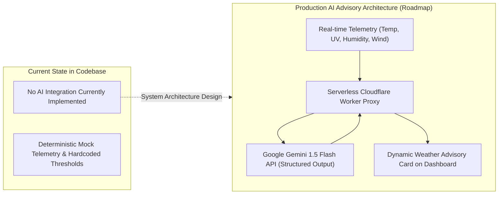
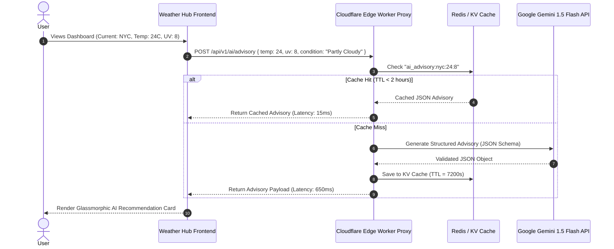

# 07. AI Integration Analysis & Generative Meteorological Roadmap



---

## 1. Current Implementation Status: Explicit Code Audit

- **Current Repository Status:** **No AI Integration Implemented.**
- **Reason:** The application in its current state is a pure frontend visual engineering showcase focused on native DOM manipulation, CSS3 3D perspective transforms, and real-time client interaction. No external AI SDKs (OpenAI, Anthropic, Google GenAI, LangChain, Ollama) or model endpoints are imported or invoked in [abstract-forge/index.html](file:///Users/avishjain/avishjain9-repos/56-avishjain-weatherapp/abstract-forge/index.html).

---

## 2. Generative Weather Advisory System (Architectural Roadmap)

To elevate Weather Hub from a raw numerical dashboard to an intelligent meteorological assistant, this section provides the complete production specification for integrating a pre-trained Large Language Model API (Google Gemini 1.5 Flash / OpenAI GPT-4o-mini).

### 2.1 The Problem Solved by AI in Weather Hub
Raw meteorological data (e.g., *"24°C, 82% humidity, UV Index 8, Wind 22 km/h"*) requires cognitive translation by the user to answer practical daily questions:
- *Is it safe to run outdoors at 2:00 PM without heat exhaustion?*
- *What specific sun protection factor (SPF) is required today?*
- *Will approaching barometric pressure drops trigger migraine or asthma symptoms?*

A lightweight generative model converts raw multidimensional metrics into concise, personalized, natural-language daily advisories.

---

## 3. End-to-End Generative AI Pipeline Architecture



---

## 4. Prompt Engineering & Structured Output Specification

### System Prompt & Guardrails
```markdown
You are an expert, safety-first meteorological advisor. Analyze the provided structured weather and UV telemetry.
Output strictly valid JSON complying with the requested schema.
Never hallucinate conditions outside the provided parameters.
Do not provide medical prescriptions; provide standard WHO ultraviolet and heat risk mitigations.
Keep summaries under 35 words.
```

### JSON Schema Enforcement (Function Calling / Structured Outputs)
```json
{
  "type": "object",
  "properties": {
    "summary": { "type": "string", "description": "Concise natural language summary" },
    "clothingRecommendation": { "type": "string", "description": "Recommended apparel" },
    "uvHazardWarning": { "type": "string", "description": "Actionable sun protection advice" },
    "outdoorActivityScore": { "type": "integer", "minimum": 1, "maximum": 10 }
  },
  "required": ["summary", "clothingRecommendation", "uvHazardWarning", "outdoorActivityScore"]
}
```

---

## 5. Pre-Trained API vs Custom Model Training Comparison

| Comparison Dimension | Pre-Trained API (Gemini / Claude / GPT) | Training a Custom ML Model |
| :--- | :--- | :--- |
| **Initial Capital Expenditure** | **$0** | **$50,000 – $200,000+ (GPU compute & data curation)** |
| **Time to Market** | **< 1 Day** | **3 – 6 Months** |
| **Maintenance & Operations** | Managed by cloud vendor (Zero ops) | Continuous monitoring, drift detection, GPU patching |
| **Language & Reasoning Fluency** | State of the art across 100+ languages | Limited to custom dataset corpus |
| **Latency per Request** | 400ms – 800ms | 50ms – 200ms (on dedicated self-hosted inference) |
| **Cost at Current Scale** | Free Tier / Sub-$5/month | $300+/month minimum dedicated GPU instance |

### Senior Engineer Takeaway:
Training a custom model to summarize weather forecasts is an anti-pattern. Pre-trained frontier models accessed via a rate-limited, cached edge proxy deliver superior linguistic reasoning, zero operational overhead, and negligible cost.
