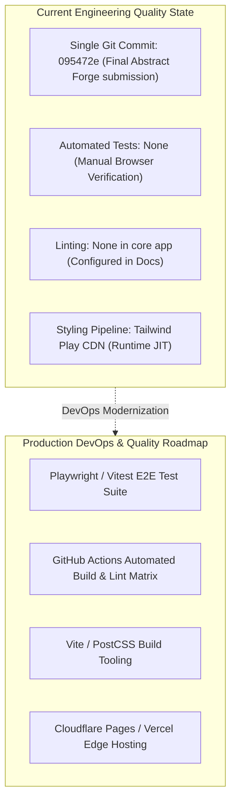

# 08. Engineering Quality, DevOps, CI/CD & Operational Audit



---

## 1. Testing Pyramid Analysis: Present vs Missing

| Testing Tier | Current Status | Coverage Assessment | Recommended Tooling & Test Strategy |
| :--- | :--- | :--- | :--- |
| **Unit Testing** | **0% (Missing)** | Core functions (`getUvRating`, `handleZoom`) are currently untested in automated pipelines. | **Vitest:** Unit test `getUvRating(index)` across all boundary conditions ($0, 2, 3, 5, 6, 7, 8, 10, 11$). |
| **Integration Testing** | **0% (Missing)** | DOM event listener attachments and state synchronization are unverified. | **DOM Testing Library / JSDOM:** Simulate button clicks and assert DOM text and class mutations. |
| **End-to-End (E2E) Testing**| **0% (Missing)** | User interactions (hovering radar, checking forecast blur) rely on manual testing. | **Playwright:** Automate browser sessions, verify 3D tilt transformations and radar zoom opacity. |
| **Visual Regression Testing**| **0% (Missing)** | Glassmorphism rendering and 3D carousel alignment are not snapshot-tested. | **Playwright Visual Comparisons:** Capture screenshot diffs on mobile and desktop viewports. |

### Unit Test Blueprint for `getUvRating`:
```javascript
// tests/uvRating.test.js
import { describe, it, expect } from 'vitest';
import { getUvRating } from '../src/utils.js';

describe('UV Rating Threshold Evaluator', () => {
    it('correctly maps Low risk tier (0 to 2)', () => {
        expect(getUvRating(0)).toEqual({ text: "Low", color: "text-green-400" });
        expect(getUvRating(2)).toEqual({ text: "Low", color: "text-green-400" });
    });
    it('correctly maps Moderate risk tier (3 to 5)', () => {
        expect(getUvRating(5)).toEqual({ text: "Moderate", color: "text-yellow-400" });
    });
    it('correctly clamps Extreme risk tier (11+)', () => {
        expect(getUvRating(11)).toEqual({ text: "Extreme", color: "text-purple-400" });
        expect(getUvRating(15)).toEqual({ text: "Extreme", color: "text-purple-400" });
    });
});
```

---

## 2. Git Workflow & Version Control Evidence

### Repository Commit Log Audit:
```bash
$ git log --oneline
095472e (HEAD -> main, origin/main, origin/HEAD) Final Abstract Forge submission
```
- **Analysis:** The repository consists of a single squash commit representing the finalized contest/project deliverable.
- **Evaluation:** Common for hackathon sprints and take-home submissions.
- **Production Standard:** An enterprise engineering environment requires feature branching (`feat/radar-magnifier`), conventional commits (`feat: add UV index clamping logic`), and pull request reviews with automated CI checks.

---

## 3. Performance Bottlenecks & Optimization Audit

### Bottleneck 1: Unthrottled `mousemove` Event Listener
- **File & Line:** [abstract-forge/index.html:378](file:///Users/avishjain/avishjain9-repos/56-avishjain-weatherapp/abstract-forge/index.html#L378)
- **Problem:** `radarzoom.addEventListener('mousemove', handleZoom)` fires at the native polling rate of the user's pointing device (often 120Hz to 1000Hz on gaming mice), updating CSS custom properties far faster than the browser's 60Hz/120Hz screen refresh rate.
- **Remedy:** Wrap `handleZoom` in `requestAnimationFrame` to decouple coordinate updates from the mouse polling rate:

```javascript
let ticking = false;
const handleZoomThrottled = (event) => {
    if (!ticking) {
        window.requestAnimationFrame(() => {
            handleZoom(event);
            ticking = false;
        });
        ticking = true;
    }
};
radarzoom.addEventListener('mousemove', handleZoomThrottled);
```

### Bottleneck 2: Tailwind Play CDN in Production
- **Problem:** `<script src="https://cdn.tailwindcss.com"></script>` downloads the full Tailwind runtime compiler, scanning the DOM dynamically. This increases initial First Contentful Paint (FCP) and causes a noticeable flash of unstyled content (FOUC).
- **Remedy:** Compile styles ahead of time into a static `dist/style.css` using the Tailwind CLI.

---

## 4. Production CI/CD Pipeline Blueprint (GitHub Actions)

```yaml
# .github/workflows/deploy.yml
name: Build & Deploy Documentation & Weather Hub

on:
  push:
    branches: [main]
  pull_request:
    branches: [main]

jobs:
  validate:
    runs-on: ubuntu-latest
    steps:
      - uses: actions/checkout@v4
      - uses: actions/setup-node@v4
        with:
          node-version: 22
          cache: 'npm'
      - run: npm ci
      - run: npm run test:unit --if-present
      - run: npm run docs:build
      - name: Deploy to Cloudflare Pages / GitHub Pages
        if: github.ref == 'refs/heads/main'
        uses: peaceiris/actions-gh-pages@v3
        with:
          github_token: ${{ secrets.GITHUB_TOKEN }}
          publish_dir: ./docs/.vitepress/dist
```
