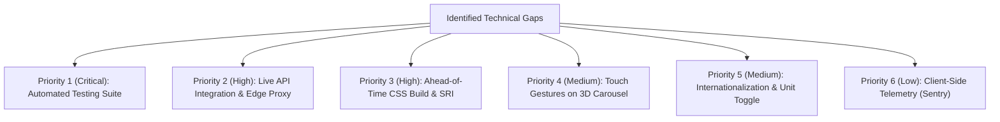

# 10. Prioritized Engineering Gaps & Architectural Roadmap



---

## 1. Prioritized Technical Debt & Gap Analysis

| Rank | Gap Area | Severity / Impact | Current State in Code | Architectural Fix & Implementation Strategy |
| :--- | :--- | :--- | :--- | :--- |
| **1** | **Automated Testing Suite** | **High** | Zero automated unit, integration, or E2E tests exist. | Setup **Vitest** for threshold logic (`getUvRating`) and **Playwright** for visual regression and E2E DOM interaction tests. |
| **2** | **Live API Telemetry Integration** | **High** | Hardcoded mock data in `mockFetchWeather()`. | Integrate OpenWeatherMap or WeatherAPI via a serverless edge worker (Cloudflare Worker) with Redis caching. |
| **3** | **Production CSS Pipeline & SRI** | **Medium** | Tailwind Play CDN runtime and unhashed script tags. | Switch to PostCSS / Tailwind CLI to emit a minified 5KB stylesheet; add Subresource Integrity (SRI) hashes. |
| **4** | **Touch Gesture Carousel Support** | **Medium** | 3D carousel only rotates via CSS keyframes and pauses on mouse hover. | Attach `touchstart`, `touchmove`, and `touchend` listeners to compute rotational delta offsets on mobile screens. |
| **5** | **Temperature Unit Toggle (°C / °F)** | **Medium** | Hardcoded to Celsius (°C). | Add state toggle button with mathematical converter function $(F = C \times 9/5 + 32)$ and `localStorage` persistence. |
| **6** | **Client Telemetry & Monitoring** | **Low** | No error tracking or crash reporting. | Integrate Sentry browser SDK to capture unhandled client exceptions and track Core Web Vitals in real-time. |

---

## 2. Detailed Technical Fix Specifications

### Fix 1: Vitest Unit Testing Implementation
```javascript
// tests/uvRating.test.js
import { describe, it, expect } from 'vitest';

function getUvRating(index) {
    if (index <= 2) return { text: "Low", color: "text-green-400" };
    if (index <= 5) return { text: "Moderate", color: "text-yellow-400" };
    if (index <= 7) return { text: "High", color: "text-orange-400" };
    if (index <= 10) return { text: "Very High", color: "text-red-400" };
    return { text: "Extreme", color: "text-purple-400" };
}

describe('UV Rating Threshold Evaluator', () => {
    it('correctly maps Low risk tier (0 to 2)', () => {
        expect(getUvRating(0).text).toBe('Low');
        expect(getUvRating(2).text).toBe('Low');
    });
    it('correctly maps Extreme risk tier (11+)', () => {
        expect(getUvRating(11).text).toBe('Extreme');
        expect(getUvRating(15).text).toBe('Extreme');
    });
});
```

### Fix 2: Temperature Converter & Persistence
```javascript
let currentUnit = localStorage.getItem('weather_unit') || 'C';

function convertTemp(tempC, targetUnit) {
    if (targetUnit === 'F') {
        return Math.round((tempC * 9/5) + 32);
    }
    return tempC;
}

function toggleUnit() {
    currentUnit = currentUnit === 'C' ? 'F' : 'C';
    localStorage.setItem('weather_unit', currentUnit);
    mockFetchWeather(); // Re-render with converted values
}
```
