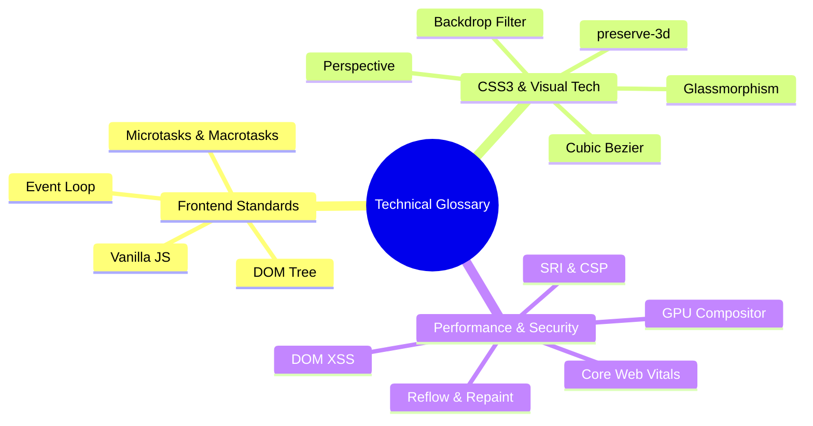

# 11. Comprehensive Technical Glossary

---

## Technical Definitions & Architectural Terms

### A–D
- **Apothem:** In geometry, the shortest distance from the center of a regular polygon to any of its sides. In our 3D carousel, it represents the radial Z-axis translation (`translateZ(300px)`).
- **Backdrop-Filter:** A CSS property that applies graphical filters (such as blurring or color shifting) to the area immediately *behind* an element, creating the frosted-glass glassmorphism effect without blurring the element's own text.
- **BoundingClientRect:** A browser API method returning the size and position of an element relative to the viewport.
- **Compositing:** The final stage of the browser rendering pipeline where independent layers rasterized by the GPU are combined and drawn onto the physical screen buffer.
- **CSS Custom Properties (CSS Variables):** Dynamic entities defined with the `--prefix` syntax (e.g. `--zoom-x`) that can be read by CSS rules and updated in real-time by JavaScript using `style.setProperty()`.
- **Cubic-Bezier:** A parametric curve defined by four control points used in CSS transitions (`cubic-bezier(P1x, P1y, P2x, P2y)`) to model realistic physical acceleration, deceleration, and elastic spring bounces.
- **Cumulative Layout Shift (CLS):** A Core Web Vital that quantifies the unexpected visual displacement of visible elements during page loading.
- **DOM-Based XSS:** A client-side security vulnerability where an application reads untrusted data from a source and writes it into an execution sink (like `innerHTML`), allowing malicious script injection.

### E–L
- **Event Loop:** The runtime coordination mechanism in browser JavaScript engines that continuously monitors the Call Stack, Microtask Queue, and Task Queue to process user interactions and asynchronous tasks without blocking.
- **First Contentful Paint (FCP):** The time from navigation until the browser renders the first piece of DOM content (text, image, SVG).
- **General Sibling Combinator (`~`):** A CSS selector combinator that matches all sibling elements that share the same parent and appear *after* a specified element in HTML markup.
- **Glassmorphism:** A modern UI aesthetic characterized by semi-transparency, soft frosted background blurs, subtle translucent light borders, and deep floating drop shadows.
- **Interaction to Next Paint (INP):** A Core Web Vital measuring user interface responsiveness by tracking the latency of all click, tap, and keyboard interactions throughout the entire page lifecycle.
- **Largest Contentful Paint (LCP):** A Core Web Vital measuring loading performance by tracking the render time of the largest image or text block visible in the initial viewport.

### M–Z
- **Optical Depth-of-Field:** A visual rendering technique that mimics a camera lens by blurring and desaturating non-focal background elements while keeping the focused element sharp and vibrant.
- **Perspective:** A CSS property defining how far the 3D canvas is positioned from the viewer's eye. Smaller values intensify spatial depth distortion; larger values create subtle perspective.
- **Preserve-3D:** A value for `transform-style` instructing the browser to position children in a shared three-dimensional spatial coordinate system rather than flattening them onto the parent's 2D plane.
- **Reflow (Layout):** The computationally expensive browser phase where the geometric dimensions and coordinate positions of elements are calculated.
- **Repaint (Paint):** The browser phase where visual pixels (colors, borders, shadows) are filled in after layout calculations.
- **Specular Glare:** An optical simulation of intense, localized light reflection off a smooth, shiny surface (such as glass or polished metal) that tracks the viewing angle.
- **Subresource Integrity (SRI):** A security mechanism allowing browsers to verify that files fetched from third-party CDNs have not been modified or compromised by checking cryptographic sha384/sha512 hashes.
- **Tailwind Play CDN:** A browser-based JIT script provided by Tailwind Labs that parses HTML class attributes in the client and generates corresponding utility styles on the fly.
- **Vanilla JavaScript:** Native ECMAScript executed directly in the browser without intermediate compilation, virtual DOM diffing libraries, or third-party framework runtimes.
- **VanillaTilt.js:** A lightweight JavaScript library that hooks into mouse events and calculates physical 3D parallax tilt matrices and glare reflections using `requestAnimationFrame`.
