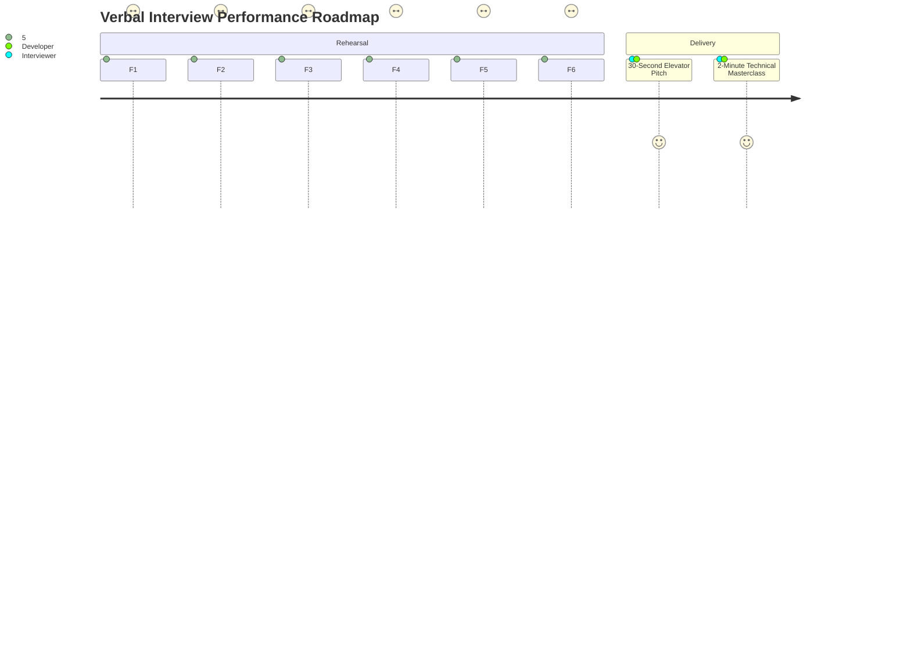

# 14. Say It Out Loud: Master Interview Rehearsal Scripts

This page brings together every feature's spoken interview script in exact verbal sequence. Read these aloud without looking at code to prepare for high-pressure technical interviews.

---

## 30-Second Project Overview Script
> "I built Weather Hub, a high-performance meteorological web dashboard engineered with Vanilla JavaScript, HTML5, and advanced modern CSS3. Instead of relying on heavy frontend frameworks for basic interactivity, I demonstrated how native browser capabilities—like CSS 3D perspective transforms, hardware-accelerated cylindrical carousels, dynamic lens magnification via CSS custom properties, and glassmorphism—can deliver an ultra-responsive, zero-runtime-overhead user experience. The app features interactive UV index tracking with real-time severity classification, an optical focus-blur 5-day forecast, and physical 3D card tilt physics. It shows my deep mastery of DOM lifecycles, CSS rendering pipelines, and visual engineering."

---

## 2-Minute Full Project Technical Script
> "In many modern web projects, developers default to pulling in heavy frameworks like React or large animation packages just to build interactive dashboard components. For Weather Hub, I wanted to step back and prove how far you can push native browser APIs and cutting-edge CSS3 to build a production-grade, highly engaging meteorological interface with virtually zero bundle bloat and sub-millisecond execution times.
>
> The project solves the visual monotony of traditional weather apps through five key architectural features:
>
> First, for the primary hero weather card, I integrated 3D gyroscope physics using VanillaTilt, which calculates cursor proximity and applies dynamic perspective rotations and specular glare on the fly. 
> 
> Second, I built an interactive UV Index monitoring engine. It maintains state in vanilla JavaScript and uses a functional evaluation algorithm to dynamically re-classify ultraviolet radiation risks into five clinical tiers—from Low to Extreme—instantly synchronizing the DOM text and Tailwind color tokens without unnecessary re-renders.
> 
> Third, I implemented an optical depth-of-field 5-day forecast grid. Using the CSS `:not(:hover)` pseudoclass, hovering over any single day scales that card forward while applying a 3-pixel Gaussian blur and grayscale filter to its sibling cards, directing user focus effortlessly.
> 
> Fourth, I developed a dual-layer Live Radar zoom magnifier. Instead of spinning up a heavyweight canvas rendering loop, I bound a mousemove listener that computes relative cursor percentages and pipes them directly into CSS Custom Properties: `--zoom-x`, `--zoom-y`, and `--display-opacity`. A hardware-accelerated pseudo-element reads these variables to position a 250% magnified radar layer smoothly at 60 frames per second.
> 
> Finally, I engineered a revolving 3D global weather carousel. Using pure CSS cylindrical projection mathematics, each city card is rotated by 60 degrees along the Y-axis and translated 300 pixels forward in 3D space, running an infinite linear keyframe loop that automatically pauses when hovered.
> 
> By keeping the core application framework-free, the entire interface loads instantly, eliminates virtual DOM reconciliation costs, and demonstrates how a deep understanding of browser rendering engines, composite layers, and clean DOM manipulation leads to exceptional user experiences."

---

## Feature F1: Hero Current Weather Card (3D Tilt & Localized Timestamp)

### Spoken Interview Script:
> "I built the Hero Current Weather card to serve as the visual and informative focal point of the dashboard. When a user lands on the page, they immediately see their location, localized date and time, current temperature, and daily high and low range. To make the interface feel tactile and alive rather than flat and static, I added real-time 3D gyroscope physics using VanillaTilt. When you move your mouse across the card, it tracks your cursor coordinates and calculates hardware-accelerated 3D rotations on the fly, complete with a specular glare effect that mimics light bouncing off real glass. I chose VanillaTilt instead of building a heavy Three.js canvas or custom WebGL shader because it weighs less than four kilobytes and hooks directly into requestAnimationFrame, giving us sixty frames per second performance with virtually zero CPU overhead. If the external CDN library fails to load over a poor network, the card gracefully falls back to a clean two-dimensional glassmorphic container without throwing errors or breaking page layout. One current limitation is that it displays hardcoded mock data for New York; my immediate next step is connecting this to a live geolocation API and an OpenWeatherMap endpoint to fetch actual local telemetry."

---

## Feature F2: Interactive UV Index Tracker (Dynamic Severity Tiering)

### Spoken Interview Script:
> "I engineered the Interactive UV Index Tracker to give users an immediate, color-coded assessment of sun exposure risk and sunburn hazard. The user sees a large digital readout of the current UV score along with an intuitive health rating and color badge. They can interact directly with increment and decrement buttons to test different atmospheric conditions. Under the hood, I maintain the state in a clean, isolated JavaScript variable and pass it through a pure evaluation function that maps the numeric score to five distinct clinical tiers, ranging from Low in green all the way to Extreme in purple. When a button is clicked, I clamp the value strictly between zero and eleven using standard Math min and max methods, then immediately update the DOM text and Tailwind utility classes without triggering unnecessary layout thrashing. I decided to build this with vanilla JavaScript instead of pulling in an external state management library or React because the state is localized and direct DOM manipulation here executes in less than a millisecond. If a user rapidly spam-clicks either button, the clamping logic guarantees the state can never exceed valid boundary limits or produce an invalid rating. A natural enhancement would be connecting this directly to solar noon UV forecast feeds and adding recommended protective actions like sunscreen warnings."

---

## Feature F3: 5-Day Forecast Grid (Focus-Blur Depth of Field)

### Spoken Interview Script:
> "I designed the 5-Day Forecast Grid to present weekly weather trends with an intuitive visual depth effect that guides the user's attention. As you scan across the five daily outlook cards, hovering over any specific day slightly lifts that card and adds a vibrant blue glow, while all other sibling cards instantly blur by three pixels and turn grayscale. I implemented this entire optical focus effect using modern pure CSS, specifically the parent hover combined with the not-hover pseudo-selector. In JavaScript, my mock fetch function iterates over the forecast array and dynamically generates the card elements with weather icons and temperature spreads, injecting them cleanly into the DOM container on page load. I chose this CSS-driven approach over JavaScript-driven mouseenter listeners because CSS filters run directly on the browser's GPU compositor thread, guaranteeing silky smooth sixty frames per second transitions without garbage collection pauses. If the data pipeline ever returns an empty forecast array, the container simply renders clean empty space without crashing. Right now the data is static mock JSON, and my plan is to replace it with real multi-day meteorological forecasts mapped to dynamic weather iconography and precipitation percentages."

---

## Feature F4: Live Radar Zoom & Magnifier (Dynamic CSS Variables)

### Spoken Interview Script:
> "I built the Live Radar Zoom feature to allow users to inspect storm fronts and precipitation cells with precision. When you move your cursor over the radar map, a high-resolution magnified lens smoothly appears and follows your cursor wherever you move, then gracefully disappears when your mouse leaves the map container. Instead of relying on a heavy canvas drawing loop or complex third-party mapping libraries, I engineered this using a combination of lightweight vanilla event listeners and dynamic CSS Custom Properties. My mousemove handler calculates the exact percentage position of the cursor relative to the container's offset width and height, then injects those percentages directly into two CSS custom properties called zoom-x and zoom-y, while setting display opacity to one. The container's after pseudo-element carries the magnified radar image at two hundred and fifty percent scale, binding its background position directly to those CSS variables with pointer events set to none so it never interrupts the mouse stream. I chose this architecture because offloading the image scaling and positioning to the CSS compositor completely eliminates layout reflows and keeps the animation perfectly locked at sixty frames per second. If an image fails to load, the base container maintains its bordered frame cleanly. As an improvement, I would love to replace the static graphic with a live tiled radar stream from the National Weather Service or RainViewer API."

---

## Feature F5: 3D Cylindrical Global Weather Carousel (Spatial Projection Math)

### Spoken Interview Script:
> "I engineered the 3D Global Weather Carousel to give the dashboard an eye-catching, three-dimensional visualization of international temperatures. The carousel automatically rotates six major global cities through three-dimensional space like a revolving cylinder, and as soon as you hover your mouse over it, the animation instantly freezes in place so you can read the temperature and conditions comfortably. The architecture behind this is pure mathematical CSS3. I wrapped the carousel in a container with a one-thousand-pixel perspective, set transform-style to preserve-3d on the inner track, and used custom properties to calculate the geometry. With six cards, each card is rotated along the Y-axis by sixty degrees multiplied by its index, and translated forward along the Z-axis by three hundred pixels to form a perfect equilateral cylinder. The continuous rotation is handled by an infinite keyframe animation, and the pause on hover is achieved simply by setting animation play state to paused. I deliberately chose pure CSS transforms over JavaScript carousel libraries like Swiper because this requires zero JavaScript execution during the loop, meaning zero CPU overhead and zero jank. On very old devices that do not support 3D transforms, it gracefully displays cards in a readable flat flow. In the next iteration, I want to make the carousel touch-draggable on mobile devices and populate the city cards with real-time international timezone clocks."

---

## Feature F6: CSS Sliding Pill Navigation Bar (Zero-JS Navigation)

### Spoken Interview Script:
> "I built the Sliding Pill Navigation Bar to provide smooth, single-page anchor jumping with a playful and responsive visual feedback loop. When you hover across Today, Forecast, Radar Map, and Cities, a smooth gradient indicator pill slides under each text label and adjusts its width to match the label perfectly, using an elastic spring bounce. What makes this implementation special is that it contains zero lines of JavaScript. I built the entire sliding mechanism using pure CSS general sibling combinators. The navigation bar contains four anchor tags followed by an absolute-positioned span element. When an anchor tag is hovered, a CSS selector matches that specific child index and transitions the span's left position and width using a custom cubic-bezier timing function that overshoots slightly for a snappy spring effect. I picked this technique over JavaScript bounding rect calculations because it has zero execution delay, zero event listeners, and works instantly on page load. If smooth scrolling is turned off in the browser, the anchor tags still reliably navigate to their section targets. To enhance it further, I would implement an IntersectionObserver in JavaScript so the indicator automatically highlights whichever section is currently visible in the user's viewport during scrolling."

---

## Rehearsal Verification Checklist

Tick off each checkbox once you can speak the explanation fluently without hesitation or checking notes:

- [ ] **30-Second High-Impact Overview** (Spoken cleanly in $\le 30$ seconds)
- [ ] **2-Minute Master Technical Walkthrough** (Spoken cleanly in $\approx 120$ seconds)
- [ ] **F1: Hero Current Weather Card & 3D Tilt** (Explained in $\approx 60$ seconds)
- [ ] **F2: Interactive UV Index & Dynamic Tiering** (Explained in $\approx 45$ seconds)
- [ ] **F3: 5-Day Forecast & Focus-Blur Depth Shader** (Explained in $\approx 45$ seconds)
- [ ] **F4: Live Radar Zoom & Dynamic CSS Variables** (Explained in $\approx 75$ seconds)
- [ ] **F5: 3D Cylindrical Perspective Carousel** (Explained in $\approx 75$ seconds)
- [ ] **F6: CSS Sliding Pill Navigation Bar** (Explained in $\approx 40$ seconds)
