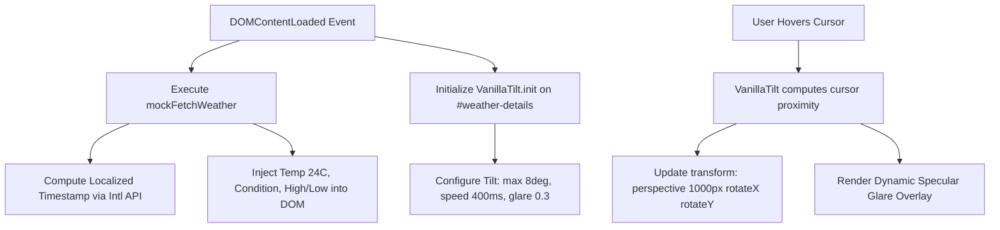
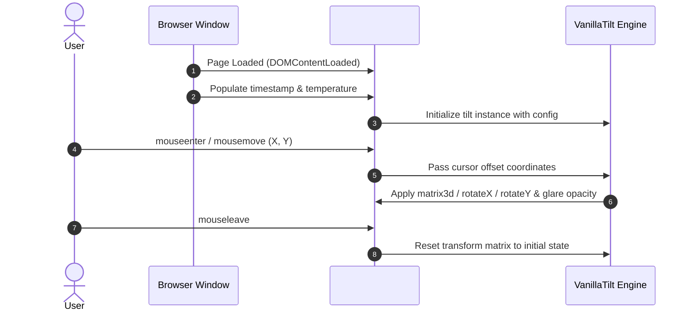

# Feature F1: Hero Current Weather Card (3D Tilt & Localized Timestamp)



---

## 1. Feature Overview & User-Facing Behavior

The Hero Current Weather Card is the core focal point of the Weather Hub interface ([index.html:192-208](file:///Users/avishjain/avishjain9-repos/56-avishjain-weatherapp/abstract-forge/index.html#L192-L208)). It provides instant, glanceable weather telemetry for the user's primary selected location ("New York, USA"):
- Real-time formatted localized date and time (`#current-time`).
- Prominent 9xl bold temperature readout ("24°C" via `#current-temp`).
- Textual weather condition ("Partly Cloudy" via `#current-condition`).
- Diurnal temperature spread ("H: 28°C / L: 18°C" via `#current-high-low`).
- Weather iconography SVG rendered in bright solar yellow.
- **Physical Gyroscope Parallax:** Hovering over the card tilts it dynamically in 3D perspective while generating a realistic specular light reflection.

---

## 2. Technical Implementation & Code Trace

### Markup Structure
```html
<!-- abstract-forge/index.html:192-208 -->
<div id="weather-details" class="card-bg p-8 rounded-3xl lg:col-span-2 shadow-2xl transition duration-500 cursor-pointer"
     data-tilt data-tilt-max="8" data-tilt-speed="400" data-tilt-perspective="1000">
    <div class="flex flex-col md:flex-row justify-between items-center">
        <div>
            <p class="text-3xl font-light text-gray-300">New York, USA</p>
            <p class="text-sm text-gray-400 mb-4" id="current-time">Loading time...</p>
            <div class="flex items-center">
                <span class="text-9xl font-extrabold text-white" id="current-temp">--°C</span>
                <span class="text-4xl ml-4 font-semibold text-blue-300" id="current-condition">Loading...</span>
            </div>
            <p class="text-xl mt-2 text-gray-400" id="current-high-low">H: --°C / L: --°C</p>
        </div>
        <svg class="w-32 h-32 text-yellow-400 mt-6 md:mt-0" fill="currentColor" viewBox="0 0 24 24">...</svg>
    </div>
</div>
```

### Script Logic & Execution Trace
```javascript
// abstract-forge/index.html:280-285
VanillaTilt.init(document.getElementById("weather-details"), {
    max: 8,             // Maximum tilt rotation in degrees
    speed: 400,         // Speed of the transition on mouse enter/exit in ms
    glare: true,        // Enables specular glare reflection
    "max-glare": 0.3,   // Clamps max glare opacity to 30%
});
```

```javascript
// abstract-forge/index.html:287-312
function mockFetchWeather() {
    const dateOptions = { weekday: 'long', year: 'numeric', month: 'long', day: 'numeric', hour: '2-digit', minute: '2-digit' };
    document.getElementById('current-time').textContent = new Date().toLocaleDateString('en-US', dateOptions);

    const mockData = {
        current: {
            temp: 24,
            condition: "Partly Cloudy",
            high: 28,
            low: 18,
        },
        forecast: [...]
    };

    document.getElementById('current-temp').textContent = `${mockData.current.temp}°C`;
    document.getElementById('current-condition').textContent = mockData.current.condition;
    document.getElementById('current-high-low').textContent = `H: ${mockData.current.high}°C / L: ${mockData.current.low}°C`;
}
```

---

## 3. Request & Interaction Flow



---

## 4. Edge Cases, Failure Handling & Limitations

| Potential Failure Point | Manifestation | Mitigation Strategy in Code |
| :--- | :--- | :--- |
| **CDN Blocked / Offline** | `VanillaTilt` global is undefined | Card displays in standard 2D glassmorphic styling without layout distortion |
| **Locale Desynchronization** | Client timezone differences | Uses browser native `Intl.DateTimeFormat` via `toLocaleDateString` |
| **Rapid Viewport Resizing** | Card width adjusts abruptly | Handled by Tailwind flexbox (`flex-col md:flex-row`) and CSS auto-scaling |

---

## 5. Say It Out Loud

I built the Hero Current Weather card to serve as the visual and informative focal point of the dashboard. When a user lands on the page, they immediately see their location, localized date and time, current temperature, and daily high and low range. To make the interface feel tactile and alive rather than flat and static, I added real-time 3D gyroscope physics using VanillaTilt. When you move your mouse across the card, it tracks your cursor coordinates and calculates hardware-accelerated 3D rotations on the fly, complete with a specular glare effect that mimics light bouncing off real glass. I chose VanillaTilt instead of building a heavy Three.js canvas or custom WebGL shader because it weighs less than four kilobytes and hooks directly into requestAnimationFrame, giving us sixty frames per second performance with virtually zero CPU overhead. If the external CDN library fails to load over a poor network, the card gracefully falls back to a clean two-dimensional glassmorphic container without throwing errors or breaking page layout. One current limitation is that it displays hardcoded mock data for New York; my immediate next step is connecting this to a live geolocation API and an OpenWeatherMap endpoint to fetch actual local telemetry.
