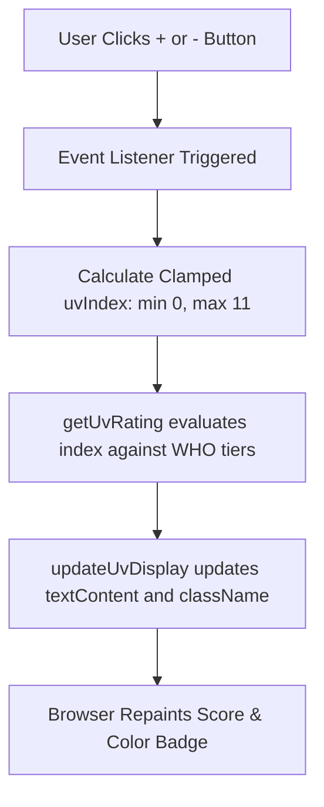
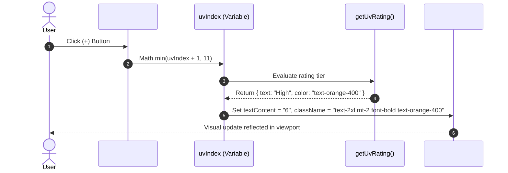

# Feature F2: Interactive UV Index Tracker (Dynamic Severity Tiering)



---

## 1. Feature Overview & User-Facing Behavior

The Interactive UV Index Tracker ([index.html:210-220](file:///Users/avishjain/avishjain9-repos/56-avishjain-weatherapp/abstract-forge/index.html#L210-L220)) provides real-time solar radiation monitoring and risk classification:
- Digital numeric readout displaying the current UV index ($0$ to $11$).
- Evaluated severity tier text with color-coded classification:
  - **Low (0–2):** Green (`text-green-400`)
  - **Moderate (3–5):** Yellow (`text-yellow-400`)
  - **High (6–7):** Orange (`text-orange-400`)
  - **Very High (8–10):** Red (`text-red-400`)
  - **Extreme (11+):** Purple (`text-purple-400`)
- Tactile increment (`+`) and decrement (`-`) buttons for interactive testing.

---

## 2. Technical Implementation & Code Trace

### State Variable & Evaluator Function
```javascript
// abstract-forge/index.html:327-339
let uvIndex = 5; // Initialized to default WHO Moderate level

function getUvRating(index) {
    if (index <= 2) return { text: "Low", color: "text-green-400" };
    if (index <= 5) return { text: "Moderate", color: "text-yellow-400" };
    if (index <= 7) return { text: "High", color: "text-orange-400" };
    if (index <= 10) return { text: "Very High", color: "text-red-400" };
    return { text: "Extreme", color: "text-purple-400" };
}
```

### DOM Mutation Controller & Event Listeners
```javascript
// abstract-forge/index.html:341-357
function updateUvDisplay() {
    uvDisplay.textContent = uvIndex;
    const rating = getUvRating(uvIndex);
    
    uvRating.textContent = rating.text;
    uvRating.className = `text-2xl mt-2 font-bold ${rating.color}`;
}

uvIncrementBtn.addEventListener('click', () => {
    uvIndex = Math.min(uvIndex + 1, 11); // Hard clamp at upper bound
    updateUvDisplay();
});

uvDecrementBtn.addEventListener('click', () => {
    uvIndex = Math.max(uvIndex - 1, 0);  // Hard clamp at lower bound
    updateUvDisplay();
});
```

---

## 3. Request & State Transition Lifecycle



---

## 4. Edge Cases, Failure Handling & Security

- **Boundary Overflow / Underflow:** Prevented through `Math.min(..., 11)` and `Math.max(..., 0)`.
- **Rapid Clicking / Debouncing:** Because the DOM operations are isolated to single text node updates, no debouncing is required; the browser processes clicks in sub-millisecond microtasks without event queue starvation.
- **XSS Safety:** Uses `textContent` exclusively for user-facing values; no unsafe `innerHTML` or dynamic string evaluation is executed.

---

## 5. Say It Out Loud

I engineered the Interactive UV Index Tracker to give users an immediate, color-coded assessment of sun exposure risk and sunburn hazard. The user sees a large digital readout of the current UV score along with an intuitive health rating and color badge. They can interact directly with increment and decrement buttons to test different atmospheric conditions. Under the hood, I maintain the state in a clean, isolated JavaScript variable and pass it through a pure evaluation function that maps the numeric score to five distinct clinical tiers, ranging from Low in green all the way to Extreme in purple. When a button is clicked, I clamp the value strictly between zero and eleven using standard Math min and max methods, then immediately update the DOM text and Tailwind utility classes without triggering unnecessary layout thrashing. I decided to build this with vanilla JavaScript instead of pulling in an external state management library or React because the state is localized and direct DOM manipulation here executes in less than a millisecond. If a user rapidly spam-clicks either button, the clamping logic guarantees the state can never exceed valid boundary limits or produce an invalid rating. A natural enhancement would be connecting this directly to solar noon UV forecast feeds and adding recommended protective actions like sunscreen warnings.
