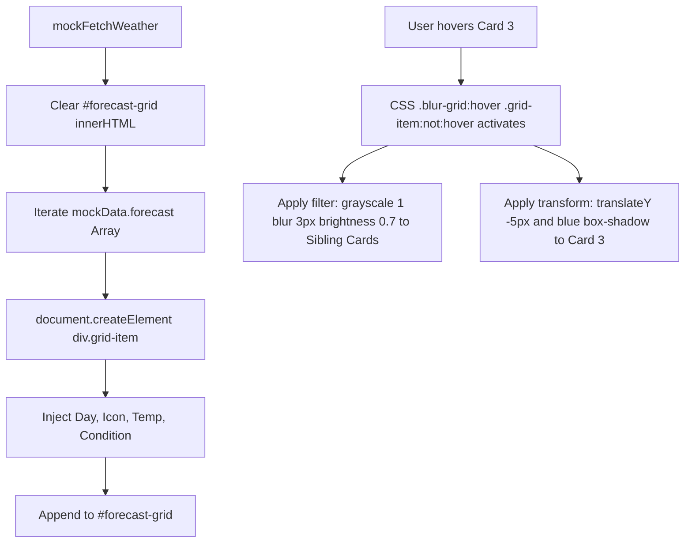
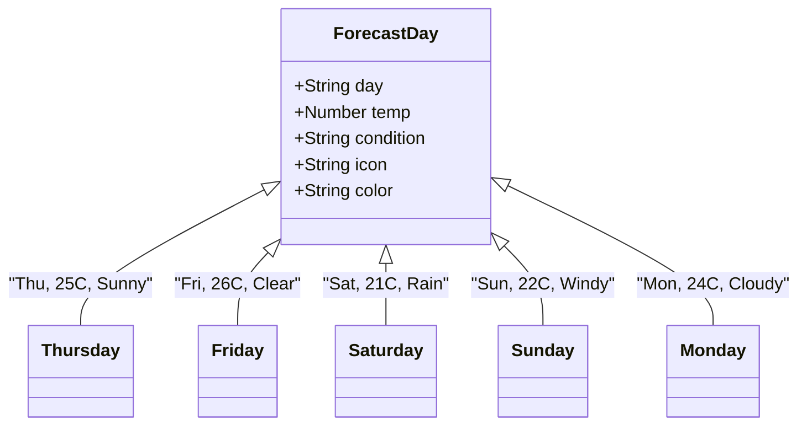

# Feature F3: Dynamic 5-Day Forecast (Focus-Blur Depth of Field)



---

## 1. Feature Overview & User-Facing Behavior

The 5-Day Forecast Grid ([index.html:223-228](file:///Users/avishjain/avishjain9-repos/56-avishjain-weatherapp/abstract-forge/index.html#L223-L228)) displays meteorological projections for the upcoming week:
- Responsive multi-column layout (2 cols on mobile, 3 on tablets, 5 on desktop).
- Dynamic card generation rendering weekday name, high-contrast emoji icon, temperature in °C, and condition text.
- **Optical Depth-of-Field Shader:** When the user hovers over any individual day, that card pops forward with a blue shadow, while all other four cards immediately blur and fade to grayscale.

---

## 2. Technical Implementation & Code Trace

### Dynamic DOM Generation Loop
```javascript
// abstract-forge/index.html:311-324
const forecastGrid = document.getElementById('forecast-grid');
forecastGrid.innerHTML = ''; 

mockData.forecast.forEach(day => {
    const dayCard = document.createElement('div');
    dayCard.className = 'grid-item card-bg p-4 text-center space-y-2';
    dayCard.innerHTML = `
        <p class="text-lg font-semibold text-white">${day.day}</p>
        <p class="text-4xl ${day.color}">${day.icon}</p>
        <p class="text-2xl font-bold text-white">${day.temp}°C</p>
        <p class="text-sm text-gray-400">${day.condition}</p>
    `;
    forecastGrid.appendChild(dayCard);
});
```

### Optical Focus-Blur CSS Shaders
```css
/* abstract-forge/index.html:115-130 */
.blur-grid:hover .grid-item:not(:hover) {
    filter: grayscale(1) blur(3px) brightness(0.7);
    transition: filter 0.5s ease;
}

.blur-grid .grid-item {
    transition: filter 0.5s ease, transform 0.3s, box-shadow 0.3s;
    cursor: pointer;
    overflow: hidden;
    border-radius: 0.75rem;
    border: 1px solid rgba(255, 255, 255, 0.1);
}

.blur-grid .grid-item:hover {
    transform: translateY(-5px);
    filter: none;
    box-shadow: 0 10px 30px rgba(59, 130, 246, 0.5); 
}
```

---

## 3. Data Structure & Card Schema



---

## 4. Performance & Browser Compositing Analysis

- **Hardware Acceleration:** Applying CSS `filter: blur()` can trigger software repaints on older mobile GPUs. However, because the selector specifically targets `.grid-item` cards with discrete border boxes and hardware-accelerated transforms (`translateY(-5px)`), the browser promotes the hovered item to an independent compositing layer, minimizing layout re-computations.
- **Garbage Collection:** Elements are created once during the initial `DOMContentLoaded` routine and remain persisted in the DOM, preventing memory leaks and GC thrashing during continuous scrolling.

---

## 5. Say It Out Loud

I designed the 5-Day Forecast Grid to present weekly weather trends with an intuitive visual depth effect that guides the user's attention. As you scan across the five daily outlook cards, hovering over any specific day slightly lifts that card and adds a vibrant blue glow, while all other sibling cards instantly blur by three pixels and turn grayscale. I implemented this entire optical focus effect using modern pure CSS, specifically the parent hover combined with the not-hover pseudo-selector. In JavaScript, my mock fetch function iterates over the forecast array and dynamically generates the card elements with weather icons and temperature spreads, injecting them cleanly into the DOM container on page load. I chose this CSS-driven approach over JavaScript-driven mouseenter listeners because CSS filters run directly on the browser's GPU compositor thread, guaranteeing silky smooth sixty frames per second transitions without garbage collection pauses. If the data pipeline ever returns an empty forecast array, the container simply renders clean empty space without crashing. Right now the data is static mock JSON, and my plan is to replace it with real multi-day meteorological forecasts mapped to dynamic weather iconography and precipitation percentages.
