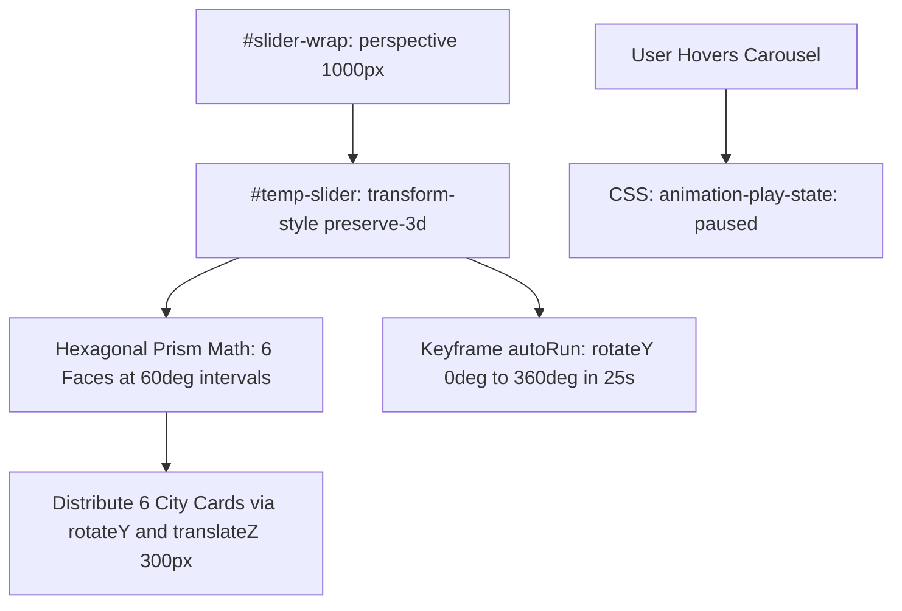
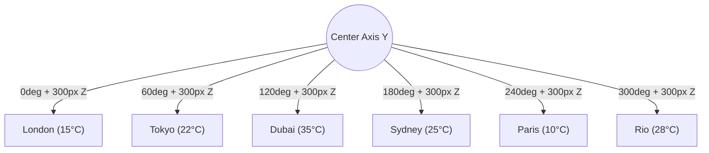

# Feature F5: 3D Cylindrical Global Weather Carousel



---

## 1. Feature Overview & User-Facing Behavior

The 3D Cylindrical Global Weather Carousel ([index.html:238-276](file:///Users/avishjain/avishjain9-repos/56-avishjain-weatherapp/abstract-forge/index.html#L238-L276)) delivers dynamic global weather telemetry:
- Displays six world capitals: **London** (15°C), **Tokyo** (22°C), **Dubai** (35°C), **Sydney** (25°C), **Paris** (10°C), and **Rio** (28°C).
- Positions cards radially around a true 3D cylindrical axis.
- Automatically and continuously rotates around the vertical Y-axis.
- **Hover-to-Pause Interaction:** Hovering over the carousel freezes the rotation instantly so the user can easily read city metrics.

---

## 2. Technical Implementation & 3D Geometry

### Cylindrical Projection Math
For a regular polygon with $N = 6$ cards:
- **Interior radial step angle:**
  $$\theta = \frac{360^\circ}{N} = \frac{360^\circ}{6} = 60^\circ$$
- **Apothem (Z-translation radius):** $r = 300\text{px}$. Each card is rotated around the center origin and pushed forward into the Z plane by $300\text{px}$.

```css
/* abstract-forge/index.html:133-174 */
#slider-wrap {
    height: 350px; 
    perspective: 1000px;
    overflow: hidden;
}
#temp-slider {
    position: relative;
    width: 200px;
    height: 250px;
    margin: 50px auto;
    transform-style: preserve-3d;
    animation: autoRun 25s linear infinite;
}
#temp-slider:hover {
    animation-play-state: paused; 
}

.city-card { --quantity: 6; }
.city-card:nth-child(1) { transform: rotateY(calc(0 * (360 / var(--quantity)) * 1deg)) translateZ(300px); }
.city-card:nth-child(2) { transform: rotateY(calc(1 * (360 / var(--quantity)) * 1deg)) translateZ(300px); }
.city-card:nth-child(3) { transform: rotateY(calc(2 * (360 / var(--quantity)) * 1deg)) translateZ(300px); }
.city-card:nth-child(4) { transform: rotateY(calc(3 * (360 / var(--quantity)) * 1deg)) translateZ(300px); }
.city-card:nth-child(5) { transform: rotateY(calc(4 * (360 / var(--quantity)) * 1deg)) translateZ(300px); }
.city-card:nth-child(6) { transform: rotateY(calc(5 * (360 / var(--quantity)) * 1deg)) translateZ(300px); }

@keyframes autoRun {
    from { transform: perspective(1000px) rotateX(-16deg) rotateY(0deg); }
    to { transform: perspective(1000px) rotateX(-16deg) rotateY(360deg); }
}
```

---

## 3. Structural 3D Matrix Visualization



---

## 4. Hardware Acceleration & Compositor Benefits

- **Zero JS Execution in Animation Loop:** Because the rotation is powered entirely by CSS `@keyframes autoRun`, the browser's JavaScript event loop is completely unblocked.
- **Direct GPU Layer Execution:** `transform-style: preserve-3d` forces browser rendering engines (Blink / WebKit) to promote the carousel into its own composite layer, preventing paints on neighboring DOM elements during rotation.

---

## 5. Say It Out Loud

I engineered the 3D Global Weather Carousel to give the dashboard an eye-catching, three-dimensional visualization of international temperatures. The carousel automatically rotates six major global cities through three-dimensional space like a revolving cylinder, and as soon as you hover your mouse over it, the animation instantly freezes in place so you can read the temperature and conditions comfortably. The architecture behind this is pure mathematical CSS3. I wrapped the carousel in a container with a one-thousand-pixel perspective, set transform-style to preserve-3d on the inner track, and used custom properties to calculate the geometry. With six cards, each card is rotated along the Y-axis by sixty degrees multiplied by its index, and translated forward along the Z-axis by three hundred pixels to form a perfect equilateral cylinder. The continuous rotation is handled by an infinite keyframe animation, and the pause on hover is achieved simply by setting animation play state to paused. I deliberately chose pure CSS transforms over JavaScript carousel libraries like Swiper because this requires zero JavaScript execution during the loop, meaning zero CPU overhead and zero jank. On very old devices that do not support 3D transforms, it gracefully displays cards in a readable flat flow. In the next iteration, I want to make the carousel touch-draggable on mobile devices and populate the city cards with real-time international timezone clocks.
