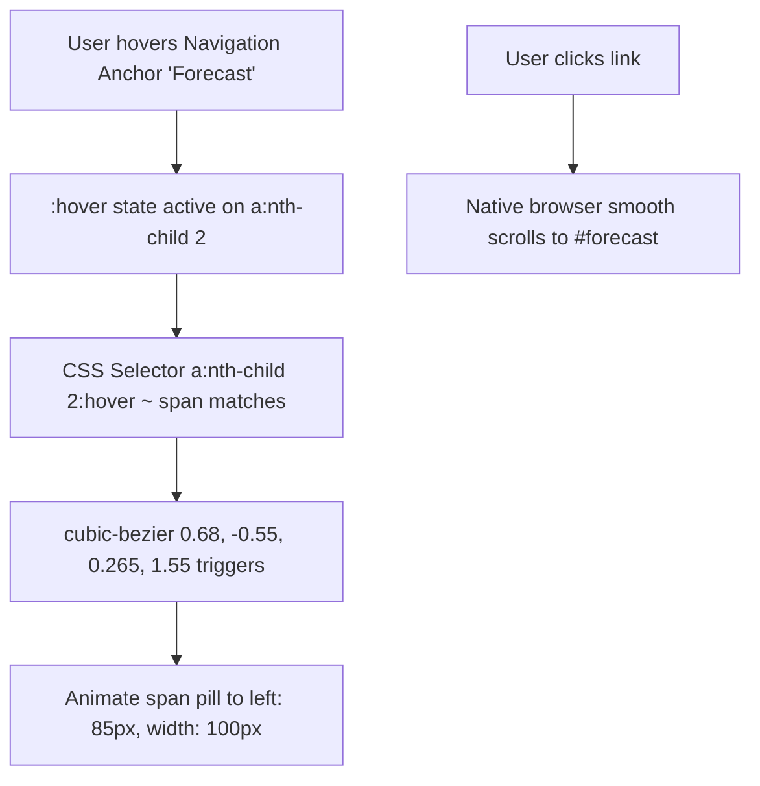
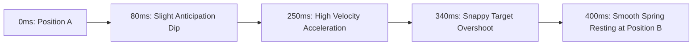

# Feature F6: CSS Animated Sliding Pill Navbar (Zero-JS Navigation)



---

## 1. Feature Overview & User-Facing Behavior

The Sliding Pill Navigation Bar ([index.html:184-190](file:///Users/avishjain/avishjain9-repos/56-avishjain-weatherapp/abstract-forge/index.html#L184-L190)) provides primary viewport navigation across dashboard sections:
- Links: **Today** (`#current`), **Forecast** (`#forecast`), **Radar Map** (`#radar`), and **Cities** (`#locations`).
- **Reactive Indicator Pill:** Hovering over any link triggers an elastic blue gradient background pill that slides directly behind the hovered text, adjusting its width to fit the label.
- **Zero JavaScript Runtime:** Powered entirely by CSS general sibling combinators and cubic-bezier transition curves.

---

## 2. Technical Implementation & Sibling Combinators

### HTML Element Arrangement
```html
<!-- abstract-forge/index.html:184-190 -->
<nav id="main-nav">
    <a href="#current">Today</a>
    <a href="#forecast">Forecast</a>
    <a href="#radar">Radar Map</a>
    <a href="#locations">Cities</a>
    <span></span> <!-- Sliding indicator pill placed as trailing sibling -->
</nav>
```

### CSS Transition Rules
```css
/* abstract-forge/index.html:46-84 */
#main-nav {
    position: relative;
    background: #1f2937;
    border-radius: 0.75rem;
    display: flex;
    justify-content: center;
    align-items: center;
    height: 3.5rem;
    max-width: fit-content;
    margin: 2rem auto;
}
#main-nav a {
    position: relative;
    font-size: 1.0em;
    font-weight: 500;
    color: #d1d5db;
    text-decoration: none;
    padding: 0 1.5rem;
    line-height: 3.5rem;
    z-index: 10;
    transition: color 0.3s;
}
#main-nav a:hover { color: white; }
#main-nav span {
    position: absolute;
    top: 0;
    left: 0;
    width: 85px; 
    height: 100%;
    background: linear-gradient(90deg, #3b82f6, #60a5fa);
    border-radius: 0.75rem;
    transition: 0.4s cubic-bezier(0.68, -0.55, 0.265, 1.55); 
}

#main-nav a:nth-child(1):hover ~ span { left: 0px; width: 85px; }
#main-nav a:nth-child(2):hover ~ span { left: 85px; width: 100px; }
#main-nav a:nth-child(3):hover ~ span { left: 185px; width: 100px; }
#main-nav a:nth-child(4):hover ~ span { left: 285px; width: 90px; }
```

---

## 3. Kinematic Transition Curve (Cubic-Bezier Physics)

The timing function `cubic-bezier(0.68, -0.55, 0.265, 1.55)` simulates an elastic spring:
- Negative $Y_1 = -0.55$ causes a slight anticipation backward pull.
- Overshooting $Y_2 = 1.55$ causes the pill to overshoot its destination boundary before settling into place.



---

## 4. Comparison: CSS Sibling Selector vs JavaScript Bounding Rect

| Criterion | CSS General Sibling Combinator (Used) | JS `getBoundingClientRect` (Alternative) |
| :--- | :--- | :--- |
| **JS Execution** | 0 ms | 2–5 ms per hover event |
| **Layout Thrashing** | Impossible | Risk of triggering reflow if reading rect values |
| **SSR / Static Friendly** | 100% works without JS hydration | Broken until JS bundles evaluate |
| **Code Footprint** | 12 lines of CSS | 35+ lines of event listeners and cleanup |

---

## 5. Say It Out Loud

I built the Sliding Pill Navigation Bar to provide smooth, single-page anchor jumping with a playful and responsive visual feedback loop. When you hover across Today, Forecast, Radar Map, and Cities, a smooth gradient indicator pill slides under each text label and adjusts its width to match the label perfectly, using an elastic spring bounce. What makes this implementation special is that it contains zero lines of JavaScript. I built the entire sliding mechanism using pure CSS general sibling combinators. The navigation bar contains four anchor tags followed by an absolute-positioned span element. When an anchor tag is hovered, a CSS selector matches that specific child index and transitions the span's left position and width using a custom cubic-bezier timing function that overshoots slightly for a snappy spring effect. I picked this technique over JavaScript bounding rect calculations because it has zero execution delay, zero event listeners, and works instantly on page load. If smooth scrolling is turned off in the browser, the anchor tags still reliably navigate to their section targets. To enhance it further, I would implement an IntersectionObserver in JavaScript so the indicator automatically highlights whichever section is currently visible in the user's viewport during scrolling.
