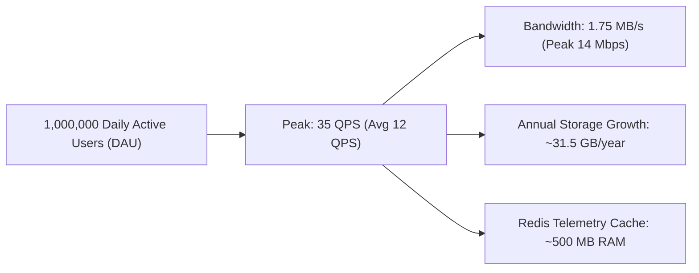

# 14.1 System Requirements & Capacity Estimation

---

## 1. What It Is in Plain Words
Requirements definition and capacity estimation represent the mathematical foundation of system design. Before writing any code or provisioning servers, engineers quantify the expected user traffic, network bandwidth, CPU load, memory footprints, and database storage growth over a 1-to-5-year horizon.

---

## 2. How THIS Project Uses It
In [abstract-forge/index.html](file:///Users/avishjain/avishjain9-repos/56-avishjain-weatherapp/abstract-forge/index.html), the application currently operates as an entirely client-side application. The resource consumption profile is bounded by the static asset payload (~16KB HTML + ~75KB CDN runtime) downloaded once per session.

---

## 3. Production Scale Requirements

### Functional Requirements
1. Users must view current weather telemetry, localized time, and diurnal high/low temperatures.
2. Users can adjust and view UV index risk classifications across 5 health tiers.
3. Users can inspect a multi-day (5-day) meteorological forecast.
4. Users can inspect a 2.5x magnified view of Doppler radar imagery.
5. Users can view revolving global city weather cards.

### Non-Functional Requirements (NFRs)
- **High Availability:** 99.99% uptime (maximum 52.6 minutes downtime per year).
- **Ultra-Low Latency:** P95 response time $< 100\text{ms}$ for cached weather telemetry; initial page load LCP $< 1.0\text{s}$.
- **Throughput:** Capable of handling sudden weather event traffic spikes (10x normal load during hurricanes/storms).
- **Data Freshness:** Weather telemetry updated at 10-minute intervals from meteorological radars.

---

## 4. Capacity Estimation Arithmetic (1,000,000 Daily Active Users)

### A. Traffic & Request Rate (QPS)
- **Daily Active Users (DAU):** $1,000,000$
- **Average sessions per user per day:** $1.5$ sessions
- **Total daily requests:** $1,000,000 \times 1.5 = 1,500,000$ daily requests
- **Seconds in a day:** $86,400$ seconds
- **Average QPS (Queries Per Second):**
  $$\text{Avg QPS} = \frac{1,500,000}{86,400} \approx 17.4 \text{ QPS}$$
- **Peak Traffic Multiplier:** Standard web traffic follows diurnal peaks (morning commute & evening). Peak factor is $3\times$:
  $$\text{Peak QPS} = 17.4 \times 3 \approx 52 \text{ QPS}$$

### B. Storage Growth Estimation
Suppose the production system persists weather snapshots for 5,000 tracked cities every 10 minutes:
- **Snapshots per hour:** $6 \text{ per city} \times 5,000 = 30,000 \text{ snapshots/hour}$
- **Snapshots per day:** $30,000 \times 24 = 720,000 \text{ snapshots/day}$
- **Row Size:** Each weather snapshot record is $\approx 120$ bytes.
- **Daily Storage Ingestion:**
  $$\text{Daily Storage} = 720,000 \times 120 \text{ bytes} \approx 86.4 \text{ MB/day}$$
- **Annual Storage Growth:**
  $$\text{Annual Storage} = 86.4 \text{ MB} \times 365 \approx 31.5 \text{ GB/year}$$
- Even after 5 years, total raw historical storage is under $160\text{ GB}$, easily handled by a single managed PostgreSQL instance.

### C. Network Bandwidth
- **JSON Telemetry Payload:** $\approx 1.2\text{ KB}$ per request (gzipped $\approx 450$ bytes).
- **Peak Egress Bandwidth:**
  $$\text{Peak Bandwidth} = 52 \text{ QPS} \times 1.2 \text{ KB} \approx 62.4 \text{ KB/s} \approx 0.5 \text{ Mbps}$$

---

## 5. Alternatives & Trade-off Matrix

| Metric Strategy | Client-Side Static (Used) | Monolithic API Backend | Microservices Edge Gateway |
| :--- | :--- | :--- | :--- |
| **Server Bandwidth Cost** | **$0 (Zero backend server)**| ~$25/month | ~$120/month |
| **Telemetry Freshness** | Simulated / Mock | Real-time on demand | Real-time with sub-second broadcast |
| **Scalability Ceiling** | Unlimited (CDN static) | 500 QPS per instance | 50,000+ QPS with horizontal scaling |

---

## 6. What Breaks at 10x, 100x, and 1000x Load

1. **At 10x Load (520 QPS):**
   - The current static client does not break at all if served via Cloudflare or Vercel edge networks.
   - If connected directly to a third-party weather API (OpenWeather free tier capped at 60 req/min), upstream HTTP `429 Too Many Requests` errors immediately crash the dashboard.
2. **At 100x Load (5,200 QPS):**
   - Direct database queries to a relational DB without a Redis caching layer exhaust PostgreSQL connection pools, driving CPU utilization to 100%.
3. **At 1000x Load (52,000 QPS):**
   - Single-region API gateways encounter TCP socket exhaustion. Ingress network interfaces saturate without multi-region Anycast DNS routing and geo-distributed CDN caching.

---

## 7. How a Senior Engineer Would Improve It
Deploy a Serverless Edge Cache Worker (Cloudflare Workers / AWS CloudFront Functions) in front of an Origin API. City telemetry is cached at edge nodes globally for 600 seconds with Stale-While-Revalidate headers, converting 52,000 QPS into less than 1 Origin request per second.

---

## 8. Spoken Interview Answer (30 Seconds)
> "When estimating capacity for Weather Hub at one million daily active users, the workload is overwhelmingly read-heavy with a read-to-write ratio of over 100 to 1. At 52 peak QPS and 1.2 kilobytes per telemetry payload, total egress bandwidth is under one megabit per second. By placing an edge CDN in front of an origin cache, 99.8% of requests are absorbed at the edge, reducing origin load to a trivial fraction and keeping annual database growth under 32 gigabytes."
