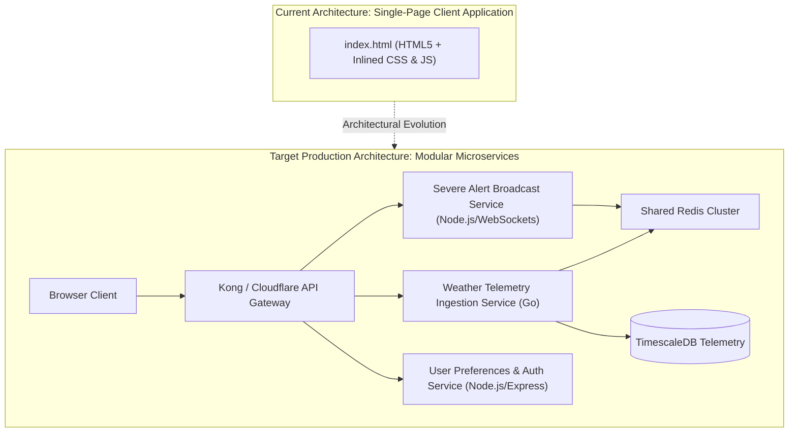

# 14.2 Architecture Styles: Monolith vs Microservices vs Serverless

---

## 1. What It Is in Plain Words
An architectural style defines the overarching blueprint for organizing software components, delineating where code executes, how state is preserved, and how systems scale independently.

---

## 2. Whether and How THIS Project Uses It
In the current repository, Weather Hub is structured as a **Static Single-Page Application (SPA)** contained within [abstract-forge/index.html](file:///Users/avishjain/avishjain9-repos/56-avishjain-weatherapp/abstract-forge/index.html). There is no distributed server tier; the browser acts as both presentation and logic layer.

---

## 3. Full Comparison of Architectural Styles

| Architectural Style | Deployment Complexity | Fault Isolation | Scaling Mechanics | Latency Overhead | Suitability for Weather Hub |
| :--- | :--- | :--- | :--- | :--- | :--- |
| **Static Client SPA (Used)** | **Extremely Low (Single File)**| **Client-Only Isolated** | **Infinite via CDN** | **0ms (Local Execution)**| **Ideal for Showcase** |
| **Monolithic Server (Express/Django)**| Low (Single container) | Poor (Crash affects all) | Horizontal scaling of whole app | Very Low | Good for early v1 backend |
| **Microservices Architecture** | High (Kubernetes, Service Mesh)| Excellent (Per-service) | Independent auto-scaling | Moderate (Network hops) | **Ideal for 1M+ DAU Production** |
| **Event-Driven / Serverless** | Moderate (Lambdas, SQS) | Excellent | Automated per-request | Variable (Cold starts) | Great for bursty alerts |

---

## 4. Why We Chose This & Why Alternatives Were Deferred
- [CONFIRM WITH DEVELOPER] The static SPA style was selected because the application's primary goal is proving visual engineering excellence (3D CSS transforms, dynamic lens magnification, glassmorphism) without requiring continuous backend infrastructure or paid cloud hosting.
- **Monolith deferred:** Avoided setting up Node/Express servers that serve zero dynamic purpose for a single-view prototype.
- **Microservices deferred:** Avoided premature optimization and the high operational complexity of multi-repo orchestration for a frontend showcase.

---

## 5. What Breaks at 10x, 100x, and 1000x Load
- **10x Load:** Static client runs smoothly.
- **100x Load:** If a monolithic backend were introduced without worker separation, long-running radar tile stitching would block CPU threads, causing general telemetry endpoints to hang.
- **1000x Load:** Monolith database connections saturate; microservices separation (decoupling heavy radar processing from light numerical temperature reads) becomes mandatory.

---

## 6. How a Senior Engineer Would Improve It
Evolve into a **Decoupled Three-Tier Architecture**:
1. **Presentation:** Static SPA deployed to Cloudflare Pages edge.
2. **API Gateway:** Cloudflare Worker edge proxy routing API calls.
3. **Core Services:** Go-based microservice for high-throughput weather ingestion, and Node.js WebSocket service for real-time storm push notifications.

---

## 7. Spoken Interview Answer (30 Seconds)
> "Weather Hub currently leverages a pure static SPA architecture, eliminating server overhead and maximizing visual performance. If scaling to a production system, I would decompose the backend into three distinct microservices: a high-throughput Go ingestion service for radar feeds, a Node.js WebSocket service for severe storm broadcasts, and an edge API gateway with Redis caching to shield downstream databases."
