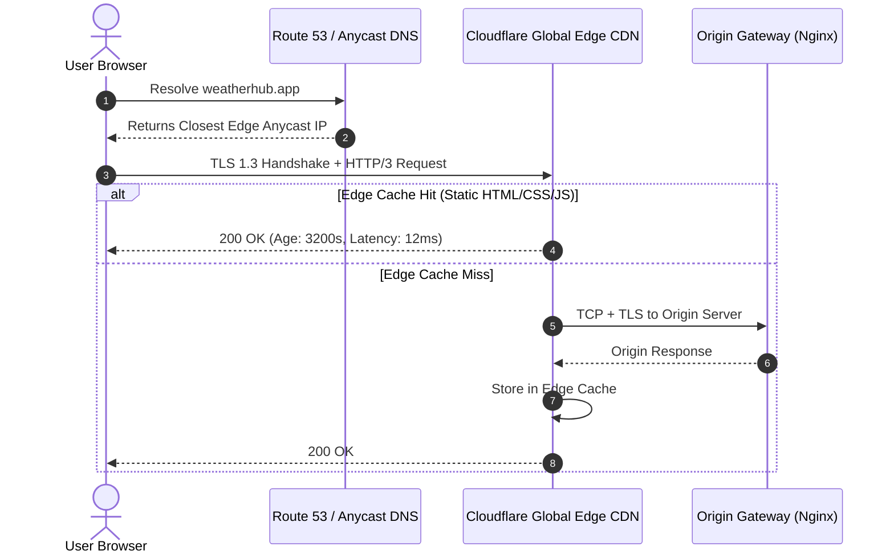

# 14.3 Networking, Edge CDNs & Communication Protocols

---

## 1. What It Is in Plain Words
Networking encompasses the physical and logical conduits over which data travels between the browser and infrastructure—including Domain Name Systems (DNS), Anycast IP routing, Content Delivery Networks (CDNs), Transport Layer Security (TLS), and transport protocols (HTTP/1.1, HTTP/2, HTTP/3).

---

## 2. Whether and How THIS Project Uses It
In [abstract-forge/index.html](file:///Users/avishjain/avishjain9-repos/56-avishjain-weatherapp/abstract-forge/index.html), the application makes external network calls to:
- `cdn.tailwindcss.com` (Cloudflare CDN Edge)
- `cdnjs.cloudflare.com` (Cloudflare Global Anycast)
- `placehold.co` (Dynamic image generation service)

---

## 3. Communication Protocols Comparison

| Protocol | Transport Layer | Head-of-Line Blocking | Handshake Overhead | Connection Multiplexing | Best Used For |
| :--- | :--- | :--- | :--- | :--- | :--- |
| **HTTP/1.1** | TCP | Yes (Pipelining flawed) | 3-way handshake + TLS | None (1 request per socket)| Legacy compatibility |
| **HTTP/2** | TCP | Yes (at TCP packet level) | 3-way handshake + TLS | Yes (Multiple streams) | Modern web assets |
| **HTTP/3 (QUIC)** | **UDP** | **No (Independent streams)**| **0-RTT / 1-RTT Handshake** | **Yes (Zero HoL Blocking)**| **Mobile & High-Loss Networks** |
| **WebSockets** | TCP | N/A (Full duplex stream)| Initial HTTP upgrade | Full-duplex persistent | Real-time weather alerts |
| **gRPC** | HTTP/2 | Managed by HTTP/2 | HTTP/2 + TLS | Binary protobuf multiplexing| Internal microservice RPC |

---

## 4. Why We Chose This & Why Alternatives Were Deferred
- [CONFIRM WITH DEVELOPER] For the current client showcase, standard HTTPS/HTTP/2 via CDN is ideal because it requires zero server configuration and delivers optimal asset caching.
- **WebSockets deferred:** Avoided setting up stateful socket servers until real-time lightning strike or live radar streaming feeds are introduced.

---

## 5. What Breaks at 10x, 100x, and 1000x Load
- **10x Load:** Networking layer operates normally.
- **100x Load:** If multiple external CDN hosts (`placehold.co`, `cdnjs`, `tailwindcss`) are contacted on initial page load, DNS resolution overhead and cross-origin connection handshakes degrade Time to First Byte (TTFB).
- **1000x Load:** Mobile users on lossy cellular networks experience packet-drop delays on TCP-based HTTP/2; migrating to HTTP/3 (QUIC) becomes critical to avoid Head-of-Line blocking during radar tile downloads.

---

## 6. How a Senior Engineer Would Improve It
1. **Consolidate Domains:** Serve all assets (styles, scripts, radar graphics) from a single custom origin domain (`cdn.weatherhub.app`) behind Cloudflare to eliminate multi-domain TLS renegotiations.
2. **Enable HTTP/3 (QUIC):** Ensure 0-RTT connection re-establishment for mobile users switching between Wi-Fi and 5G cellular networks.
3. **Deploy Subresource Integrity (SRI):** Secure CDN script imports against supply-chain tampering.

---

## 7. Spoken Interview Answer (30 Seconds)
> "Weather Hub's networking relies on edge CDNs for asset delivery over HTTP/2. To prepare for production scale, I would consolidate all remote assets onto a single custom domain fronted by Cloudflare Anycast, enable HTTP/3 over QUIC to eliminate TCP Head-of-Line blocking on mobile cellular connections, and add Subresource Integrity hashes to protect against third-party CDN tampering."
