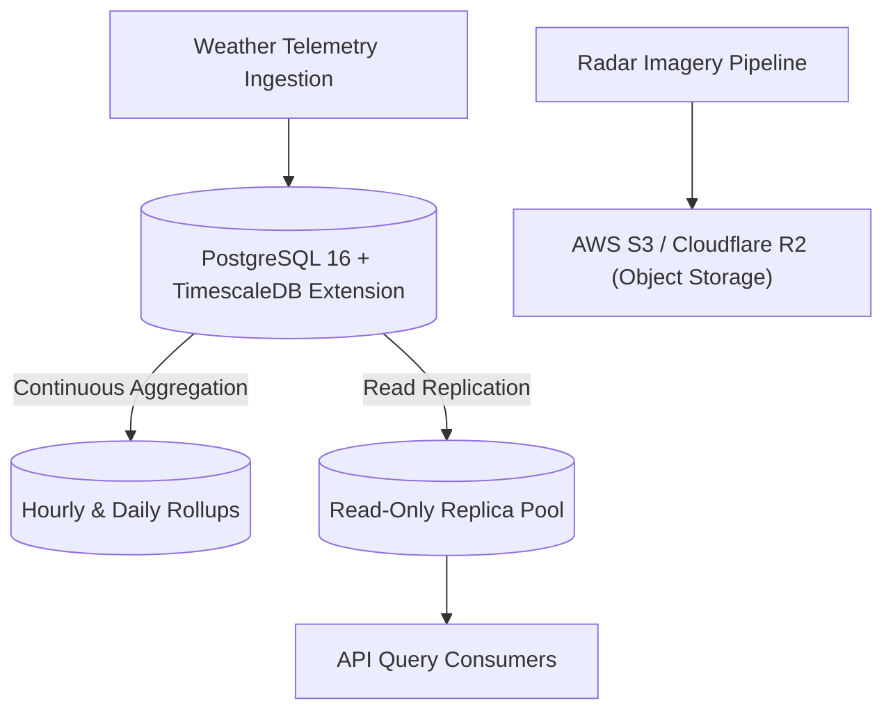
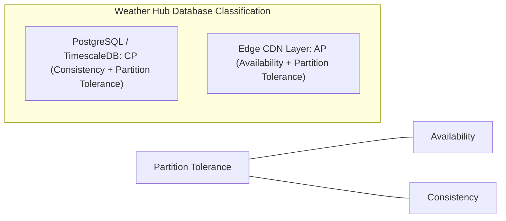

# 14.5 Databases, Data Modeling & Storage Engines

---

## 1. What It Is in Plain Words
The database and storage layer persists application data, ensuring durability, consistency, and efficient query retrieval across structured relational records, time-series metrics, and binary image objects.

---

## 2. Whether and How THIS Project Uses It
In [abstract-forge/index.html](file:///Users/avishjain/avishjain9-repos/56-avishjain-weatherapp/abstract-forge/index.html), **no persistent database is currently used**. State is maintained exclusively in client browser memory:
- `mockData.current` and `mockData.forecast` ([index.html:291-305](file:///Users/avishjain/avishjain9-repos/56-avishjain-weatherapp/abstract-forge/index.html#L291-L305))
- Variable `uvIndex` ([index.html:327](file:///Users/avishjain/avishjain9-repos/56-avishjain-weatherapp/abstract-forge/index.html#L327))

---

## 3. Database Paradigms Comparison for Weather Data

| Database Engine | Data Model | Time-Series Compression | Query Power | Horizontal Scaling | Fit for Weather Hub |
| :--- | :--- | :--- | :--- | :--- | :--- |
| **PostgreSQL + TimescaleDB**| **Relational + Hypertables** | **High (Lempel-Ziv / Delta-of-Delta)** | **Full SQL / Joins** | **Read Replicas** | **Superior (Best Choice)**|
| **MongoDB** | Document (BSON) | Low | MQL / Aggregations | Sharding | Good for unstructured metadata |
| **InfluxDB** | Pure Time-Series (TSM) | Extremely High | InfluxQL / Flux | Commercial clustering | Great for metrics, poor for relational |
| **Cassandra / ScyllaDB**| Wide-Column NoSQL | Moderate | CQL (No joins) | Masterless linear scale| Overkill under 10M DAU |
| **Amazon S3 / R2** | Blob / Object Store | N/A | Key-based fetch | Unlimited | **Mandatory for Radar PNGs** |

---

## 4. Why TimescaleDB (PostgreSQL) is the Superior Production Choice
- Meteorological data is inherently time-series: temperature, UV index, and wind speed arrive stamped with `(location_id, recorded_at, metric_value)`.
- TimescaleDB automatically partitions tables into "chunks" by timestamp (hypertables), allowing fast time-range filtering (`WHERE recorded_at > NOW() - INTERVAL '5 days'`).
- Native data compression achieves an 85–90% reduction in storage footprint using Run-Length and Delta-of-Delta encoding algorithms.

---

## 5. CAP Theorem & PACELC Classification

- **Core Database (PostgreSQL):** Sits in the **CP (Consistency / Partition Tolerance)** partition. Meteorological ingestion requires strict timestamp sequencing and non-corrupt aggregations.
- **Client Delivery (CDN / Cache):** Sits in the **AP (Availability / Partition Tolerance)** partition. If a network partition occurs between origin and edge, serving slightly stale weather data (e.g. 15 minutes old) is far preferable to throwing a 500 error to the user.

---

## 6. What Breaks at 10x, 100x, and 1000x Load
- **10x Load:** Single PostgreSQL instance handles queries easily.
- **100x Load:** Time-range aggregate queries (computing 5-day averages across thousands of cities) saturate database CPU. **Remedy:** Implement continuous materialized aggregate views in TimescaleDB.
- **1000x Load:** Write throughput from global weather station telemetry saturates single-node IOPS. **Remedy:** Partition hypertables across multiple disk arrays and route all client reads to read-only replicas.

---

## 7. How a Senior Engineer Would Improve It
1. **Hypertables with Automatic Data Tiering:** Keep raw 10-minute telemetry in fast NVMe storage for 30 days, roll up into 1-hour averages for 1 year, and compress into daily summaries for long-term historical archives.
2. **Object Storage for Radar Maps:** Store tiled radar map layers on AWS S3 / Cloudflare R2, distributed via CDN URLs rather than storing binary images in the database.

---

## 8. Spoken Interview Answer (30 Seconds)
> "Weather Hub currently operates with in-memory client state. For our production backend, I selected PostgreSQL with the TimescaleDB extension. Meteorological telemetry is inherently time-series, and TimescaleDB provides automatic chunk-based time partitioning and 90% compression ratios while retaining full relational SQL power. High-resolution radar maps are stored in S3 object storage, keeping binary blobs completely out of the database engine."
