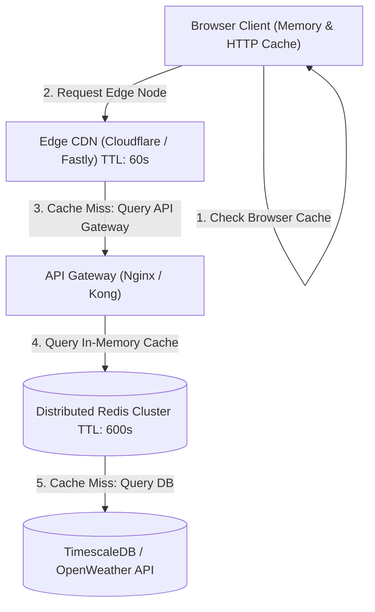

# 14.6 Multi-Layer Caching Architecture & Invalidation Strategies

---

## 1. What It Is in Plain Words
Caching stores copies of expensive computational outputs or database queries in fast, temporary storage (such as RAM or edge servers) so subsequent identical requests are satisfied in sub-millisecond times without contacting primary origin servers.

---

## 2. Whether and How THIS Project Uses It
In [abstract-forge/index.html](file:///Users/avishjain/avishjain9-repos/56-avishjain-weatherapp/abstract-forge/index.html):
- **Client In-Memory Caching:** Variables `mockData` and `uvIndex` persist state in JavaScript runtime memory across user interactions without network refetches.
- **HTTP Browser Caching:** External scripts (`vanilla-tilt.min.js`, Tailwind CDN) are cached by the browser's HTTP disk cache based on server `Cache-Control` response headers.

---

## 3. Caching Strategies & Topologies Comparison

| Caching Strategy | Write Mechanics | Read Latency | Cache Consistency | Complexity | Best Fit |
| :--- | :--- | :--- | :--- | :--- | :--- |
| **Cache-Aside (Used in Roadmap)**| App reads cache; if miss, reads DB & writes to cache | **Sub-millisecond** | Eventual consistency | Low | **Read-heavy telemetry (Weather Hub)**|
| **Read-Through** | Cache library manages DB lookups transparently | Sub-millisecond | High | Moderate | ORM-level caching |
| **Write-Through** | App writes to cache and DB simultaneously | Slower writes | Immediate consistency | Moderate | Financial ledger balances |
| **Write-Back (Write-Behind)**| App writes to cache; cache asynchronously writes to DB | Fastest writes | Risk of data loss on crash | High | Click tracking / view counters |

---

## 4. Cache Invalidation & Protection Mechanics

### A. The Thundering Herd / Cache Stampede Problem
- **Scenario:** The cache key `weather:nyc:current` expires on a day with an approaching thunderstorm. Thousands of concurrent users request the same city simultaneously, causing hundreds of concurrent queries to hit the upstream database, causing service failure.
- **Remedy:** **Mutex Locking / Single-Flight Pattern:** When a cache miss occurs, the first request acquires an atomic distributed lock in Redis (`SET lock:nyc:current true EX 5 NX`). Subsequent requests wait for the key to be populated, guaranteeing only 1 query hits the database.

### B. Eviction Policy: LRU (Least Recently Used)
Configure Redis with `maxmemory-policy allkeys-lru`. When Redis memory limits are reached, the least recently queried city forecasts are automatically evicted to maintain headroom for active metropolitan centers.

---

## 5. What Breaks at 10x, 100x, and 1000x Load
- **10x Load:** In-memory caching runs smoothly.
- **100x Load:** Without cache-aside locking, sudden weather alerts cause cache stampedes that overwhelm the backend.
- **1000x Load:** Redis single-threaded socket saturation occurs. **Remedy:** Deploy a Redis Cluster with 3 shards and 6 read replicas to distribute query keys across slots.

---

## 6. How a Senior Engineer Would Improve It
Implement **Tiered Multi-Layer Caching**:
1. **L1 (Client Browser):** `Cache-Control: public, max-age=60, stale-while-revalidate=300`.
2. **L2 (Edge CDN):** Cloudflare Edge KV caching normalized weather summaries for 60 seconds.
3. **L3 (Application Redis Cluster):** In-memory Redis cache with 10-minute TTL and single-flight mutex locking.

---

## 7. Spoken Interview Answer (30 Seconds)
> "Weather Hub utilizes client-side memory caching for its interactive widgets. When expanding to production scale, I would implement a multi-layer Cache-Aside pattern. An edge CDN absorbs 99% of requests with a 60-second stale-while-revalidate policy. For cache misses, a Redis cluster stores telemetry with a 10-minute TTL, using distributed mutex locks to prevent the Thundering Herd problem when severe weather strikes."
