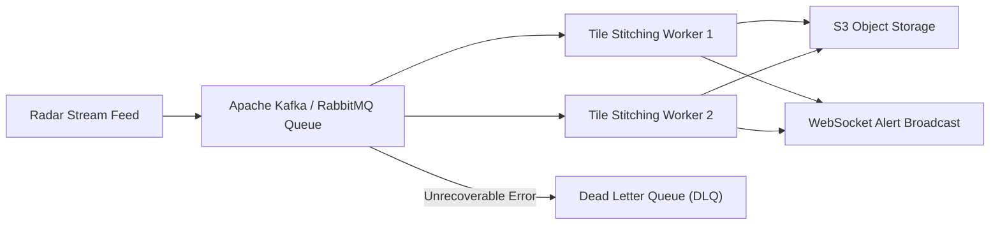

# 14.7 Messaging, Async Processing & Event Streams

---

## 1. What It Is in Plain Words
Asynchronous messaging and queueing decouples producers (services generating work or receiving data) from consumers (workers executing heavy processing), allowing systems to level traffic spikes, retry failures reliably, and execute long-running tasks without blocking HTTP request threads.

---

## 2. Whether and How THIS Project Uses It
In [abstract-forge/index.html](file:///Users/avishjain/avishjain9-repos/56-avishjain-weatherapp/abstract-forge/index.html), **no backend queue is currently used**. All state transitions occur synchronously within the browser's single-threaded event loop.

---

## 3. Queueing Systems & Event Streamers Comparison

| Technology | Architecture Model | Throughput Capacity | Ordering Guarantees | Delivery Semantics | Best Use Case in Weather Hub |
| :--- | :--- | :--- | :--- | :--- | :--- |
| **Apache Kafka** | Distributed Append-Only Log | **1,000,000+ msgs/sec** | Strict per-partition | At-least-once | High-volume global radar & sensor ingestion |
| **RabbitMQ** | Smart Broker / Dumb Consumer | ~50,000 msgs/sec | Strict FIFO in queue | At-least-once | Complex routing of severe weather alerts |
| **BullMQ (Redis)** | Redis-backed Task Queue | ~10,000 msgs/sec | Priority & Delayed jobs| At-least-once | Scheduled 10-minute weather polling jobs |
| **AWS SQS** | Fully Managed Serverless Queue| Highly Elastic | FIFO or Standard | At-least-once | Zero-ops cloud ingestion |

---

## 4. Delivery Semantics & Idempotency
- **At-Least-Once Delivery:** Messages may be redelivered if a worker crashes before sending an acknowledgment (ACK).
- **Idempotent Consumers:** To prevent duplicate database records when processing redelivered telemetry, workers use natural deduplication keys:
  $$\text{dedup\_key} = \text{MD5}(\text{location\_id} + \text{recorded\_at})$$
  Database inserts execute using `ON CONFLICT (location_id, recorded_at) DO NOTHING`.

---

## 5. Dead Letter Queues (DLQ) & Poison Pills
If a radar image tile is malformed or corrupted, attempting to parse it will throw an exception. Rather than crashing worker threads in an infinite retry loop, the message is retried 3 times with exponential backoff and then ejected to a **Dead Letter Queue (DLQ)** for engineering inspection.

---

## 6. What Breaks at 10x, 100x, and 1000x Load
- **10x Load:** Synchronous processing suffices.
- **100x Load:** Synchronous stitching of high-resolution radar maps blocks backend HTTP threads, causing connection timeouts.
- **1000x Load:** Radar feeds produce gigabytes of raw data per minute; without distributed partitioning via Kafka, message queues overflow, leading to worker out-of-memory (OOM) crashes.

---

## 7. How a Senior Engineer Would Improve It
Deploy **BullMQ or Apache Kafka** to decouple ingestion from delivery:
1. Ingestion service receives radar telemetry and pushes raw payloads to a Kafka topic (`weather.radar.raw`).
2. Autoscaled worker nodes pull from partitions, stitch tiles, upload to S3, and publish a completion event (`weather.radar.ready`).
3. WebSocket servers listen to the completion event and push updated tiles to active browser clients.

---

## 8. Spoken Interview Answer (30 Seconds)
> "Weather Hub currently executes all operations synchronously on the client. When scaling our backend to handle live radar map generation, I would introduce asynchronous processing with BullMQ or Kafka. This decouples CPU-intensive radar tile rasterization from user-facing HTTP endpoints, using idempotent workers and Dead Letter Queues to guarantee resilience against corrupted meteorological feeds."
