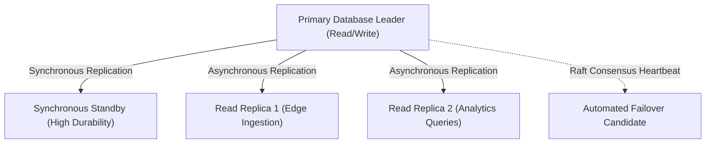

# 14.8 Concurrency, Distributed Consistency & Consensus



---

## 1. What It Is in Plain Words
In distributed systems spanning multiple servers and regions, concurrency and consistency define how concurrent writes are synchronized, how race conditions are prevented, and how nodes agree on the true state of data despite network delays and hardware crashes.

---

## 2. Whether and How THIS Project Uses It
In [abstract-forge/index.html](file:///Users/avishjain/avishjain9-repos/56-avishjain-weatherapp/abstract-forge/index.html), **concurrency is constrained to the browser's single-threaded event loop**. Race conditions are mitigated by synchronous variable mutations (`uvIndex = Math.min(...)`).

---

## 3. Distributed Consistency Models Comparison

| Consistency Model | Latency Overhead | Read Stale Risk | System Complexity | Applicable Tier in Weather Hub |
| :--- | :--- | :--- | :--- | :--- |
| **Strict Serializability** | Very High (Distributed locks) | None | Extremely High | User billing / payments only |
| **Read-Your-Writes** | Moderate (Sticky session / session tokens)| Low | Moderate | User location bookmarks |
| **Eventual Consistency** | **Ultra-Low (Async replication)** | **Low (Slight delay)** | **Low** | **Meteorological Telemetry (Best fit)** |
| **Causal Consistency** | Moderate (Vector clocks) | Moderate | High | Collaborative chat / annotations |

---

## 4. PACELC Theorem Classification
The PACELC theorem states: in a system that has **P**artitions, one must choose between **A**vailability and **C**onsistency; **E**lse (when running normally without partitions), one must choose between **L**atency and **C**onsistency.
- **Weather Hub PACELC Profile:** **PA/EL (Partition $\rightarrow$ Availability, Else $\rightarrow$ Latency).**
- When network partitions occur between Europe and US data centers, we prioritize Availability over Consistency (serving a 5-minute-old temperature reading rather than an error).
- Under normal operation, we prioritize ultra-low read Latency over immediate atomic Consistency across global regions.

---

## 5. What Breaks at 10x, 100x, and 1000x Load
- **10x Load:** Single-threaded client state is rock solid.
- **100x Load:** In a multi-instance backend, two concurrent workers writing weather updates for the same city overwrite each other without optimistic concurrency control (`updated_at` version checks).
- **1000x Load:** Global multi-region deployments suffer from cross-region replication lag; users booking notifications in London and checking in New York experience split-brain states without Raft-based consensus.

---

## 6. How a Senior Engineer Would Improve It
1. **Optimistic Concurrency Control (OCC):** Add an integer `version` column to location records:
   ```sql
   UPDATE locations SET temperature = 24.2, version = version + 1 
   WHERE id = '...' AND version = 3;
   ```
2. **Distributed Locks with Redlock (Redis):** Prevent duplicate ingestion jobs across autoscaling backend pods.

---

## 7. Spoken Interview Answer (30 Seconds)
> "Weather Hub's client-side state is protected from race conditions by JavaScript's single-threaded event loop. In a distributed backend architecture, we classify the system under the PACELC theorem as PA/EL, choosing Availability and Latency over strict linearizability. Meteorological telemetry tolerates eventual consistency, while user bookmark mutations are protected using optimistic concurrency control with version stamps."
