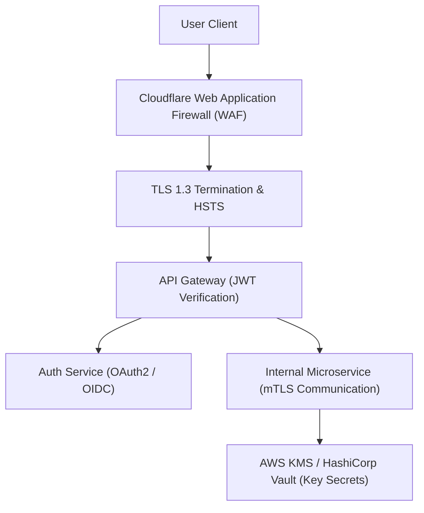

# 14.11 Security Architecture, Zero Trust & Identity

---

## 1. What It Is in Plain Words
Security architecture establishes end-to-end defense mechanisms across all layers—verifying identities, enforcing encryption in transit and at rest, isolating networks, and preventing unauthorized data access under a Zero Trust model.

---

## 2. Whether and How THIS Project Uses It
In [abstract-forge/index.html](file:///Users/avishjain/avishjain9-repos/56-avishjain-weatherapp/abstract-forge/index.html), **security is focused entirely on the client**:
- Direct DOM XSS mitigation using `textContent` for dynamic values ([index.html:342](file:///Users/avishjain/avishjain9-repos/56-avishjain-weatherapp/abstract-forge/index.html#L342)).
- Zero embedded secrets or sensitive API credentials in client source code.

---

## 3. Authentication & Token Storage Comparison

| Storage Mechanism | XSS Vulnerability | CSRF Vulnerability | Refresh Token Rotation | Best Use Case |
| :--- | :--- | :--- | :--- | :--- |
| **`localStorage`** | **Extremely High (Readable via script)**| None | Client-driven | Simple non-sensitive tokens |
| **`sessionStorage`** | High (Readable during session) | None | Closed on tab exit | Temporary single-tab state |
| **HttpOnly, Secure, SameSite Cookie**| **Immune to JavaScript XSS** | **Mitigated via SameSite=Strict**| Server-driven rotation | **Enterprise Auth (Recommended)**|
| **In-Memory Variable** | Immune to disk storage theft | None | Lost on page refresh | Short-lived Access Tokens |

---

## 4. Zero Trust & Secrets Management Architecture
1. **Zero Trust Network Access (ZTNA):** Never trust internal networks; all service-to-service communication between the API Gateway and internal Go/Node microservices uses mutual TLS (mTLS) with short-lived certificates.
2. **Secrets Management:** Upstream weather API keys (OpenWeather, NOAA) and database passwords are never stored in `.env` files committed to Git. They are fetched dynamically at container startup from **HashiCorp Vault** or **AWS Secrets Manager** with automatic 90-day rotation.

---

## 5. What Breaks at 10x, 100x, and 1000x Load
- **10x Load:** Static client security is stable.
- **100x Load:** Credential stuffing attacks target login endpoints if introduced without rate limiting and CAPTCHA challenges.
- **1000x Load:** Cryptographic verification of JWT signatures (`RS256` asymmetric RSA decryption) on every single request consumes excessive CPU. **Remedy:** Cache verified token claims in local worker memory for 60 seconds, or use symmetric `HS256` with rotating keys behind a secure gateway.

---

## 6. How a Senior Engineer Would Improve It
Deploy a **Dual-Token Architecture**:
- **Access Token:** Short-lived (15 minutes), stored in memory, signed via `RS256`.
- **Refresh Token:** Long-lived (7 days), stored in an `HttpOnly, Secure, SameSite=Strict` cookie, bound to a database session with automatic revocation on reuse detection.

---

## 7. Spoken Interview Answer (30 Seconds)
> "Weather Hub enforces safe DOM sinks on the client to prevent XSS. For our production identity architecture, I recommend a Dual-Token authentication system. Short-lived access tokens reside in client memory, while refresh tokens are stored in HttpOnly, SameSite=Strict cookies. Internal microservice communications are secured via mutual TLS under a Zero Trust posture with dynamic key rotation in HashiCorp Vault."
