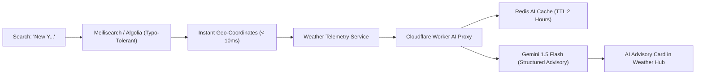

# 14.12 Search Systems & AI Pipeline Architecture



---

## 1. What It Is in Plain Words
Search architecture powers fast, typo-tolerant prefix search across millions of geographic cities, while AI architecture integrates large language models to synthesize raw telemetry into actionable natural-language daily advisories.

---

## 2. Whether and How THIS Project Uses It
In [abstract-forge/index.html](file:///Users/avishjain/avishjain9-repos/56-avishjain-weatherapp/abstract-forge/index.html):
- **Search:** The current client features hardcoded global capitals in the 3D carousel ([index.html:243-271](file:///Users/avishjain/avishjain9-repos/56-avishjain-weatherapp/abstract-forge/index.html#L243-L271)).
- **AI Integration:** **Not currently implemented** in code; designed as an architectural roadmap.

---

## 3. Geographic City Search Engines Comparison

| Search Solution | Search Latency | Typo Tolerance | Ingestion Overhead | Index Memory Footprint | Best Use Case in Weather Hub |
| :--- | :--- | :--- | :--- | :--- | :--- |
| **Meilisearch (Recommended)**| **< 15ms** | **Native Levenshtein distance** | **Minimal** | **Low (Rust-based engine)**| **City Autocomplete Search Box** |
| **PostgreSQL Trigram (`pg_trgm`)**| 40–90ms | Moderate (Similarity index)| Low (Native to DB) | Moderate (GIN index size) | Small city lists (< 50,000) |
| **Elasticsearch** | 30–60ms | High (Fuzzy queries) | High (JVM cluster) | High (Heavy heap memory) | Massive log search, overkill for cities |
| **Algolia (Managed SaaS)** | < 10ms | Exceptional | Zero ops | Managed cloud | Expensive at high query scale |

---

## 4. LLM Weather Advisory Pipeline & Cost Optimization

To prevent exorbitant LLM API costs when serving 1,000,000 users:
1. **Deduplication by City & Condition:** Rather than invoking the LLM per individual user, generate advisories once per city per distinct meteorological condition:
   $$\text{cache\_key} = \text{MD5}(\text{city\_id} + \text{temp} + \text{uv\_tier} + \text{condition})$$
2. **Aggressive Edge Caching:** Cache generated JSON advisories in Cloudflare Workers KV or Redis for 2 hours.
3. **Structured Outputs:** Enforce strict JSON output schemas (via Gemini 1.5 Flash JSON Mode), reducing token count and eliminating hallucinated conversational filler.

---

## 5. What Breaks at 10x, 100x, and 1000x Load
- **10x Load:** Direct search queries to PostgreSQL trigram indexes work well.
- **100x Load:** Uncached LLM calls exhaust upstream provider rate limits (e.g., 2,000 RPM) and rack up thousands of dollars in token billing.
- **1000x Load:** Database full-text search crashes under autocomplete keystroke traffic ($1,000,000 \times 4 \text{ keystrokes} = 4,000,000 \text{ queries}$). **Remedy:** Deploy dedicated Meilisearch edge clusters or Algolia with client-side 300ms debounce timers.

---

## 6. How a Senior Engineer Would Improve It
1. **Client-Side Trie Index:** For top 1,000 global cities, ship a compact 25KB prefix Trie directly in JavaScript, eliminating 90% of search network requests.
2. **LLM Fallback Rule Engine:** If the LLM provider experiences an outage, fall back to a deterministic rule-based template engine:
   ```javascript
   `UV Index is ${uv}. Wear sunscreen and avoid direct sun exposure between 11 AM and 3 PM.`
   ```

---

## 7. Spoken Interview Answer (30 Seconds)
> "Weather Hub's search architecture is designed around Meilisearch, providing sub-15ms typo-tolerant city autocomplete with prefix matching. For our AI advisory pipeline, we optimize LLM costs by caching generated structured summaries in Redis for two hours keyed by location and weather conditions. This guarantees that 10,000 concurrent users checking New York weather trigger exactly one LLM call."
