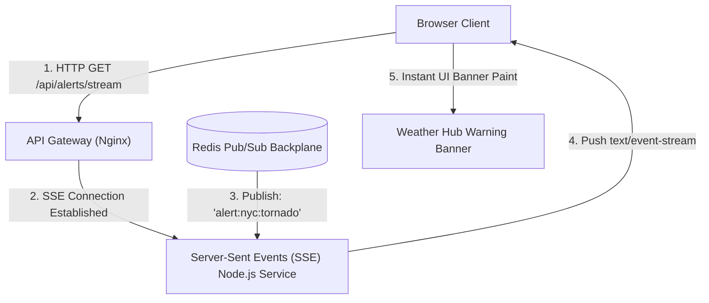
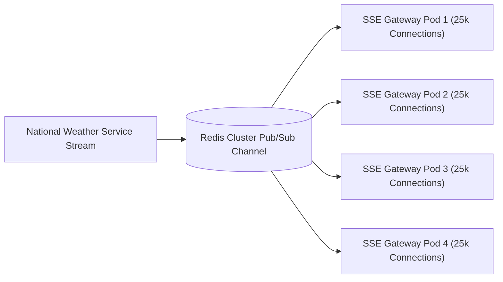

# 14.13 Real-Time Protocols, WebSockets & Server-Sent Events



---

## 1. What It Is in Plain Words
Real-time communication enables the server to push instantaneous data updates (such as tornado warnings, lightning strikes, or live radar sweeps) to connected browser clients without the client repeatedly asking "is there an update?" via polling.

---

## 2. Whether and How THIS Project Uses It
In [abstract-forge/index.html](file:///Users/avishjain/avishjain9-repos/56-avishjain-weatherapp/abstract-forge/index.html), **real-time protocols are currently simulated on the client**. The clock updates on page load and user interactions immediately mutate state via DOM event listeners.

---

## 3. Real-Time Protocols Comparison

| Protocol | Communication Direction | Connection Mechanics | Auto-Reconnection | Best Use Case in Weather Hub |
| :--- | :--- | :--- | :--- | :--- |
| **Short Polling** | Unidirectional (Client $\rightarrow$ Server)| Repeated HTTP requests every 5s | Manual | Anti-pattern (high server overhead) |
| **Long Polling** | Unidirectional | HTTP request holds open until update | Manual loop | Legacy browser fallback |
| **Server-Sent Events (SSE)**| **Unidirectional (Server $\rightarrow$ Client)**| **Single persistent HTTP stream** | **Native browser retry** | **Severe Weather & Storm Alerts (Best fit)**|
| **WebSockets** | **Bidirectional (Full-Duplex)** | **TCP upgrade handshake** | Requires client logic | Interactive radar annotation & live chat |

---

## 4. Why Server-Sent Events (SSE) Outperforms WebSockets for Weather
1. **Unidirectional Nature:** Weather telemetry flows strictly from meteorological sensors to the user; the user does not send real-time data back to the server.
2. **HTTP/2 Multiplexing:** SSE runs over standard HTTP/2, multiplexing smoothly alongside normal API requests without consuming dedicated TCP socket ports.
3. **Native Browser Reconnection:** The browser `EventSource` API automatically handles network reconnects and backoff without requiring external client libraries.

---

## 5. Scaling Real-Time Connections to 100,000 Concurrent Users



To support 100,000 active persistent connections:
- Deploy 4 Node.js SSE gateway pods, each holding 25,000 lightweight idle TCP sockets.
- Connect all pods to a central **Redis Pub/Sub backplane**.
- When an emergency storm warning arrives, the weather service publishes to `alerts:geo:nyc`. All 4 pods receive the message and push it to connected New York clients in $< 50\text{ms}$.

---

## 6. What Breaks at 10x, 100x, and 1000x Load
- **10x Load (1,000 connections):** Single Node.js server handles sockets easily.
- **100x Load (10,000 connections):** OS file descriptor limits (`ulimit -n`) are reached, causing connection drops without Linux kernel tuning.
- **1000x Load (100,000+ connections):** Single Redis instance reaches network I/O limits during message broadcasts. **Remedy:** Deploy a partitioned Redis cluster with dedicated pub/sub broker nodes.

---

## 7. How a Senior Engineer Would Improve It
Tune Linux kernel TCP parameters on SSE gateway containers:
```bash
# /etc/sysctl.conf
fs.file-max = 2097152
net.ipv4.tcp_max_syn_backlog = 8192
net.core.somaxconn = 8192
net.ipv4.tcp_tw_reuse = 1
```

---

## 8. Spoken Interview Answer (30 Seconds)
> "Weather telemetry is naturally unidirectional, making Server-Sent Events (SSE) an architecturally superior choice over WebSockets. SSE runs over standard HTTP/2, features native browser reconnection, and eliminates custom heartbeat management. By linking SSE server pods to a Redis Pub/Sub backplane, we can broadcast live severe weather warnings to over 100,000 concurrent users with sub-50ms latency."
