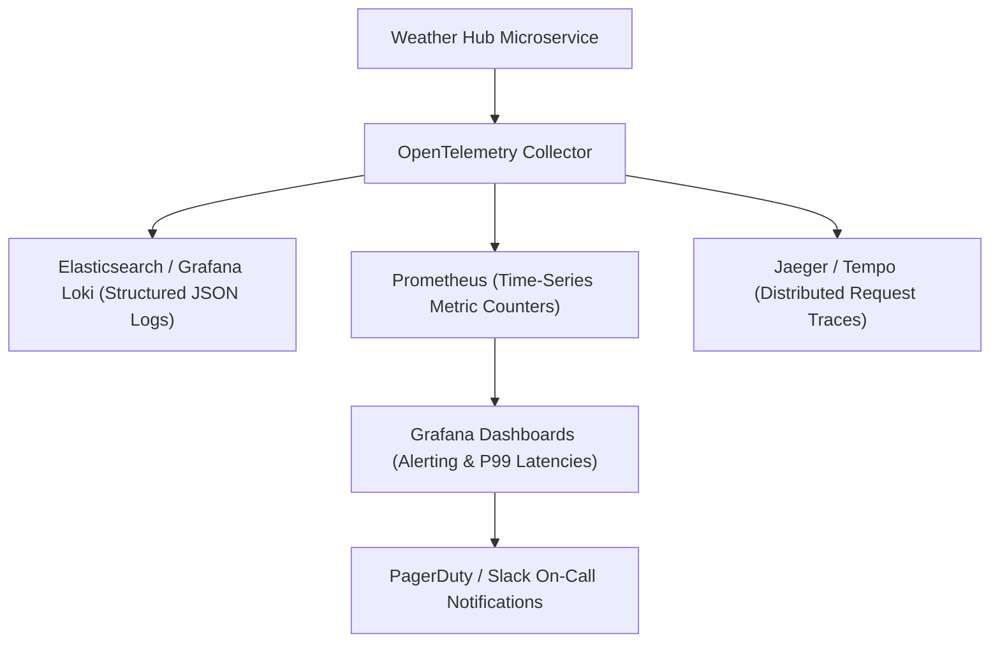

# 14.14 Observability, Telemetry & SRE Operations



---

## 1. What It Is in Plain Words
Observability measures the internal states of a system based on its external outputs. It is built upon the **Three Pillars of Observability**: Structured Logs (what happened), Metrics (aggregated numeric health values over time), and Distributed Traces (the end-to-end path of a request across services).

---

## 2. Whether and How THIS Project Uses It
In [abstract-forge/index.html](file:///Users/avishjain/avishjain9-repos/56-avishjain-weatherapp/abstract-forge/index.html), **observability is currently minimal**:
- Developers rely on the browser developer console (`console.log`, `console.error`) and the Chrome DevTools Performance panel for runtime inspection.

---

## 3. The Three Pillars of Observability Comparison

| Pillar | Data Format | Retention Window | Primary Tooling | Core Use Case in Weather Hub |
| :--- | :--- | :--- | :--- | :--- |
| **Metrics** | Numeric key-value time-series | 30 to 90 Days | **Prometheus + Grafana** | Tracking QPS, P99 latency, error rates, CPU/RAM usage |
| **Structured Logs**| JSON key-value log entries | 7 to 30 Days | **Grafana Loki / ELK** | Debugging specific user failures (`request_id`, `user_id`) |
| **Distributed Traces**| Trace spans with parent/child IDs| 3 to 7 Days | **Jaeger / OpenTelemetry** | Pinpointing which microservice caused a 150ms delay |

---

## 4. Structured Logging Standards (JSON)
All backend log outputs must follow strict JSON schemas with unique correlation IDs:

```json
{
  "timestamp": "2026-10-25T12:45:00.123Z",
  "level": "INFO",
  "service": "weather-ingest-service",
  "correlation_id": "req-9f82b1-4c7a-b921",
  "location": "New York, USA",
  "duration_ms": 14.2,
  "status_code": 200,
  "message": "Telemetry fetched and stored in Redis"
}
```

---

## 5. What Breaks at 10x, 100x, and 1000x Load
- **10x Load:** Unstructured logs written to disk work fine.
- **100x Load:** Log disk volumes fill up rapidly, crashing container hosts. **Remedy:** Sample traces at 10% and stream logs to Grafana Loki with strict log rotation.
- **1000x Load:** Prometheus scrapers experience metric explosion (high cardinality from raw lat/lon metrics). **Remedy:** Strip high-cardinality labels and aggregate metrics before ingestion.

---

## 6. How a Senior Engineer Would Improve It
1. **Instrument OpenTelemetry (OTel):** Use vendor-neutral OTel SDKs so the application can switch between Datadog, Prometheus, or Honeycomb with zero code changes.
2. **Implement Automated SLO Alerting:** Configure multi-window multi-burn-rate alerts in Grafana to notify on-call engineers via PagerDuty when 2% of the monthly error budget is consumed in a 1-hour window.

---

## 7. Spoken Interview Answer (30 Seconds)
> "Weather Hub currently relies on browser devtools for local debugging. In production, I would deploy the Three Pillars of Observability using OpenTelemetry. Prometheus tracks golden signals like P99 latency and error rates, Grafana Loki indexes structured JSON logs with correlation IDs, and Jaeger traces requests end-to-end, enabling on-call teams to diagnose production incidents in minutes."
