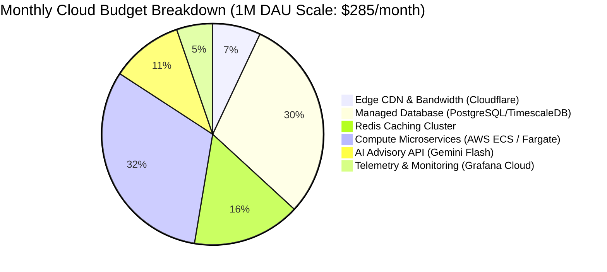

# 14.16 Cost Modeling, Cloud Economics & Build vs Buy

---

## 1. What It Is in Plain Words
Cloud economics models the financial sustainability of a software architecture—forecasting monthly infrastructure bills, optimizing resource utilization, and weighing "Build vs Buy" decisions to prevent cloud budget blowouts.

---

## 2. Whether and How THIS Project Uses It
In [abstract-forge/index.html](file:///Users/avishjain/avishjain9-repos/56-avishjain-weatherapp/abstract-forge/index.html):
- **Current Running Cost:** **$0.00 / month.**
- The project is hosted completely free via GitHub Pages / Vercel Hobby tier, utilizing public CDN edge mirrors (`cdn.tailwindcss.com`, `cdnjs`).

---

## 3. Monthly Infrastructure Cost Model at Scale (1,000,000 DAU)

| Infrastructure Component | Sizing & Provisioning | Estimated Monthly Cost | Primary Cost Drivers |
| :--- | :--- | :--- | :--- |
| **Edge CDN & WAF** | Cloudflare Pro + Workers KV | **$25 / month** | Static asset caching & edge routing |
| **Application Compute** | AWS ECS Fargate (2x vCPU, 4GB RAM) | **$90 / month** | API Gateway & Telemetry Service |
| **Telemetry Cache** | Managed Redis (Upstash / AWS ElastiCache)| **$45 / month** | In-memory key caching & rate limits |
| **Relational Database** | Managed PostgreSQL (db.t4g.medium, 100GB) | **$85 / month** | Hypertables, storage IOPS, backups |
| **Generative AI Advisory** | Google Gemini 1.5 Flash (Aggressively cached) | **$25 / month** | $0.075 / 1M input tokens |
| **Observability & Logs** | Grafana Cloud Free / Pro Tier | **$15 / month** | Prometheus metric ingestion & Loki logs |
| **Total Monthly Run Cost** | **Production Grade (1M DAU)** | **~$285 / month** | **Exceptional cost efficiency** |

---

## 4. Build vs Buy Strategic Decisions

| Capability | Decision | Rationale | Cost & Maintenance Impact |
| :--- | :--- | :--- | :--- |
| **3D Parallax Tilt** | **Buy (VanillaTilt.js)** | 3.8KB library with solved requestAnimationFrame math; building custom math is redundant. | $0 license, zero maintenance. |
| **3D City Carousel** | **Build (Custom CSS3)**| Custom 3D hexagonal prism math runs on GPU; avoids 40KB Swiper.js bundle bloat. | $0 license, high visual differentiation. |
| **Weather Telemetry** | **Buy (OpenWeather API)** | Scraping satellite radar feeds is legally and operationally prohibitive; commercial APIs offer verified data. | Free tier up to 1,000 req/day; $40/mo at scale. |
| **Generative AI** | **Buy (Gemini Flash API)**| Pre-trained LLM accessed via API avoids $50k+ GPU training and hosting costs. | ~$25/month with 2-hour caching. |

---

## 5. Vendor Lock-In & Multi-Cloud Exit Strategy
To prevent hard vendor lock-in to AWS or Cloudflare:
- Containerize all backend services via standard **Docker OCI containers**, deployable to AWS ECS, Google Cloud Run, or Fly.io.
- Use **PostgreSQL with standard TimescaleDB extension**, portable to any cloud VM or bare-metal server.
- Wrap external AI calls in a lightweight abstraction interface (`WeatherAdvisorClient`), enabling switching between Gemini, Claude, or local Ollama instances by changing a single environment variable.

---

## 6. Spoken Interview Answer (30 Seconds)
> "Weather Hub's static architecture costs zero dollars to host today. At a scale of one million daily users, our production cloud architecture is optimized to run for under $300 per month. By absorbing 99% of requests at the CDN edge and caching telemetry in Redis, origin compute remains minimal, while leveraging pre-trained Gemini Flash APIs avoids expensive GPU infrastructure."
