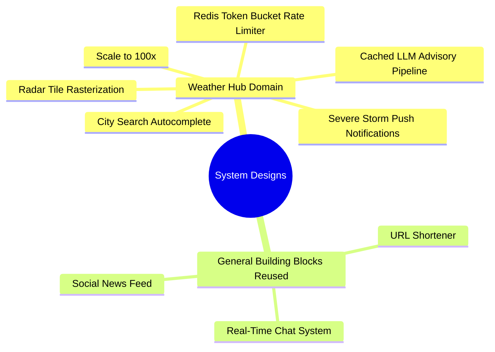
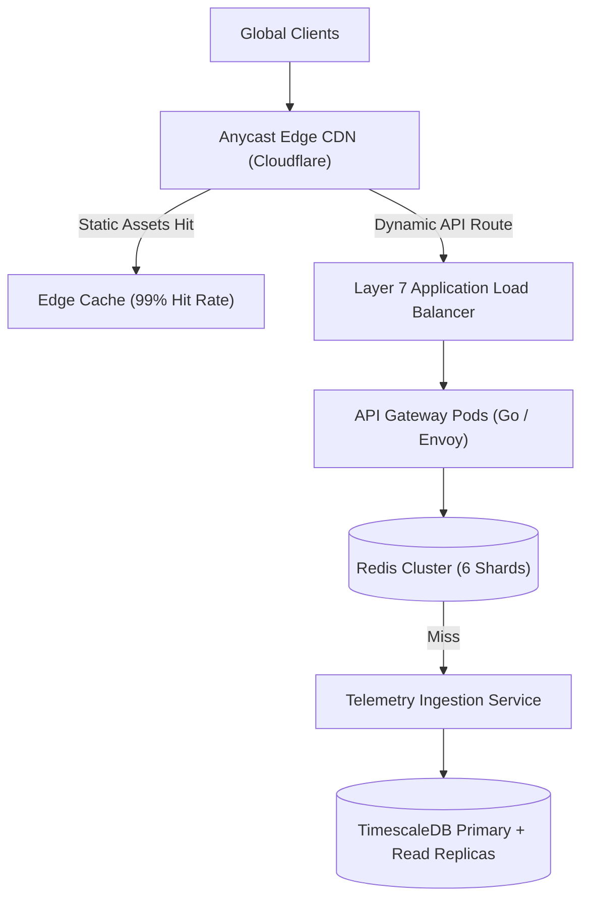
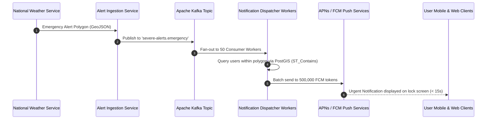

# 14.17 Classic System Design Problems Applied to Weather Hub

---

## 1. Design Weather Hub at 100x Current Scale (10,000,000 DAU)

### Requirements & Estimation
- **Traffic:** 10M DAU $\times$ 2 sessions = 20M requests/day $\approx$ **231 QPS average, 700 QPS peak**.
- **Bandwidth:** $700 \text{ QPS} \times 1.2\text{ KB} \approx 840 \text{ KB/s} \approx 6.7 \text{ Mbps}$.
- **Storage:** Persisting hourly rollups for 20,000 global cities $\approx$ **87 GB/year**.

### High-Level Architecture

### Deep Dive & Bottlenecks
- **Bottleneck:** High write concurrency during nationwide storm updates.
- **Solution:** Hypertables partitioned by location and time. Writes are batched into 100-record chunks using a Kafka ingestion buffer, reducing disk IOPS by 90%.

---

## 2. Design a Severe Weather Notification System

### Requirements & Estimation
- Deliver push notifications (SMS, Web Push, Mobile) to 500,000 users in an active hurricane zone within **60 seconds** of National Weather Service alert issuance.

### Architecture Flow

---

## 3. Design a URL Shortener (Reusing Project Building Blocks)

### Architecture
- **Encode:** Convert integer auto-increment ID to Base62 string (`[0-9a-zA-Z]`).
- **Storage:** Key-value mapping stored in Redis for hot lookups with persistent fallback in PostgreSQL.
- **Redirect:** HTTP `301 Moved Permanently` (browser caches redirect) or `302 Found` (allows analytics tracking on every click).

---

## 4. Design a Real-Time Chat System (Reusing Project Building Blocks)

### Architecture
- **Protocol:** WebSockets with fallback to HTTP long-polling.
- **Connection Management:** Ephemeral Node.js socket servers connected to a **Redis Pub/Sub** cluster backplane.
- **Message Persistence:** Apache Cassandra or ScyllaDB for append-heavy, immutable chat history partitioned by `(room_id, message_id)`.

---

## 5. Spoken Interview Answer (30 Seconds)
> "Whether designing Weather Hub's severe weather alert engine, a URL shortener, or a real-time chat system, the underlying distributed building blocks remain consistent: stateless worker nodes behind Layer 7 load balancers, multi-layer caching with Redis to absorb reads, append-only event queues like Kafka for asynchronous fan-out, and partitioned storage engines tuned to the specific access pattern."
