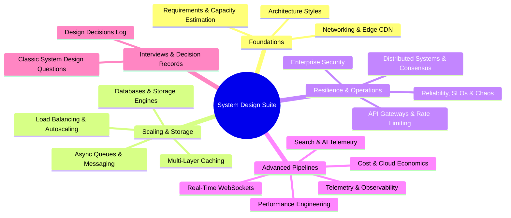

# System Design Deep Dive: Architectural Syllabus & Index

---

## System Design Syllabus

This 18-part system design master suite prepares the engineer to answer any distributed systems, scaling, and architectural questions related to Weather Hub:

| Chapter | Topic | Key Focus Areas | Link |
| :--- | :--- | :--- | :--- |
| **14.1** | [Requirements & Estimation](/system-design/01-requirements-and-estimation) | Functional/NFRs, QPS math, storage and bandwidth calculations | [01-requirements](/system-design/01-requirements-and-estimation) |
| **14.2** | [Architecture Styles](/system-design/02-architecture-styles) | Monolith vs Microservices vs Serverless, Layered architecture | [02-architecture](/system-design/02-architecture-styles) |
| **14.3** | [Networking & Communication](/system-design/03-networking-and-communication) | DNS, CDN Edge, HTTP/2 vs HTTP/3, TLS handshake | [03-networking](/system-design/03-networking-and-communication) |
| **14.4** | [Load Balancing & Scaling](/system-design/04-load-balancing-and-scaling) | L4 vs L7, Round Robin vs Least Conn, Autoscaling, SPOF | [04-load-balancing](/system-design/04-load-balancing-and-scaling) |
| **14.5** | [Databases & Storage](/system-design/05-databases-and-storage) | SQL vs NoSQL vs TimescaleDB, CAP theorem, B-Trees vs LSM | [05-databases](/system-design/05-databases-and-storage) |
| **14.6** | [Multi-Layer Caching](/system-design/06-caching) | Cache-aside, Redis vs Memcached, Thundering Herd, Eviction | [06-caching](/system-design/06-caching) |
| **14.7** | [Messaging & Async Queues](/system-design/07-messaging-and-async) | Kafka vs RabbitMQ vs BullMQ, Delivery semantics, Dead letter | [07-messaging](/system-design/07-messaging-and-async) |
| **14.8** | [Consistency & Distribution](/system-design/08-consistency-and-distributed-systems) | PACELC, 2PC, Sagas, Raft consensus, Eventual consistency | [08-consistency](/system-design/08-consistency-and-distributed-systems) |
| **14.9** | [Reliability & Resilience](/system-design/09-reliability-and-resilience) | Circuit Breakers, Bulkheads, Retries with jitter, SLO/SLA | [09-reliability](/system-design/09-reliability-and-resilience) |
| **14.10**| [API Design & Rate Limiting](/system-design/10-api-design-and-rate-limiting) | Token Bucket vs Leaky Bucket, Sliding window log, Idempotency | [10-api-design](/system-design/10-api-design-and-rate-limiting) |
| **14.11**| [Security Architecture](/system-design/11-security-architecture) | Zero Trust, OAuth2/OIDC, JWT vs Sessions, WAF, Encryption | [11-security](/system-design/11-security-architecture) |
| **14.12**| [Search & AI Architecture](/system-design/12-search-and-ai-architecture) | Elasticsearch vs Meilisearch, LLM Weather Advisory pipeline | [12-search-ai](/system-design/12-search-and-ai-architecture) |
| **14.13**| [Real-Time Systems](/system-design/13-real-time-systems) | WebSockets vs SSE vs Long Polling, Socket.io pub/sub backplane| [13-real-time](/system-design/13-real-time-systems) |
| **14.14**| [Observability & Operations](/system-design/14-observability-and-operations) | Prometheus, Grafana, OpenTelemetry, Structured Logs, Sentry | [14-observability](/system-design/14-observability-and-operations) |
| **14.15**| [Performance Engineering](/system-design/15-performance-engineering) | P95/P99 latency, Little's Law, N+1 query elimination, Web Vitals | [15-performance](/system-design/15-performance-engineering) |
| **14.16**| [Cost & Cloud Economics](/system-design/16-cost-and-tradeoffs) | Monthly infrastructure budget, Build vs Buy, Exit strategies | [16-cost](/system-design/16-cost-and-tradeoffs) |
| **14.17**| [Classic System Designs](/system-design/17-classic-questions) | Scale 100x, Notification System, Rate Limiter, URL Shortener | [17-classic](/system-design/17-classic-questions) |
| **14.18**| [Design Decisions Log](/system-design/decisions) | Full decision matrix with alternatives, trade-offs & triggers | [Decisions Log](/system-design/decisions) |
